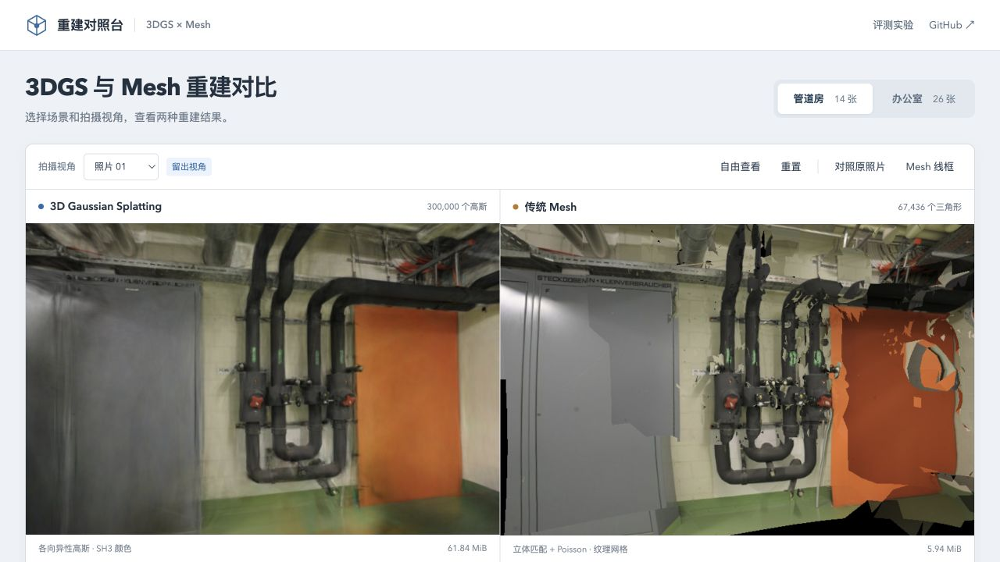
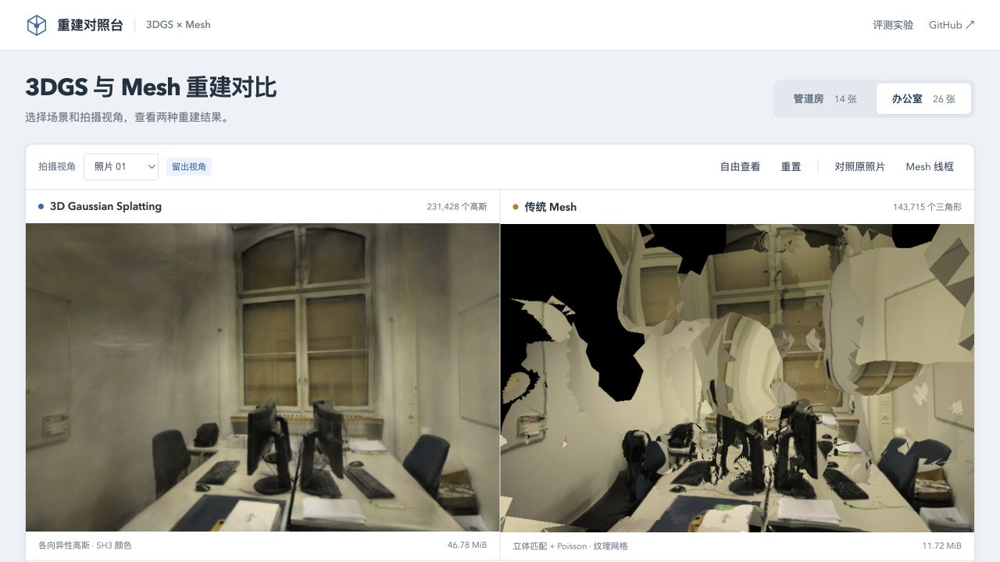
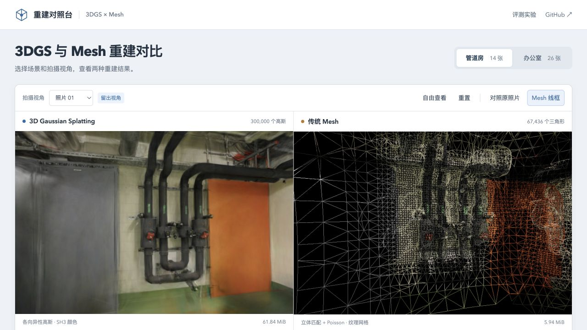

# 重建对照台 · 3DGS × Mesh

[在线演示](https://sakorman.github.io/3dgs-mesh-compare/) · [性能与画质实验](https://sakorman.github.io/3dgs-mesh-compare/benchmark.html) · [更新日志](CHANGELOG.md) · [开发计划](docs/ROADMAP.md)

基于同一组照片，比较 **3D Gaussian Splatting** 与 **立体匹配 + Poisson Mesh** 的重建效果、渲染性能和模型体积。默认场景来自 [sakorman/web-scan](https://github.com/sakorman/web-scan) 的 ETH3D 管道房照片，可切换办公室。

仓库包含两组照片、SH3 高斯模型与纹理 GLB，可直接启动查看。性能与画质指标在浏览器中计算。

[](https://sakorman.github.io/3dgs-mesh-compare/)

**管道房，同一拍摄视角。** 左侧为 30 万个高斯的 SH3 渲染，右侧为约 6.7 万三角形的纹理 Mesh。可对照管线轮廓、墙面连续性和门边的缺失区域。点击图片进入在线页面，使用「对照原照片」查看参考照片。

## 重建耗时

| 场景 | 3DGS 训练与模型导出（GPU） | Mesh 重建与 GLB 导出（CPU） |
| --- | ---: | ---: |
| 管道房（pipes） | 503.24 秒（约 8 分 23 秒） | 2.72 秒 |
| 办公室（office） | 577.83 秒（约 9 分 38 秒） | 4.87 秒 |

两组均复用已有 COLMAP 位姿，表中不含首次 SfM、网页加载与浏览器渲染耗时。

- **3DGS**：web-scan 历史记录，Brush 0.3.0，10,000 步，分辨率上限 1024。
- **Mesh**：本项目 CPU 构建记录，4 线程，分辨率上限 1024；包含立体匹配、点云融合、Poisson 重建、贴图和 GLB 导出。

两种耗时来自不同运行条件，不作为同条件的速度倍数比较。原始记录：[管道房](public/scenes/pipes/scene.json)、[办公室](public/scenes/office/scene.json)（`gaussian.seconds` / `mesh.seconds`）。

## 运行

需要 Node.js 20.19+、npm，以及支持 WebGL2 和 DecompressionStream 的现代浏览器。

```bash
git clone https://github.com/sakorman/3dgs-mesh-compare.git
cd 3dgs-mesh-compare
npm ci
npm run dev
```

打开 `http://127.0.0.1:5178`。两个场景的数据总计约 130 MiB，首次下载高斯模型需要等待；开发服务和 GitHub Pages 使用的 gzip 响应方式都已兼容。代码与默认数据都是静态文件，没有后端服务。

```bash
npm run build   # strict TypeScript + Vite 构建
npm run preview
npm test        # 数值、相机和模型解压测试
```

## 使用

首页提供模型查看与照片导航。通过页头「评测实验」进入 `benchmark.html`，运行性能与画质测试。

下载等待期间可点击「取消加载」，再重新加载或选择另一场景；取消的加载不生成耗时报告。

- **拍摄视角 / 照片条**：左右使用完全相同的相机外参、内参和画幅。蓝点表示留出照片。
- **自由查看**：拖动任一模型同步旋转，右键平移，滚轮缩放；重置回标定照片视角。
- **对照原照片**：切换显示当前视角的去畸变照片。
- **Mesh 线框**：查看三角结构，不参与性能或画质评分。
- **运行性能对比**：当前分辨率、固定相机；交替单独绘制每个后端，避免双画布并行竞争。
- **评测留出画质**：依次渲染所有留出视角，计算与同尺寸去畸变照片的 PSNR、SSIM。
- **本次场景加载**：在评测页展开读取/解压、解析初始化和首帧准备耗时；仅保存成功加载的结果。
- **导出 JSON**：加载完成即可导出，保存加载分段、原始性能样本、逐视角画质、相机、分辨率、浏览器和模型来源。

切换场景/分辨率会清空性能与画质成绩；切换拍摄视角会清空该视角的性能成绩。加载记录保留加载时的画幅，只在重新加载场景时替换。测试时冻结控制，进入后台、窗口变化、上下文丢失或点击取消会作废测试。

候选格式另有[受控 HTTP 加载报告](docs/PACED-MODEL.md)，含缓存未命中/命中耗时、分段样本、画质和截图。默认网页继续使用原始 PLY。

## 场景与网格

### 办公室



办公室包含 26 张照片，使用其中 22 张训练、4 张留出评测。图中两侧使用同一个留出视角：3DGS 保留了较连续的外观，当前 Mesh 基线在墙面与细小结构处存在空洞和变形。切换其他照片或自由查看，可以检查不同位置的重建情况。

### Mesh 线框



点击「Mesh 线框」显示三角形边。管线附近的网格较密，部分平面由较大的三角形连接；这个视图用于检查几何结构，线框状态不参与性能与画质评测。

以上图片均截自项目页面，使用默认模型与标定相机。照片及衍生画面遵循 ETH3D 的 CC BY-NC-SA 4.0 许可。

## 数据与重建

| 场景 | 总照片 | 训练 / 留出 | 3DGS |
| --- | ---: | ---: | ---: |
| ETH3D pipes（默认） | 14 | 12 / 2 | 300,000 高斯，SH3 |
| ETH3D office | 26 | 22 / 4 | 231,428 高斯，SH3 |

**共享阶段**：复用 web-scan 已完成的 COLMAP 3.13.0 位姿与去畸变结果，两条路径使用同一场景归一化坐标。所有照片都参与了 SfM。留出仅针对高斯训练、稠密立体匹配及纹理，因此这是固定几何下的渲染留出实验，不是完全独立的端到端泛化测试。

**3DGS**：直接复用 web-scan 的 Brush 0.3.0 / 10,000 步 / 1024 分辨率模型。使用 Spark 2.4.0 渲染，保留 SH3，按深度排序并关闭 LoD。场景记录原任务 ID、文件 SHA-256 和历史训练时间。

**Mesh**：独立读取相同训练照片与相机；选择有重叠的照片对，极线校正后执行 OpenCV SGBM、左右一致性及光度检查，估计深度。点云法线朝向拍摄相机，体素融合和离群过滤后，Open3D Screened Poisson 重建连续表面；按射线可见性和夹角选择训练照片为三角形贴图。输出包含纹理的 GLB。Mesh 流程不读取高斯位置、颜色或协方差。

Mesh 采用 CPU 摄影测量基线，未使用 COLMAP PatchMatch、OpenMVS 或商业重建软件。弱纹理、反光和匹配失败会影响几何；Poisson 会填补缺少观测的区域，贴图可能出现接缝。结果适用于本文所列实现和参数。

默认参数、照片哈希、立体匹配对、几何数量、模型哈希在 `public/scenes/<scene>/scene.json` 中。照片经过相同长边 1024 缩放，内参随尺寸缩放。留出集合从原 Brush 评估输出的文件名读取，不假定照片排序。

## 评测口径

### 浏览器性能

加载分段单列于 JSON 的 `loading` 字段，使用 `performance.now()` 墙钟时间。两模型并行加载，阶段不可相加；下载与解压重叠记作读取/解压，首帧准备包含排序与绘制提交，不等同于独立排序 Worker 时间或屏幕实际呈现。记录保留加载时的相机、尺寸、文档可见性；后续切换分辨率不会改写它。缓存策略未受控时明确标为 `uncontrolled`，不推导冷/热加载加速。完整边界见[加载计时](docs/LOAD-TIMING.md)。

AB / BA / AB / BA 共四轮，每组每轮 12 帧预热 + 40 帧采样，总计每组 160 帧。固定同一个标定相机、相同像素尺寸、DPR=1、黑色背景、关闭 MSAA，排序稳定后开始。结果仅反映**固定视角稳态渲染**；不测首次下载/解码、训练、移动镜头排序延迟或峰值显存。

- CPU：主线程 `renderer.render()` 提交中位数 / P95，不包含异步高斯排序 Worker。
- GPU：`EXT_disjoint_timer_query_webgl2` 异步查询；不可用时留空，发生 disjoint 时丢弃该组全部 GPU 结果。不调用 `gl.finish()`。
- FPS：`requestAnimationFrame` 实际间隔的倒数，受屏幕刷新率与调度限制，不能等同于无限制渲染吞吐。
- 两种表示执行不同的工作量，三角数与高斯数不是可直接等价比较的单位。
- 双模型预览不作为正式性能结果；无头浏览器或软件渲染的结果不能代替真实 GPU 测量。

### 画质

在当前渲染尺寸，读取浏览器实际模型像素，和同样缩放的 JPEG 去畸变照片比较。两边使用相同背景、画幅及相机，无曝光拟合、裁剪或遮罩，Mesh 未覆盖的黑色区域计入误差。

PSNR 使用全图 RGB MSE；SSIM 使用每通道 RGB、11×11 Gaussian 窗口（σ=1.5）、有效内部区域、C1=(0.01×255)²、C2=(0.03×255)²。先逐视角计算，再等权平均。完全一致的 PSNR 用 JSON `null` / UI `∞` 表示。这里是浏览器实现与显示管线的画质；不直接与 Brush 日志中的训练器指标混算。不含 LPIPS、几何真值 Chamfer/F-score。

### 重建时间与体积

具体数值见[重建耗时](#重建耗时)。3DGS 时间来自 web-scan 历史 GPU 训练记录；Mesh 时间来自当前 CPU 构建，均单独标识，不推导速度倍数。模型大小是 gzip PLY 与含纹理 GLB 的文件字节数，不是 GPU 显存占用。高斯解压后字节数也记录在 manifest；默认加载会[核对完整长度](docs/PLY-SIZE.md)，拒绝超长、截断或缺失长度记录的数据。

## 复现 Mesh

需要 Python 3.12，以及有相应任务产物的本地 web-scan 数据目录。重新构建需要 web-scan 的 `.data` 任务产物；仅查看已提交的场景无需这些文件。

```bash
python3.12 -m venv .venv
.venv/bin/python -m pip install -r requirements.txt
.venv/bin/python scripts/prepare_scenes.py --web-scan /path/to/web-scan --scene all
.venv/bin/python -m unittest discover -s tests -p 'test_*.py'
```

脚本只读来源仓库，写入当前项目 `public/scenes`。精确任务 ID 为 pipes `82acea65e9874f64806815a592015dec`、office `59bb5740d2e945d9a459ca2514c66bb2`；它们对应 web-scan 公开的精细档质量记录。重建脚本可调整 `--resolution` 和 `--stride`，这些改变会写入新 manifest；应重新运行网页评分。

## GitHub Pages

已发布：[https://sakorman.github.io/3dgs-mesh-compare/](https://sakorman.github.io/3dgs-mesh-compare/)。

更新线上页面时，在 Actions 中手动运行 **Deploy comparison to GitHub Pages** 工作流。普通推送运行 CI。构建使用相对路径，支持仓库子路径；Fork 部署需先在 Settings → Pages 中将 Source 设为 GitHub Actions。

## 目录

```text
src/                  同步相机、双渲染器、测量、画质和界面
scripts/prepare_scenes.py  独立 Mesh 重建与场景打包
public/scenes/         两组照片、模型和来源清单
public/licenses/      运行时第三方许可与数据说明
tests/                数学与数据完整性检查
docs/                 界面结构与测试记录
docs/images/          页面截图
.github/workflows/    CI 与手动 Pages 发布
```

代码为 MIT。**照片及衍生模型使用 ETH3D 的 CC BY-NC-SA 4.0，限非商业用途**；这部分不适用项目 MIT 许可。详见 [第三方与数据许可](THIRD_PARTY_NOTICES.md)。

技术参考：[3DGS 原论文与实现](https://repo-sam.inria.fr/fungraph/3d-gaussian-splatting/)、[OpenCV StereoSGBM](https://docs.opencv.org/4.x/d2/d85/classcv_1_1StereoSGBM.html)、[Open3D 表面重建](https://www.open3d.org/docs/release/tutorial/geometry/surface_reconstruction.html)、[Spark](https://sparkjs.dev/docs/)、[ETH3D](https://www.eth3d.net/datasets)。
