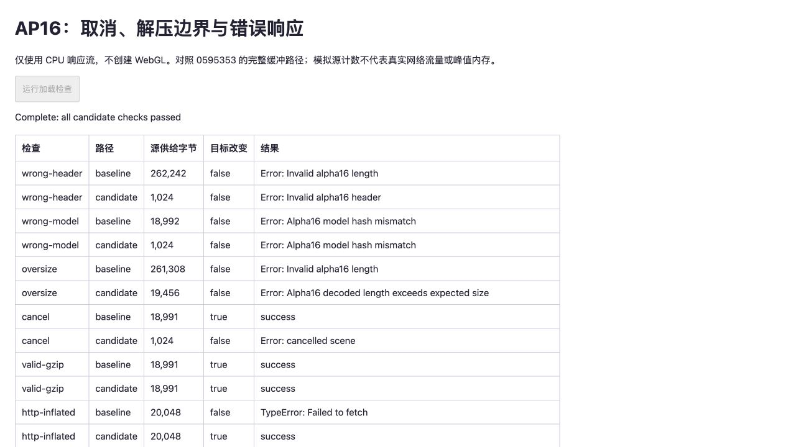

# AP16 读取：取消与解压边界

2026-10-27，为 [SH8 + AP16 候选](SPZ-ALPHA16.md)新增独立的可取消读取器。旧实验路径在取消后仍可能读完附加文件并写入不透明度；新路径验证完整数据后才写回，失败和取消均保留原数组。**这次完成 CPU 读取组件验证，尚未接入正式查看器，也未替换默认模型。**

[浏览器原始记录](benchmarks/alpha16-stream-2026-10-27.json)保存 7 组新旧对照、4 组真实文件检查及环境信息；[验证页](../tests/browser/alpha16-stream.html)不创建 WebGL 上下文。检测到另一重建任务使用 GPU，因此没有重复画质、漫游或 GPU 性能实验，也没有新增 FPS、首帧或耗时提升结论。

## 基线与实现

先对 `0595353` 的读取方式复现：完整收集响应，再通过 `DecompressionStream` 解压，最后应用 AP16。它没有接收取消信号，也没有解压长度限制；只在全部解压后发现长度或模型不匹配。原始路径限定原始 gzip 输入，若 HTTP 已经展开数据，再解压会失败。

新组件 [alpha16-stream.ts](../tests/helpers/alpha16-stream.ts)使用调用方已确认的点数和 SH8 文件摘要：

- 根据实际响应头两个字节识别原始 gzip 或已展开 AP16，支持跨块签名，不根据 `Content-Encoding` 重复解压。
- 按 `48 + 2 × 点数` 分配结果缓冲，拒绝多余或不足字节；该缓冲另有 8MiB 上限，当前两场景为 600,048 / 462,904 字节。没有信任文件头内的点数或 `Content-Length` 来扩大分配。
- 收齐 48 字节头部即检查 magic、版本、数量、保留位与模型摘要；错配无需等到响应末尾。非成功 HTTP 状态在读取前拒绝。
- 取消会通知源与解压读取端，保留调用方的取消原因，并释放自有 reader 锁和事件监听。即使已收到完整属性，仍等待 EOF 和 gzip 校验通过，随后再次检查取消状态。
- `restoreAlpha16Response` 在上述步骤成功后一次性写回；它不创建模型、不上传纹理，也不拥有调用方的数组。读取或校验失败时不会部分覆盖属性。

8MiB 是实验组件的**结果缓冲限制**，不是浏览器峰值内存承诺。输入块、解压器内部队列和网络预读另有开销；此处没有控制或测量它们的总量。超出该限制的大模型需要另行设计分页或显式预算。

## 浏览器结果

Chromium 156，异步模拟源每次供给 1024 字节，固定 10,000 点的合成 AP16，期望解码长度 20,048 字节。原始路径与候选串行执行；取消信号在首个块供给后触发。两边传入相同数据和目标数组初值。

| 情况 | 旧路径源供给 | 新路径源供给 | 结果 |
| --- | ---: | ---: | --- |
| 错误文件头 | 262,242 B | 1,024 B | 新路径提前拒绝并取消余下读取 |
| 模型摘要错配 | 18,992 B | 1,024 B | 不等待剩余属性 |
| 解压后超长 | 261,308 B | 19,456 B | 新路径超出预期长度即拒绝 |
| 首块后取消 | 18,991 B | 1,024 B | 旧路径仍写入；新路径目标保持原样 |
| 正常 gzip | 18,991 B | 18,991 B | 两边输出相同 |
| HTTP 已展开 | 20,048 B | 20,048 B | 旧路径重复解压失败；新路径成功 |
| gzip CRC 错误 | 18,991 B | 18,991 B | 两边拒绝；新路径不发布已解压部分 |

超长样本中，旧路径先生成 262,144 字节解码结果再拒绝，新路径只分配 20,048 字节结果缓冲并停止收集。表中是测试源计数，不能当作真实传输节省比例；浏览器预读、缓存和服务器实现可能改变数字。旧路径 `Response.arrayBuffer()` 结束后的锁状态也不单独视为资源泄漏证据，新路径仅保证释放自己取得的 reader。



两份已归档 AP16 文件分别以原始 gzip 和模拟 HTTP 展开后的字节输入，共 4 组检查。原始 AP16 SHA-256 均与上一报告相同，全部 531,428 个不透明度字段在两种输入方式下都精确恢复；其他字段、保留位保持不变。没有改写文件、点序、照片或相机。此处是数值等价验证，不冒充新的 PSNR/SSIM 或渲染截图结果。

## 回归与复现

新增 11 项单元检查：分块签名、HTTP 展开、头部及模型错配、超长与串接 gzip、截断及 CRC、异常不透明度、错误状态、预先取消、等待签名/解压/EOF 时取消、源错误后重试，以及源关闭后的取消。失败时目标数组不变，读取锁释放。62 项测试、类型检查和生产构建通过。生产 JS/CSS 内容哈希未变，默认资源未变，本次不重复部署 Pages。

准备文件沿用 [AP16 复现步骤](SPZ-ALPHA16.md#复现与下一步)，文件置于 `.qa/spz-alpha16/{pipes,office}.ap16.bin`。在仓库根目录执行：

```bash
node --import tsx --test tests/alpha16.test.ts tests/alpha16-stream.test.ts
npm run dev
```

打开 `http://127.0.0.1:5178/tests/browser/alpha16-stream.html`，点击「运行加载检查」，完成后保存页面 JSON。基线缓冲流程保留在验证页中，不需要恢复旧分支；生产页面与旧画质/耗时实验的加载入口未改变。

下一步是把这个组件接入独立候选模型加载事务：同时管理 SPZ 和 AP16，取消时处理不可中断初始化的迟到结果，失败时回退至完整 PLY，确认缓存组合不会错配。仍需模型资源释放、真实 HTTP 编码/缓存、受控冷/热首帧和内存测量。浏览器 CPU 流的取消不代表 Spark Worker 初始化已经可取消。

参考 [Spark 2.4.0 加载实现](https://github.com/sparkjsdev/spark/blob/ffe210dc0a45d0515a06c9235878108112827d61/src/SplatLoader.ts)与 [MoQSplat 论文](https://arxiv.org/abs/2609.18624)的接收状态边界；作者实现、许可证及平台条件见[研究索引](RESEARCH.md)。未移植 MoQ、采用渐进剪枝或套用论文性能数据。
