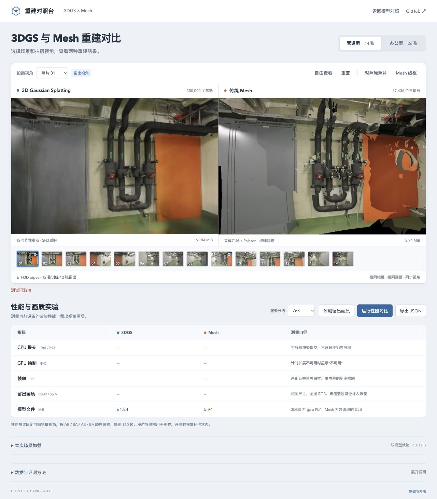

# 性能采样取消与查询清理

2026-10-28；基线 `8190435`，Spark 2.4.0，Chrome 156 / Apple M5（WebGL2 / ANGLE Metal）。本次修复性能评测的等待生命周期，不更换渲染算法或默认模型。

## 问题与修改

原性能评测在排序准备时未传入取消信号，采样和最终 GPU 查询收集又直接等待 `requestAnimationFrame`。后台帧暂停后，点击取消或离开页面不能立即进入清理，已有查询与锁定的评测控件会等到下一帧才处理。

新增可取消的帧等待器：保留正常帧时间戳，取消时撤销排队回调、移除监听并拒绝等待。性能评测把同一个信号传给排序准备和全部三处帧等待，查询收集恢复后与报告返回前再次检查状态。销毁后不会恢复预览，界面继续使用原有中文取消提示。

不强行终止 Spark 已经提交的排序或 GPU 作业；这里释放的是评测自身的 WebGL 查询对象与等待回调。

## 基线与修复验证

夹具用真实模型和 WebGL2，但暂存动画回调以精确控制“没有下一帧”，后台与离页使用合成事件。每项在取消后观察 80ms，再释放旧版积压回调完成清理。80ms 是检查窗口，不是响应时间跑分。

| 检查 | 旧版 | 修复后 |
| --- | --- | --- |
| pipes / office 排序准备中取消 | 2 项均未结束，控件锁定 | 2 项均无需下一帧即可结束 |
| pipes / office 首个采样帧前取消 | 2 项均未结束，控件锁定 | 2 项均结束，帧回调清除 |
| pipes / office 已开始采样后进入后台 | 2 项均未结束，各保留 1 个查询 | 均结束，各查询删除，无取消后绘制 |
| office 采样时永久离页 | 未结束，保留 1 个查询 | 结束并清理查询，销毁状态不重新启用控件 |
| 取消后的性能成绩 | 不发布 | 不发布 |

修复后 7 项均结束，待处理帧与查询均为 0，无浏览器异常；未销毁场景恢复操作，销毁场景继续禁用。夹具在处理器结束后暂停预览，避免把合法的预览重绘计为未清理的采样回调。

[旧版原始记录](benchmarks/benchmark-cancel-baseline-2026-10-28.json)与[修复记录](benchmarks/benchmark-cancel-2026-10-28.json)保留每项状态、查询计数及像素摘要。两场景依次运行，固定 SH3、LoD 关闭、768 长边、原照片/相机及训练留出划分。恢复后对 6 个留出视角重复检查，共 18 次像素摘要与原始 PLY 控制完全一致，未重新计算画质分数或声称画质提升。

生产构建中，pipes / office 均实际点击取消后恢复控件、清空性能成绩，再次运行并成功导出各后端 160 个样本；[恢复检查](benchmarks/benchmark-restart-2026-10-28.json)保留协议、分辨率和浏览器信息，不作速度对比。



新增 10 项 Node 回归，覆盖取消、迟到帧、监听器清理、调度失败、采样和最终查询收集，以及正常 AB/BA 协议。107 项测试、类型检查与构建通过。GPU 查询数量不代表显存大小；没有测 GPU 速度提升、原生后台限流或系统睡眠。

## 复现

```bash
npm ci
npm test
npm run build
npm run dev -- --port 5184 --strictPort
```

打开 `http://127.0.0.1:5184/tests/browser/benchmark-cancel.html`，加载完成后点击“运行帧等待取消检查”。页面顺序执行两场景和 7 项检查，输出 JSON。测试入口不进入生产构建。

旧版使用 `8190435` 的 `main.ts` / `benchmark.ts` 本地副本，仅重定位导入；测试记录已经归档。真实页面可在 `benchmark.html` 启动性能采样、点击取消，再重新运行和导出。正常协议仍为 AB / BA / AB / BA，每轮 12 帧预热、每后端合计 160 个样本。

## 参考与边界

- [Spark #476](https://github.com/sparkjsdev/spark/pull/476)（2026-10-15 合并）处理渲染器销毁后的内部排序/LoD 拒绝，不负责应用持有的等待或查询；当前依赖 2.4.0 已包含该补丁，本次没有改写依赖。
- [TIGAS v1](https://arxiv.org/html/2605.08699v1)区分远端渲染、网络及客户端处理，其交互时延不能等同本地 GPU 查询时间。作者[浏览器实验实现](https://github.com/Rekenar/GaussianAdaptiveStreamer/blob/8143b03687577e91b106ea5fe1be44678dd66cf2/templates/player.html)设置取消标志后在执行边界检查；没有据此推断当前等待已经被中断，也未移植其服务端。版本与许可见[研究索引](RESEARCH.md)。
