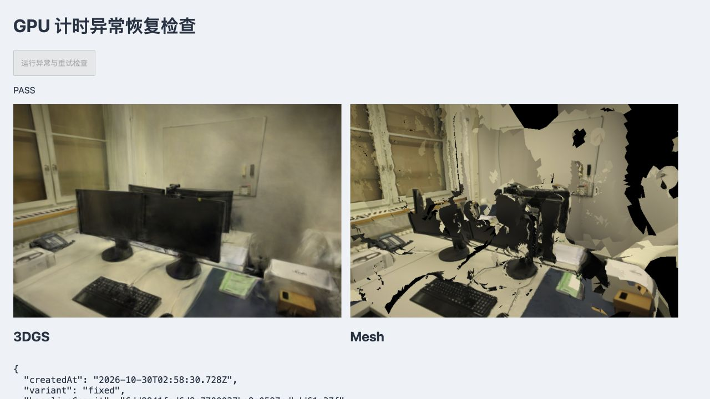

# GPU 计时查询的异常清理

2026-10-30，基线为 `6dd9941`。绘制在 `beginQuery` 后抛错时，旧版只清理已结束、等待结果的查询，遗漏当前活动查询。下一次计时因此触发 `INVALID_OPERATION`，影响失败后的重新评测。

修复将活动查询纳入计时器所有权：正常结束后移入待结果队列；异常退出时先结束并删除活动查询，再删除队列。分配返回空值时跳过该帧的 GPU 计时，CPU 与帧间隔样本仍保留，缺失值不填成零。

## 浏览器对照

使用本机 macOS、Chrome 156、真实 WebGL2 和原始 PLY，渲染长边 768、完整 SH3、LoD 关闭。基线与修复串行运行；pipes 两张、office 四张留出相机不变。人为在第二个正式采样帧绘制完成后抛出相同错误，检查原始异常、查询数量和原生 `CURRENT_QUERY`。随后直接尝试下一条查询，**记录完成后**才清理基线遗漏资源。

| 检查 | 基线 | 修复后 |
| --- | --- | --- |
| pipes / office × 3DGS / Mesh，4 项异常 | 每项残留 1 个活动查询 | 每项活动与待结果查询均为 0 |
| 下一条原生查询 | 4 项均报 1282，未成功开始 | 4 项均正常开始，无 GL 错误 |
| 原始绘制异常 | 保留 | 保留，失败不生成报告 |
| 两场景正常完整重试 | 未运行完整重试，仅记录上述原生探测 | 每后端各 160 个 CPU / GPU 样本 |
| 两场景首次分配返回空值 | 单元测试拒绝无效调用 | 每后端各 160 个 CPU 样本；3DGS 为 159 个 GPU 样本，Mesh 为 160 个 |
| 六个留出视角 × 两后端，12 份 RGBA 摘要 | 作为对照 | 异常前后及两版本之间全部相同 |

四次完整重试均无 disjoint、无 GL 错误，已创建查询数与删除数相等。分配空值由测试夹具注入，并非实际耗尽显存。实际查询释放不代表已测得显存即时下降。异常只由可控注入触发，未声称默认场景会自然发生该错误。

原始[基线、修复与查询统计](benchmarks/benchmark-query-2026-10-30.json)包含浏览器版本、错误码、逐视角摘要和源码摘要。GPU 数值仅用于确认有效样本恢复，没有形成性能对照，不报告速度提升。渲染器、模型、照片、分辨率和评分算法未改；本次校验重建像素，未重复 PSNR / SSIM 实验。



## 复现

在仓库根目录核对 `git rev-parse --show-toplevel` 后准备固定基线：

```sh
mkdir -p .qa/benchmark-query
git show 6dd9941:src/benchmark.ts > .qa/benchmark-query/benchmark-before.ts
python3 - <<'PY'
from pathlib import Path
p = Path('.qa/benchmark-query/benchmark-before.ts')
p.write_text(p.read_text().replace('from "./', 'from "../../src/'))
PY
npm run dev
```

依次打开并点击「运行异常与重试检查」：

- `/tests/browser/benchmark-query.html?variant=baseline`
- `/tests/browser/benchmark-query.html`

每页结束后再启动下一页；需要支持 `EXT_disjoint_timer_query_webgl2` 的浏览器。基线故意触发的 GL 警告与修复后结果分开记录。夹具完成后释放查看器，不更换原始资产。

单元回归另外覆盖“旧查询始终未就绪时发生新绘制错误”，同时检查活动查询和队列清理。新增 3 项回归先在旧代码失败，再在修复后通过；全部 129 项测试、类型检查和生产构建通过。

## 参考与后续

- [WebGL2 计时扩展规范](https://registry.khronos.org/webgl/extensions/EXT_disjoint_timer_query_webgl2/)：活动查询、异步结果与 disjoint 是不同状态；异常清理需要包含未结束查询。
- [WebSplatter 原文 §4.2](https://arxiv.org/html/2602.03207v1#S4.SS2)与[作者计时实现](https://github.com/websplatter/WebSplatter/blob/16bb06e86b8fb12193d4bb4cd2b0b3d4f3ab62be/src/gaussian-renderer.ts)：计时能力与样本完整性应先验证，再比较分阶段耗时。其 WebGPU 时间戳读回不可直接代替本项目的 WebGL2 查询或主线程提交时间，详见[研究记录](RESEARCH.md#计时可靠性与失败后的重试)。
