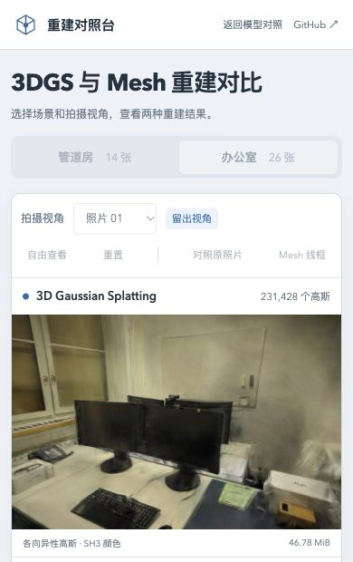

# 上下文丢失后的页面收尾

2026-10-30，基线 `ae2ead8`。修复 WebGL 上下文丢失后仍可切换场景、等待提示被覆盖及缺少刷新入口的问题；故障后统一释放查看器并锁定操作，刷新页面后重新建立渲染资源。

## 基线与修复

真实浏览器通过 `WEBGL_lose_context.loseContext()` 触发事件，检查 `isContextLost()`，没有用普通 Event 冒充丢失。每项新文档、串行运行，Chromium 156 / Apple M5 / ANGLE Metal / WebGL2。Spark 2.4.0、SH3、LoD 关闭，原始 PLY/GLB、相机、照片与训练/留出划分不变。

| 场景 / 触发位置 | 丢失后端 | 基线问题 | 修复 |
| --- | --- | --- | --- |
| pipes / 已就绪 | 3DGS | 场景和分辨率仍可操作；切场景后变成无尽加载提示 | 通过 |
| office / 已就绪 | Mesh | 同上，无可点击的刷新入口 | 通过 |
| pipes / 场景信息等待 | 3DGS | 取消入口仍显示；迟到收尾会解锁场景 | 通过 |
| office / 首帧等待 | Mesh | 同上 | 通过 |
| pipes / 性能采样 | 3DGS | 故障提示被“测试已取消”覆盖 | 通过 |
| office / 画质评测恢复相机 | Mesh | 已发布评分暂留，提示随后被“评测已取消”覆盖 | 通过 |

六项基线均失败，修复后六项全部通过。等待点由夹具控制，丢失前后各观察 80ms 并释放迟到操作；这是有界状态检查，不是取消延迟、GPU 故障率或性能测试。原始状态、像素摘要、Worker 记录及刷新后完整报告见[验证记录](benchmarks/context-loss-2026-10-30.json)。

修改包含：

- 查看器丢失任一上下文时执行既有幂等释放流程，停止预览、取消加载/排序等待、移除模型并释放渲染器。已释放实例忽略后续丢失事件。
- 页面在中断前作废加载请求标识，清空加载/性能/画质结果并隐藏取消入口；锁定场景、分辨率、照片与评测操作。
- 保留上下文丢失提示，迟到的 progress、catch、finally 不能覆盖故障状态；“刷新页面”按钮执行整页刷新，不在失效实例上重试。

## 画面、资源与恢复

两场景共六个留出相机、两后端的 **12 份 RGBA 摘要**与基线及既有画质帧记录完全一致，固定 pipes 768×505、office 768×500、DPR=1、黑色背景。此处没有渲染算法或模型改动，也没有新增 PSNR/SSIM 收益主张。没有重跑完整漫游或训练。

修复的六项检查均观察到两个 Worker 已创建、一个已终止；结束的是查看器排序 Worker，解析 Worker 由 Spark 文档级池保留至文档结束。模型从查看器移除，预览停止；这不等于证明浏览器内存或显存立刻回收，也未测 CPU 空闲占用。

另在 390×844 CSS 视口复测 office / Mesh 丢失，八份留出画面仍一致，评分画幅仍为 768×500。下图为实际窄屏故障状态，刷新入口可见且未被禁用：



两次实际点击刷新均重新加载 pipes，恢复可操作状态且隐藏刷新入口；其中一次继续完成两后端各 160 帧性能采样、两个留出相机画质评测和 JSON 导出。该报告用于功能回归，缓存条件未受控，不与历史性能数字比较。

136 项单元回归、严格类型检查、生产构建通过；另有上述六项桌面丢失回归、一次窄屏验证与两次刷新检查。浏览器夹具不由当前 CI 自动运行，需要按下节复现。未验证自然 GPU 重置、移动设备及原地 `webglcontextrestored` 重建；恢复策略仍为整页刷新。

## 复现

当前版本运行 `npm run dev -- --port 5190`，打开：

```text
/tests/browser/context-loss.html?scene=pipes&stage=ready&backend=gaussian
/tests/browser/context-loss.html?scene=office&stage=ready&backend=mesh
/tests/browser/context-loss.html?scene=pipes&stage=metadata&backend=gaussian
/tests/browser/context-loss.html?scene=office&stage=settle&backend=mesh
/tests/browser/context-loss.html?scene=pipes&stage=benchmark&backend=gaussian
/tests/browser/context-loss.html?scene=office&stage=quality-restore&backend=mesh
```

每项点击“运行上下文丢失检查”，保存 JSON 后导航至下一项。基线加 `variant=baseline`；在仓库根目录准备两份独立源快照：

```python
from pathlib import Path
from subprocess import check_output
assert check_output(["git", "rev-parse", "--show-toplevel"], text=True).strip() == str(Path.cwd())
out = Path(".qa/context-loss")
out.mkdir(parents=True, exist_ok=True)
for name in ("main", "viewer"):
    source = check_output(["git", "show", f"ae2ead8:src/{name}.ts"], text=True)
    source = source.replace('from "./', 'from "/src/').replace('import "./style.css"', 'import "/src/style.css"')
    if name == "main":
        source = source.replace('from "/src/viewer"', 'from "/.qa/context-loss/viewer-before.ts"')
    with (out / f"{name}-before.ts").open("x") as f:
        f.write(source)
```

其他依赖源与本记录相同；这些快照只用于隔离本次改动。不要覆盖已有快照或原始模型。

参考：[WebGL 丢失扩展规范](https://registry.khronos.org/webgl/extensions/WEBGL_lose_context/)、[Spark 释放实现](https://github.com/sparkjsdev/spark/blob/ffe210dc0a45d0515a06c9235878108112827d61/src/SparkRenderer.ts)、[WebSplatter 论文 §4.2](https://arxiv.org/html/2602.03207v1#S4.SS2)。版本、许可与适用边界见[研究记录](RESEARCH.md#已修复上下文丢失后的页面状态与释放)。
