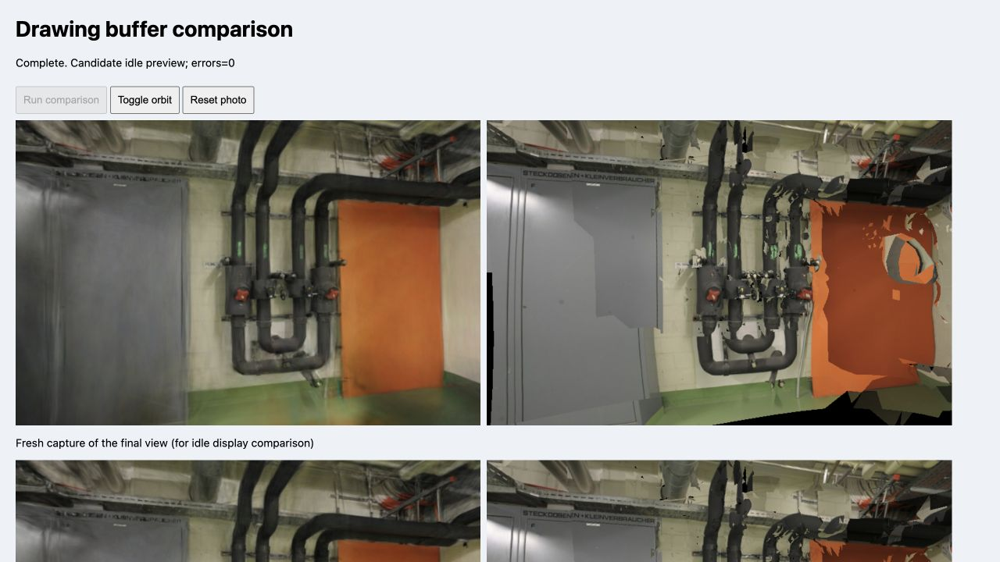

# 绘图缓冲保留对照

2026-10-25 在 Apple M5、Chromium 153、ANGLE Metal 上比较 `preserveDrawingBuffer=true/false`。暂不修改默认设置：管道房的 3DGS GPU 查询时间下降，但办公室没有稳定收益，Mesh 的两次候选采样都变慢。

## 设置与范围

- 基线源码 `e1d3c06`，Spark 2.4.0、Three.js 0.180.0。两份独立查看器模块仅改变两个 WebGL 上下文的 `preserveDrawingBuffer`，其余代码相同。
- pipes：300,000 个高斯、768×505；office：231,428 个高斯、768×500。保持 SH3、LoD 关闭、DPR=1、MSAA 关闭、完整默认模型和原始训练/留出划分。
- 每场景按保留 / 关闭 / 关闭 / 保留串行创建查看器，退出时释放资源与上下文。每次调用现有 `benchmark()`，3DGS/Mesh 按 AB/BA/AB/BA 单独绘制，每组预热 12 帧、采样 40 帧。每个设置、每个后端、每个场景合计 320 个样本，全部 2,560 个样本保存在[原始记录](benchmarks/drawing-buffer-2026-10-25.json)。
- 测速固定在每场景首个留出相机，开始前等待异步排序收敛。画质读取在测速结束后进行，使用显式绘制后立即读取的 `pixels()`，避免读回影响时间。
- 开始前没有发现其他重建或训练进程。渲染器请求 `alpha:false`，浏览器实际返回 `alpha:true`，两个设置一致；完整上下文属性保存在记录中。

## 实测耗时

下表为每次 160 个样本的 GPU 中位数，两次结果分别列出，单位 ms。查询范围是 `renderer.render()` 提交的 GPU 工作，**不包含完整浏览器合成链路及所有缓冲复制成本**。

| 场景 / 后端 | 保留缓冲，两次 | 关闭保留，两次 |
| --- | --- | --- |
| pipes / 3DGS | 5.614 / 5.908 | 5.274 / 5.345 |
| pipes / Mesh | 0.372 / 0.377 | 0.403 / 0.388 |
| office / 3DGS | 4.582 / 4.756 | 4.624 / 4.637 |
| office / Mesh | 0.648 / 0.644 | 0.772 / 0.759 |

合并同设置的 320 帧后，pipes 的 3DGS GPU 中位数为 5.753 → 5.291ms；office 为 4.644 → 4.628ms。后者处于两次基线波动范围内，不能据此声称稳定加速。office Mesh 为 0.645 → 0.765ms，因此不采用两个上下文一起关闭保留的方案。

3DGS CPU 提交中位数均约 0.10ms；Mesh 约 0.20–0.30ms，接近当前计时粒度。各组帧率均约 120 FPS，受到刷新率限制，不能用它推导最大吞吐量。此次没有测量显存峰值、异步排序耗时、移动相机帧时间、冷/热加载或训练耗时。

## 画质与交互

两场景全部 6 个留出视角、两个后端的 12 对 RGBA SHA-256 均完全一致，PSNR、SSIM 和 MAE 也完全一致。以下为逐视角指标的算术平均值，两个设置相同。

| 场景 / 后端 | PSNR（dB） | SSIM |
| --- | --- | --- |
| pipes / 3DGS | 15.952799 | 0.728403 |
| pipes / Mesh | 13.453569 | 0.543110 |
| office / 3DGS | 18.747466 | 0.837788 |
| office / Mesh | 13.346643 | 0.610287 |

候选设置的管道房在停止连续绘制后仍可见；相机拖动能更新画面，复位恢复照片视角，控制台无错误或警告。该交互检查未替代固定路径下的移动画质与排序评测。



## 复现

使用本报告所在提交及其锁文件，在仓库根目录准备隔离模块：

```sh
python3 - <<'PY'
from pathlib import Path
source = Path('src/viewer.ts').read_text()
assert source.count('preserveDrawingBuffer: true') == 1
source = source.replace('from "./', 'from "../src/')
Path('.qa').mkdir(exist_ok=True)
for name, value in [('preserved', 'true'), ('discarded', 'false')]:
    Path(f'.qa/drawing-buffer-{name}.ts').write_text(
        source.replace('preserveDrawingBuffer: true', f'preserveDrawingBuffer: {value}'))
PY
npm run dev
```

打开 `/tests/browser/drawing-buffer.html`，点击 **Run comparison**。页面按上述顺序串行测试；Raw samples 可查看完整 JSON。测试结束保留关闭缓冲的管道房，用于检查空闲显示、漫游与复位。该检查页不进入首页或生产构建。

## 决策与后续

保留当前默认设置，后续可单独评估仅对 3DGS 关闭缓冲保留，并在更多设备、固定移动路径及包含浏览器合成的测量中确认收益。不能将此次 GPU 查询差值推广为整体 FPS、功耗或内存提升。

Three.js 的[截图说明](https://threejs.org/manual/pages/tips.html)建议在截图前显式绘制，项目现有 `pixels()` 已满足这一条件；其他诊断若直接读取空闲画布，仍可能得到已清空的内容。[Spark 性能说明](https://sparkjs.dev/docs/performance/)也强调高斯覆盖面积和混合成本，后续优先研究减少无贡献片元，同时固定画质门槛。
