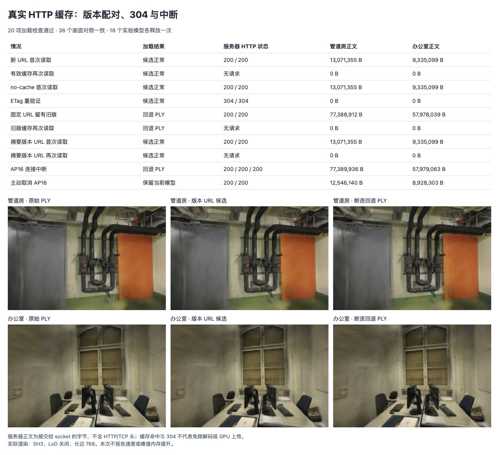

# 配对模型的真实 HTTP 缓存与连接中断

2026-10-28，使用同源本地 HTTP 服务验证 [SH8 + AP16 候选加载](PAIRED-MODEL.md)。固定 URL 在有效缓存期内仍可能返回旧 AP16，连续重试也会回退 PLY；为实验清单使用包含内容摘要的新 URL 后恢复候选加载，并保留正常缓存命中。**结论用于后续候选发布设计，默认网页、模型与加载器未改动。**

[原始记录](benchmarks/http-model-2026-10-28.json)包含服务器请求、ETag、If-None-Match、响应状态、正文提交量、连接完成/关闭标志、Fetch 状态、36 个像素控制与资源释放记录。没有新增首帧、FPS、训练或峰值内存测量。

## 方法与边界

基线提交 `5ba54a6`，Spark 2.4.0，Chromium 156 / Apple M5 / ANGLE Metal / WebGL2。继续使用固定摘要的两个场景 SPZ、AP16、PLY，点数 300,000 / 231,428、SH3、LoD 关闭、长边 768。原始照片、相机、训练/留出划分、模型文件不变。

[专用 Vite 配置](../tests/browser/vite-http-model.config.ts)只绑定 `127.0.0.1:5180`，启动时校验文件摘要。[HTTP 中间件](../tests/helpers/http-model-fixture.ts)仅从预先加载的场景白名单返回模型字节，不根据请求读取任意磁盘路径。[验证页](../tests/browser/http-model.html)逐项串行调用现有加载器，没有在客户端伪造 Fetch 响应或模拟缓存。

每次生成新的运行 ID，形成未被请求过的资源 URL。“首次读取”只表示该 HTTP 缓存键未使用，不代表冷浏览器、冷 WASM 或冷 GPU。普通缓存响应使用 `Cache-Control: public, max-age=3600`；重验证路径使用 `no-cache` 与 ETag，浏览器自动发送条件请求。服务器记录是缓存是否命中的依据，不仅凭 Fetch 状态推断。

AP16 与 PLY 在服务端发送 gzip 和真实 `Content-Encoding: gzip`；浏览器展开后交给读取器。SPZ 保持原字节，不添加 HTTP gzip 编码。ETag 对应传输表示摘要，而加载器分别验证 SPZ 文件、展开后的 AP16 和 PLY 摘要。

## 旧版缓存与版本 URL

先在服务端内存生成一份合法但内容不同的旧 AP16：仅将首个不透明度改成另一个有效 binary16 值，再 gzip；文件头仍绑定同一 SPZ。原始文件不写入，旧数据只用于预填 HTTP 缓存，不创建或显示模型。

预填后，将同一个固定 URL 的服务端内容切到正确 AP16。此前响应仍在一小时有效期内，浏览器继续返回旧正文，未请求服务端。AP16 自身摘要校验阻止错误显示并回退原始 PLY；再次尝试依旧如此。这是“内容已旧、HTTP 缓存仍新鲜”，不是过期缓存未重验证，也不是默认线上页面的已知故障。

实验清单随后改用 `versioned` 路径及 `?sha256=<预期内容摘要>`，服务端只返回对应数据。新 URL 首次下载成功，第二次完整命中缓存。该对照验证**新的内容版本 URL 避开旧缓存键**，没有单独测量只改变路径或只改变查询参数的差异，也未证明任意 CDN 都按查询参数区分缓存。

后续发布应使用内容地址文件名或已确认缓存键规则的版本 URL，发布新文件后再更新清单，保留旧版本给已有会话。数据摘要校验仍保留；不能通过去掉校验或直接关闭全部缓存解决错配。清单更新一致性、CDN 和跨版本会话尚未验证。

## 浏览器结果

正文量仅为服务器交给 socket 的数据字节，不含 HTTP/TCP 头、重传和客户端实际接收量。只统计各次候选加载的模型端点，不含此前原始模型基线、Mesh、场景清单、照片、脚本和控制接口；它不是整页端到端总流量。SPZ 在请求 AP16 前已完整下载，所以取消 AP16 不会省去本次 SPZ 传输。

| 情况 | 结果 / 服务器状态 | pipes 正文 | office 正文 |
| --- | --- | ---: | ---: |
| 新 URL 首次读取 | 候选成功；200 / 200 | 13,071,355 B | 9,335,099 B |
| 有效缓存再次读取 | 候选成功；无请求 | 0 B | 0 B |
| no-cache 首次读取 | 候选成功；200 / 200 | 13,071,355 B | 9,335,099 B |
| ETag 重验证 | 候选成功；304 / 304 | 0 B | 0 B |
| 固定 URL 留有旧 AP16 | PLY 回退；200 / 200 | 77,388,912 B | 57,978,039 B |
| 旧版缓存再次读取 | 仍回退；无请求 | 0 B | 0 B |
| 摘要版本 URL 首次读取 | 候选成功；200 / 200 | 13,071,355 B | 9,335,099 B |
| 摘要版本 URL 再次读取 | 候选成功；无请求 | 0 B | 0 B |
| AP16 连接中断 | PLY 回退；200 / 200 / 200 | 77,389,936 B | 57,979,063 B |
| 主动取消 AP16 | AbortError，保留画面；200 / 200 | 12,546,140 B | 8,928,303 B |

旧版缓存行的两个 200 来自 SPZ 和回退 PLY，AP16 命中缓存。旧版预填请求另记于 JSON 的 `priming`，没有隐去其成本。重验证时，服务器收到匹配的 If-None-Match 并返回 304；Fetch 提供的两个状态均为 200，携带合并后的缓存正文，现有 `response.ok` 检查无需特判 304。

断连端点写出 AP16 gzip 的首 1,024B，保持完整 Content-Length，50ms 后销毁连接。读取失败后仅回退一次；主动取消端点保持不完整响应，收到头部后取消请求。两场景均观察到服务端连接关闭、未完整结束；主动取消不创建新模型、不请求 PLY，并保留当前显示。

20 项加载检查全部通过，18 个实验模型各调用 dispose 一次，页面异常与控制台错误均为 0。此处不把 dispose 计数解释为已测内存回收。



36 个像素控制包括初始原始模型、各成功路径首个留出视角，以及版本 URL 候选与断连回退的全部六个留出视角和首视角 ±0.08rad 偏转。与原始 PLY / 既有 AP16 控制逐像素一致，没有改变点数、SH 或画幅，也没有显示合成旧属性。候选仍保留原 AP16 的量化代价，不能称为 PLY 无损。

| 留出均值 | pipes PSNR / SSIM | office PSNR / SSIM |
| --- | --- | --- |
| 版本 URL 候选 | 16.268331 / 0.731814 | 18.962445 / 0.839371 |
| 断连回退 PLY | 16.268912 / 0.730921 | 18.953445 / 0.839018 |

## 复现与后续

先沿用 [AP16 文件准备步骤](SPZ-ALPHA16.md#复现与下一步)。在目标仓库根目录运行：

```bash
node --import tsx --test tests/http-model-fixture.test.ts
npx vite --config tests/browser/vite-http-model.config.ts
```

打开 `http://127.0.0.1:5180/tests/browser/http-model.html`，点击「运行 HTTP 检查」。需要浏览器启用正常 HTTP 缓存；不要使用禁用缓存的开发工具或请求拦截。每次运行使用独立 URL，无需清理用户浏览器缓存。测试完停止专用服务。

新增 3 项 Node 回归，核对 HTTP 响应、304 无正文、场景更新隔离、版本摘要拒绝、断连及取消记录。75 项测试、类型检查和生产构建通过。Node Fetch 不具备这里的浏览器缓存行为，不能用这 3 项测试替代浏览器记录。生产 JS/CSS 哈希不变，本次不重复部署 Pages。

后续[受控加载报告](PACED-MODEL.md)已补充版本化候选的冷/热 HTTP 缓存耗时，分别记录读取、摘要、初始化与排序稳定后的绘制提交；渲染器/WASM 仍为热状态，不能视为整页首帧。缓存命中仍会执行校验、解码、模型构建和上传；0B 不代表 0ms。真实 CDN、304 元数据更新、页面重启后的磁盘缓存、内存峰值及移动端均未验证。

参考 [Fetch 缓存模式](https://developer.mozilla.org/en-US/docs/Web/API/Request/cache)、[Spark Worker 读取](https://github.com/sparkjsdev/spark/blob/ffe210dc0a45d0515a06c9235878108112827d61/src/worker.ts)及 [SplatStream v2](https://arxiv.org/abs/2607.25971v2)。论文带宽估算不能代替真实网络/缓存测量，详见[研究索引](RESEARCH.md)。
