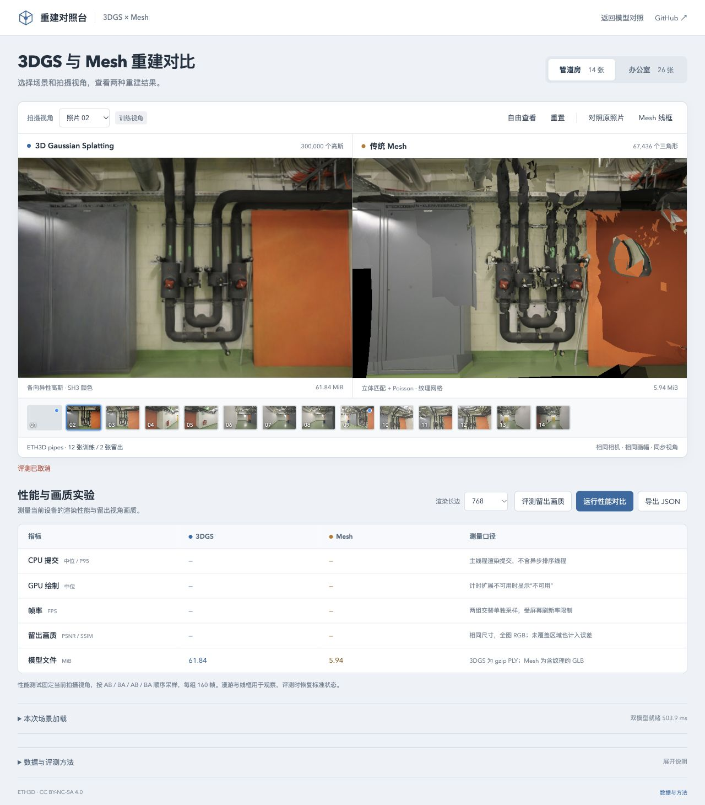

# 参考照片等待取消

2026-10-29，基线 `870afb8`，Chromium 156。pipes / office、768 长边、DPR 1、完整 SH3、LoD 关闭及照片划分保持不变；使用原来的 `Image.decode → drawImage → getImageData` 路径。

## 修复边界

画质评测等待参考照片时，原来的 `Image.decode()` 不接收取消信号。即使已点击取消、调整窗口、进入后台或离开页面，处理函数仍会等待照片；成功返回后还会读取一次已经无用的参考像素。

新增可取消的等待包装：取消或失败时移除图片源，解除信号监听并结束调用方等待；继续接收原生 Promise 的迟到成功或拒绝，避免额外像素读取和未处理拒绝。评测信号与查看器生命周期信号共同覆盖参考照片请求，成功时保留原图解码与缩放方式。没有新增图片缓存或更换解码器。

## 取消回归

[浏览器夹具](../tests/browser/image-decode.ts)在真实图片解码后暂缓完成通知，分别测试按钮、resize、合成 visibilitychange 和永久 pagehide；隐藏情形在放行时主动产生迟到拒绝。每场景四种情况，共八项。

| 检查 | 基线 | 修改后 |
| --- | --- | --- |
| 解码通知未放行时评测已结束 | 0 / 8 | 8 / 8 |
| 已取消图片解除 src | 0 / 8 | 8 / 8 |
| 迟到成功后的额外参考像素读取 | 6 次 | 0 次 |
| 取消后残留画质报告 | 0 | 0 |

六项可继续使用的页面检查恢复原照片 02 和控件；两项已释放页面保持控件禁用，不恢复绘制。80ms 是检查挂起状态的观察窗口，不是取消延迟测量。新增九项单元回归覆盖提前取消、迟到完成、正常失败、同步异常及监听清理，共 116 项测试通过，类型检查与生产构建通过。

## 原生 JPEG 停流

[HTTP 服务](../tests/browser/serve-image-decode.py)对每场景第一张留出 JPEG 发送 1024 字节后停流，不完成正文。[原生检查](../tests/browser/image-network.ts)确认两次 `Image.decode()` 均处于 pending，取消后调用方均得到 AbortError、图片源已移除，服务器均观察到连接在正文完成前关闭；正常照片重试得到 1024×673 / 1024×667 的原尺寸。

150ms 观察时，底层原生 decode Promise **仍为 pending**。因此该修复保证调用方不再等待，不代表原生解码任务或其内存已同步回收。测试没有量化节省的带宽、内存或解码耗时。原生后台限流、系统睡眠及其他浏览器仍待验证。

本地生产页的 pipes 在真实参考照片停流时完成取消，恢复照片 02、按钮及无画质结果的导出；office 另在 390×844 窄屏检查评测取消与导出恢复。缩略图可以共享同一图片请求，页面上仍有其他使用者时，不要求整条共享下载连接关闭。

## 评分输入与既有波动

保存每个留出视角的参考图、3DGS 和 Mesh 的实际 RGBA 输入摘要。首次对照 18 份输入中的 17 份相同：**全部 12 份重建画面一致**，差异仅位于办公室照片 01 的参考图。最大绝对变化为 PSNR 0.00076960dB、SSIM 0.00100159；其余逐视角成绩相同。

再运行一次旧版的相同办公室流程，也得到修复版的参考图摘要和全部相同成绩，确认该状态可在旧版出现。保留首次对照与复测，未以复测替换差异记录。这将[此前评分波动](QUALITY-FRAMES.md)进一步缩小到参考照片读取、解码或缩放后的像素路径；尚未分离原尺寸解码与缩放结果，不能断言是缓存、色彩处理或具体插值算法导致。

本次没有渲染画质退化证据，也没有宣称 PSNR/SSIM 提升。下一步单独记录原尺寸 RGB 和目标尺寸 RGBA，定位参考输入稳定性，保持当前评分公式不变。

原始记录：[pipes 基线](benchmarks/image-decode-baseline-pipes-2026-10-29.json)、[office 基线](benchmarks/image-decode-baseline-office-2026-10-29.json)、[office 基线复测](benchmarks/image-decode-baseline-office-repeat-2026-10-29.json)、[pipes 修改后](benchmarks/image-decode-fixed-pipes-2026-10-29.json)、[office 修改后](benchmarks/image-decode-fixed-office-2026-10-29.json)、[HTTP](benchmarks/image-decode-http-2026-10-29.json)、[差异汇总](benchmarks/image-decode-comparison-2026-10-29.json)。

## 复现与参考

运行 `npm run dev -- --port 5190`，打开 `tests/browser/image-decode.html?scene=pipes` 或 `?scene=office` 并运行检查。旧版需要从 `870afb8` 提取 `src/main.ts` 到 `.qa/image-decode/main-before.ts`，把相对导入改为 `/src/`；把该版本 viewer 的 reference 方法保存为 `.qa/image-decode/reference-before.ts` 中的同名导出函数，再加 `variant=baseline`。

原生停流检查先启动 `python3 tests/browser/serve-image-decode.py`，再打开 `tests/browser/image-network.html`；重启服务可重置首次停流。加入 `--built` 可直接用 5191 端口检查生产页面，需要先 `npm run build`。

研究参考：[gsplat 最新图片缓存实现](https://github.com/nerfstudio-project/gsplat/commit/512d366b67073d77ca099ede742683c165dfc23b)、[原论文评价口径](https://arxiv.org/html/2409.06765v1#S4)。其 CUDA 训练缓存并不解决浏览器取消等待；此次只修复任务生命周期，不套用作者性能数据，详见[研究索引](RESEARCH.md#候选gsplat-的图片缓存与启动成本)。
