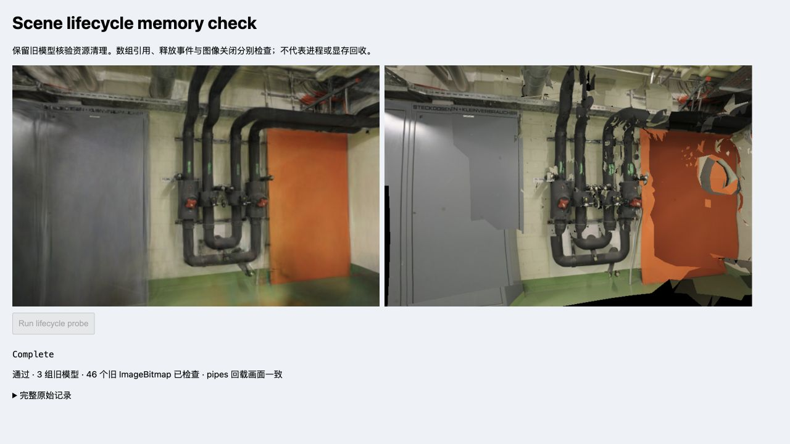

# 场景切换与资源生命周期

日期：2026-11-08。生产代码基线 `b5ec4de`，Spark 2.4.0 / Three.js 0.180.0，探针协议 2。仅改独立浏览器探针及其回归，默认页面、模型、相机和训练/留出划分不变。

## 修正的测量问题

11-07 探针在清理后读取 `viewer.gaussian` / `viewer.mesh`。当前指针已被移除时，高斯字节和图像数量自然为零，即使旧模型没有清理也能得到相同结果。因此旧摘要只能证明活动引用消失，不能独立证明旧 ImageBitmap 已关闭或旧属性已清空。

新版在每次切换和最终 dispose **之前保留旧模型、ExtSplats、实际纹理和 ImageBitmap**，之后检查旧对象上的字段、纹理数据源、场景 parent、逐资源 dispose 事件和图像尺寸。回归覆盖只丢指针、只发 dispose 事件但不关图像、不清纹理数据源、重复释放、共享 backing buffer 与零长度视图持有非零容量，避免再次产生误通过。158 项回归、严格 TypeScript 检查与生产构建通过。

## 保留旧对象的实测

Chrome 156 / WebGL2 / ANGLE Metal（Apple M5），默认完整 PLY / SH3、关闭 LoD，顺序为 `pipes → office → pipes → dispose`。同一文档串行运行，页面始终可见，未启动训练或其他渲染实验。

| 旧模型的清理时点 | 属性视图字节（前 → 后） | 高斯纹理（各 dispose 一次 / 总数） | 仍带数据的高斯纹理 | 已关闭旧 ImageBitmap / 总数 | Mesh 几何 / 材质 / 纹理（各 dispose 一次） |
| --- | ---: | ---: | ---: | ---: | ---: |
| pipes 被 office 替换 | 28,901,376 → 0 | 6 / 6 | 0 | 12 / 12 | 12 / 12 / 12 |
| office 被 pipes 替换 | 22,413,312 → 0 | 6 / 6 | 0 | 22 / 22 | 22 / 22 / 22 |
| 最终 pipes dispose | 28,901,376 → 0 | 6 / 6 | 0 | 12 / 12 | 12 / 12 / 12 |

三组旧模型均脱离场景，`SplatMesh.extSplats` 均置空；保留的旧 ExtSplats 属性视图与去重 backing capacity 均为 0 B。Spark 仍放入两份零长度数组，故 `backingBuffers=2` 不是两份非零内存分配。18 个高斯纹理及 Mesh 的 46 个几何、46 个材质、46 个纹理各观测到一次释放事件；46 个旧 ImageBitmap 的宽高均为零。

这些检查证明所列对象的清理行为，不证明垃圾回收、Worker 终止、GPU 驱动回收或内存峰值。保留的旧对象本身也会影响 JS 堆；不会为降低计数强制清空共享 Spark/Three.js 状态。

## 活动引用与渲染器计数

属性视图字节和唯一 backing capacity 分列于原始记录；这次两者相等，不能推广为所有布局都无共享。下表的 MiB 严格使用 `bytes / 1,048,576`，由 JSON 的整数字节生成。

| 阶段 | 活动属性视图 | 活动打开图像 | 3DGS renderer（几何 / 纹理） | Mesh renderer（几何 / 纹理） | JS used heap |
| --- | ---: | ---: | ---: | ---: | ---: |
| Renderer 构造后 | 0 B | 0 | 0 / 0 | 0 / 0 | 94.2 MiB |
| pipes 已加载 | 28,901,376 B | 12 | 2 / 12 | 12 / 12 | 122.2 MiB |
| office 覆盖 pipes | 22,413,312 B | 22 | 2 / 14 | 21 / 21 | 180.7 MiB |
| pipes 再加载 | 28,901,376 B | 12 | 2 / 14 | 12 / 12 | 258.7 MiB |
| viewer dispose 后 | 0 B | 0 | 1 / 3 | 0 / 0 | 258.7 MiB |

最终 3DGS renderer 仍为 1 / 3，Mesh 为 0 / 0；未将剩余计数归因到具体资源。Spark 源码有释放排序/LoD Worker 的调用，但本探针没有观测其终止，不写成实测已回收。Three.js 计数只包含它管理并上传过的资源；例如 office 捕获到 22 份 Mesh 几何，renderer 的几何数为 21，二者含义不同。

`performance.memory` 未强制 GC，亦未计量 WASM Worker 池、浏览器缓存和 GPU 驱动。当前堆读数不能与 11-07 的旧文档比较收益，不是峰值或泄漏证据。

## 画面与耗时边界

pipes 初次与回载均使用首个留出相机、768 × 505；3DGS 与 Mesh 的 RGBA SHA-256 各自相同。office 首个留出相机的两份摘要也完整保存，但只作观察，不宣称覆盖全部留出 PSNR/SSIM 或移动视角。此次没有修改渲染算法、分辨率、高斯数量、SH 阶数或模型资产。

按钮触发至结果序列化前为 **904.3ms**，含两次切换、像素读取/摘要与诊断，且不含最初 pipes 加载及模块启动；不能当作首帧、冷/热加载、CPU 提交、异步排序、GPU 绘制或训练耗时。各阶段性能继续使用既有 benchmark 和加载实验。

[完整浏览器原始 JSON](benchmarks/lifecycle-memory-2026-11-08.json)直接保存 DOM 中的结果，含每次释放计数、全部像素摘要、可见性和限制；[输入清单](benchmarks/lifecycle-memory-2026-11-08.inputs.json)记录 SHA-256 和字节数，26 项输入在实测前后不变，生产源码与场景资产匹配基线提交。



初次[预检记录](benchmarks/lifecycle-memory-2026-11-08-preflight.json)与[预检输入摘要](benchmarks/lifecycle-memory-2026-11-08-preflight.inputs.json)也保留。预检后补充零长度视图仍持有缓冲区的断言，移除探针内硬编码提交号，再采集正式结果；基线由各自输入清单记录。正式记录来自开发服务更新后的新文档，浏览器编译、着色器和模型缓存未重置，两个文档的堆值和墙钟不作性能比较。

## 复现

```bash
npm run dev -- --host 127.0.0.1 --port 5178
```

打开 `http://127.0.0.1:5178/tests/browser/memory-lifecycle.html`，等待 Ready 后点击一次按钮。保持页面前台，不在运行中切换标签页。展开「完整原始记录」保存全部 JSON；不同浏览器另存新结果。此夹具保留旧对象用于核验，不用于测进程或显存峰值。

## 历史记录更正

[11-07 原始摘要](benchmarks/lifecycle-memory-2026-11-07.json)和[原截图](images/memory-lifecycle.jpg)保留，基线为 `7620b45`。其 `pixelEqual=true` 仅指 pipes 初次/回载的 3DGS、Mesh 两份摘要，office 没有对应回载控制。

旧报告将十进制 MB 错标为 MiB。按原始字节换算，五阶段 JS used heap 应为 **123.5、123.9、177.5、186.6、186.6 MiB**。同时撤回“旧图像已关闭”“模型资源已释放”“剩余计数属于内部状态”和“Worker 已实测释放”的表述；新协议的旧对象证据见上文，历史原始字节不改写。

相关原文与代码：[Spark ExtSplats.dispose](https://github.com/sparkjsdev/spark/blob/ffe210dc0a45d0515a06c9235878108112827d61/src/ExtSplats.ts)、[SparkRenderer.dispose](https://github.com/sparkjsdev/spark/blob/ffe210dc0a45d0515a06c9235878108112827d61/src/SparkRenderer.ts#L693)、[Three.js renderer.dispose](https://github.com/mrdoob/three.js/blob/r180/src/renderers/WebGLRenderer.js#L980)。[WebSplatter v1 §4.5](https://arxiv.org/html/2602.03207v1#S4.SS5)的 Windows / RTX 显存观测与本探针的对象计数不同；[GSL 1.7.0 共享码本](https://github.com/WilliamLiu-1997/Gaussian-Splat-Lite/blob/7774bdd759cff1f77a1ccdf9cbdaaa7782c831a1/src/data/shPalette.js)又允许缓存数据在纹理 dispose 后保留，移植前必须先明确共享所有权。两者均未作为本项目性能收益。
