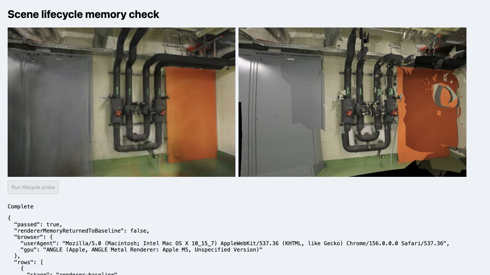

# 场景切换与资源生命周期

日期：2026-11-07。基线 `7620b45`，Spark 2.4.0 / Three.js 0.180.0。该页只记录可从浏览器观察到的资源边界，不把 JS 堆或 `renderer.info` 计数当作进程峰值、显存峰值或驱动回收证明。

## 结果

在 Chrome 156、WebGL2 / ANGLE Metal（Apple M5）中按 `pipes → office → pipes` 串行加载，使用默认完整 PLY、GLB 和固定 768 像素查看器。初始与最终像素摘要完全一致，未发生脚本错误。第一次场景切换后，旧 Mesh 的 12 个 ImageBitmap 全部关闭；办公室切换后 22 个新 ImageBitmap 正常打开；第二次回到管道房后仍为 12 个打开图像。最终 `gaussianAttributeBytes` 为 0，Mesh 图像数量和打开数量均为 0。

| 阶段 | 高斯属性缓冲 | Mesh ImageBitmap（数量 / 打开） | 3DGS `renderer.info.memory`（几何 / 纹理） | Mesh `renderer.info.memory`（几何 / 纹理） | JS used heap |
| --- | ---: | ---: | ---: | ---: | ---: |
| Renderer 构造后 | 0 B | 0 / 0 | 0 / 0 | 0 / 0 | 129.5 MiB |
| pipes 已加载 | 28,901,376 B | 12 / 12 | 2 / 12 | 12 / 12 | 129.9 MiB |
| office 覆盖 pipes | 22,413,312 B | 22 / 22 | 2 / 14 | 21 / 21 | 186.1 MiB |
| pipes 再加载 | 28,901,376 B | 12 / 12 | 2 / 14 | 12 / 12 | 195.6 MiB |
| viewer dispose 后 | 0 B | 0 / 0 | 1 / 3 | 0 / 0 | 195.6 MiB |

最终 3DGS 计数没有回到构造后 0 / 0，但模型属性和照片资源已经释放。Spark 当前固定版本的 `SparkRenderer.dispose()` 会释放自身几何、材质、目标纹理、排序/LoD Worker 和分页器；剩余 1 个几何与 3 个纹理属于 Three.js/渲染器可观测的内部状态，单次实验无法证明它们是泄漏。当前不增加强制清零或销毁共享静态资源的代码，避免破坏后续上下文或其他查看器。

Chrome 暴露的 `performance.memory` 没有强制垃圾回收：堆从 129.5 MiB 上升到 195.6 MiB 只能说明同一文档经历了三次大模型解码，不能作为峰值或回收失败结论。WASM 解析池、GPU 驱动分配和浏览器缓存不在这些计数内。

原始摘要见[`lifecycle-memory-2026-11-07.json`](benchmarks/lifecycle-memory-2026-11-07.json)，浏览器夹具为[`memory-lifecycle.html`](../tests/browser/memory-lifecycle.html)。截图取自最后一次完成状态，画面用于确认模型仍可显示，表格数据以 JSON 为准：



## 复现

```bash
npm run dev -- --host 127.0.0.1 --port 5178
```

打开 `http://127.0.0.1:5178/tests/browser/memory-lifecycle.html`，等待 `Ready` 后点击一次按钮。保持页面前台，不在运行中切换标签页；顺序固定为 `pipes → office → pipes`。若要比较不同浏览器，必须另存新的摘要，不能把 `performance.memory` 或驱动计数跨浏览器直接比较。

相关实现：[SparkRenderer.dispose()](https://github.com/sparkjsdev/spark/blob/ffe210dc0a45d0515a06c9235878108112827d61/src/SparkRenderer.ts#L693)、[Three.js renderer.dispose()](https://github.com/mrdoob/three.js/blob/r180/src/renderers/WebGLRenderer.js#L980)。Spark 2.0 的 RAD、共享页表和渐进 LoD 另列为独立候选，尚未把本次完整 PLY 资源计数外推到分页场景。
