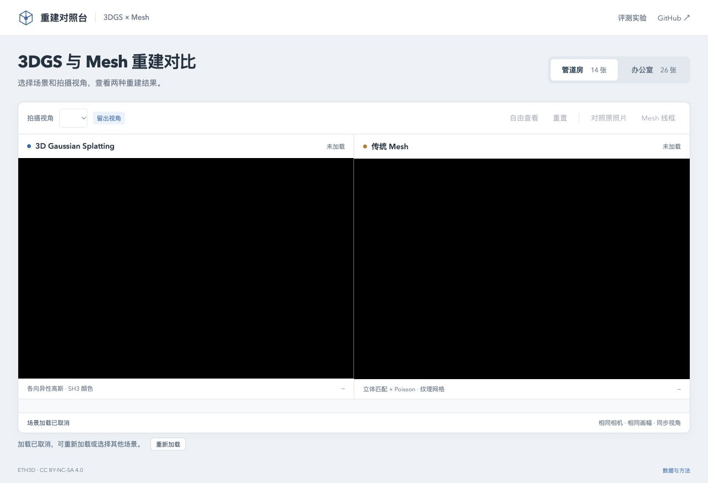

# 场景加载取消与重试

2026-10-29，基线 `1f78fca`；Spark 2.4.0、Chromium 156、Apple M5。默认 pipes / office 模型、相机、完整 SH3、LoD 关闭及 768 长边均保持不变。

## 问题与修改

线上曾观测到一次约 332 秒的未受控加载，主要等待模型读取，详见[原始记录](QUALITY-FRAMES.md#线上发布检查)。旧页面在整个加载期间禁用场景切换，也不提供取消按钮；只有加载失败后才能重试。

现在首页和评测页在加载期间显示「取消加载」。点击后使当前界面请求失效，调用已有加载作用域清理，取消下载和首帧等待，移除已拥有的模型，清空旧画面与照片覆盖层。视角、测试和导出仍禁用，允许重新加载或选择另一场景。后续评测使用同一按钮时恢复「取消测试」标签。

未改动 Spark 解码、排序、渲染、模型或评分公式。已提交的解析任务可能继续结束，迟到资源由原作用域负责释放；界面恢复不表示底层所有计算已同步停止，也没有加入固定下载超时或自动重试。

## 对照结果

使用[浏览器夹具](../tests/browser/load-cancel.ts)延迟场景 JSON、gzip PLY 正文、GLB 正文、Mesh 解析结果及首帧准备。每种情况分别覆盖 pipes 和 office，串行执行。

| 检查 | 旧版 | 修改后 |
| --- | --- | --- |
| 等待期间提供可见取消入口 | 0 / 10 | 10 / 10 |
| 取消后可重试或切换场景 | 0 / 10 | 10 / 10 |
| 重试完成后释放旧等待，不覆盖新场景或报告 | 不适用 | 10 / 10 |
| 取消后两侧旧画布清空 | 不适用 | 10 / 10 |

两次延迟 Mesh 解析分别记录到 12 / 22 次 geometry dispose 事件，迟到 Mesh 未挂回场景。此计数不等于纹理数量、独立 geometry 数量或实际显存释放量。模拟正文的四次取消均传播到流，未出现浏览器异常。观察窗口为 80ms，用于确认工作仍挂起时可操作，不能据此报告取消延迟。

重复加载后，两版本六个留出视角的 3DGS RGBA 摘要均与原始 PLY 控制一致。没有改变量化、点数、SH 或 LoD；此次不新增 PSNR/SSIM、CPU/GPU 性能跑分，既有微小评分波动仍单独待查。

原始数据：[基线](benchmarks/load-cancel-baseline-2026-10-29.json)、[修改后](benchmarks/load-cancel-fixed-2026-10-29.json)。107 项自动测试、严格类型检查与生产构建通过。

## 真实 HTTP 与界面检查

[本地 HTTP 服务](../tests/browser/serve-load-cancel.py)直接提供生产构建，在每个场景首次高斯请求发送 1024 字节后停流，保留完整 Content-Length，禁用该响应缓存。用真实页面按钮取消，观察服务器是否在正文完成前收到连接关闭，再重试正常资源。该实验检查 Fetch 取消与恢复，不模拟带宽或 CDN 性能。

这张截图来自本地生产首页；详细性能面板继续只在 `benchmark.html`。

本地生产页桌面与 390×844 窄屏操作检查通过，评测开始时按钮恢复「取消测试」，取消后控件正常恢复，未出现浏览器错误。

两场景停流均观测到 `closedBeforeCompletion: true`，发送正文为 1024 字节，随后「重新加载」均成功；[服务端记录](benchmarks/load-cancel-http-2026-10-29.json)。

## 参考与限制

[Spark 的分页读取接口](https://github.com/sparkjsdev/spark/blob/ffe210dc0a45d0515a06c9235878108112827d61/src/PagedSplatsFetcher.ts)把 AbortSignal 传递到请求，但也明确允许某些输入在取消后完成。这里沿用已有资源所有权检查，不接入分页格式。[MoQSplat](https://arxiv.org/html/2609.18624v1)讨论传输状态和失效后的重新请求；其 CUDA / gsplat 与 MoQ 服务架构不能直接用于当前 WebGL2 静态站点，详见[研究记录](RESEARCH.md#候选moqsplat-的传输状态与取消边界)。

真实 CDN 变慢的原因、缓存状态、原生后台限流及底层解析取消仍未验证。1024 字节停流只是可重复的故障条件，不是节省流量的实测幅度，也不作为解码、首帧或 GPU 提速结论。
