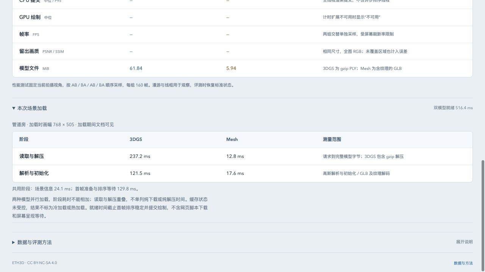

# 场景加载分段计时

评测页增加“本次场景加载”，记录当前场景成功加载的六个阶段、总时间和原始起止偏移。加载完成后即可导出 JSON 的 `loading`，无需先跑渲染性能或画质测试。首页继续只展示模型对照。

## 时间边界

计时使用 `performance.now()`，单位 ms。总时间从 `CompareViewer.load()` 进入、清理旧模型之前开始，到 `settle()` 等待高斯排序稳定并提交两侧绘制之后结束。阶段保存 `startMs`、`endMs`、`durationMs`，起止均相对于本次加载开始。

| 字段 | 边界 |
| --- | --- |
| `metadata` | 发起 scene.json 请求 → JSON 解析完成且仍为有效请求 |
| `gaussianReadDecode` | 发起高斯请求 → 响应读完、gzip 解压及签名校验完成 |
| `gaussianInitialize` | 创建 SplatMesh → initialized 完成、SH3 配置与生成器更新 |
| `meshRead` | 发起 GLB 请求 → 完整 ArrayBuffer |
| `meshParse` | GLTFLoader.parseAsync → 几何、材质及纹理解码完成 |
| `settle` | 模型挂入场景后开始准备首帧 → 排序稳定并完成两侧绘制提交 |

两模型保持原来的并行加载，CPU 工作也会相互竞争；阶段是墙钟等待，**不是两后端的隔离性能对照，不能相加得到总时间**。下载与流式解压重叠，现阶段不拆成纯网络或纯解压时间；`initialized` 也不表示所有首次 GPU 上传已完成，首次提交成本可能进入 `settle`。

`settle` 含渲染调度、资源准备、排序及连续静止帧确认，不等于独立排序线程耗时或 GPU 查询。总时间不含网页脚本下载、查看器构造、照片条加载、历史训练，亦不证明画面已在屏幕呈现。本次没有修改渲染性能评测的 CPU/GPU 口径。

`camera` 和 `resolution` 固定为加载时状态，后续修改视角或画幅不会改写加载记录。新场景开始即清空旧记录，失败、取消或销毁不发布部分记录；旧请求迟到不能覆盖新场景。曾在加载期间进入后台会记录 `visibility: "backgrounded"`。文档可见不等同于窗口具有键盘焦点。

`cache: "uncontrolled"` 表示未控制 HTTP 缓存、操作系统缓存、Worker 初始化或着色器缓存，不能把第一次/第二次加载自动叫作冷/热加载。

## 本地观测

基线 `1b30626`；Spark 2.4.0、Three.js 0.180.0，Chromium 153 / Apple M5。开发服务位于本机。先运行旧查看器外部总时间记录，再运行带分段记录的查看器；各自依次加载 pipes、pipes、office、office。第二次加载复用查看器，但重新构造模型；HTTP 缓存没有清空或强制命中。

| 场景 / 顺序 | 总时间 | 高斯读取/解压 | 高斯初始化 | Mesh 读取 | Mesh 解析 | 首帧准备 |
| --- | ---: | ---: | ---: | ---: | ---: | ---: |
| pipes / 1 | 519.1 | 244.4 | 131.3 | 15.7 | 13.2 | 132.2 |
| pipes / 2 | 497.5 | 224.3 | 127.3 | 12.7 | 10.2 | 142.7 |
| office / 3 | 440.1 | 173.7 | 93.7 | 21.1 | 15.5 | 163.6 |
| office / 4 | 435.7 | 172.3 | 94.2 | 22.9 | 17.0 | 166.5 |

单位 ms，场景信息阶段及全部原始偏移见[记录](benchmarks/load-timing-2026-10-26.json)。本地管道房的主要等待在高斯读取/解压；办公室首帧准备已接近读取/解压时间，后续应分别研究这两个环节。该观察不能推断公网加载的瓶颈。

旧版四次外部总时间为 580.6 / 492.6 / 447.8 / 418.0ms。记录只用于保留当前测量边界和验证流程，不构成 ABBA 性能实验，缓存及运行顺序未受控，**不据此声称提速或量化计时开销**。

## 验证与复现

- 两个定时器单元测试覆盖重叠阶段、未计入分段的间隙，以及导出快照独立性；44 项测试、类型检查与构建通过。
- 四次成功加载各包含六个合法阶段，总时间与外部墙钟记录相差小于 5ms；两场景全部留出视角、两个后端的像素哈希及 PSNR/SSIM/MAE 与基线完全一致。
- 四项加载生命周期检查通过：旧元数据、旧首帧晚完成不覆盖当前计时，单模型失败不发布计时，销毁后无计时；清空场景也清空记录。
- 桌面与 390px 窄屏显示正常；加载后独立导出、变更分辨率保留加载画幅、切换场景替换计时均通过。取消画质评测后只保留可导出的加载记录，无部分画质成绩。



基线复现，在仓库根目录执行：

```sh
python3 - <<'PY'
from pathlib import Path
import subprocess
source = subprocess.check_output(['git', 'show', '1b30626:src/viewer.ts'], text=True)
Path('.qa').mkdir(exist_ok=True)
Path('.qa/timing-baseline.ts').write_text(source.replace('from "./', 'from "../src/'))
PY
npm run dev
```

分别打开 `/tests/browser/load-timing.html?variant=baseline` 和去掉参数的页面，串行点击 **Run sequential loads**，完成一组后关闭页面再运行下一组。生命周期检查使用 `/tests/browser/load-lifecycle.html`，正常界面在 `/benchmark.html`。

参考：[Spark SplatMesh 初始化边界](https://github.com/sparkjsdev/spark/blob/ffe210dc0a45d0515a06c9235878108112827d61/src/SplatMesh.ts)、[Spark 加载依赖链讨论](https://github.com/sparkjsdev/spark/issues/321)、[LMG 分层场景传输](https://aiins-nthu.github.io/LMG/)。分层预览的“可交互”与完整精度“就绪”应分别计时；当前完整 PLY 仍只有后者。
