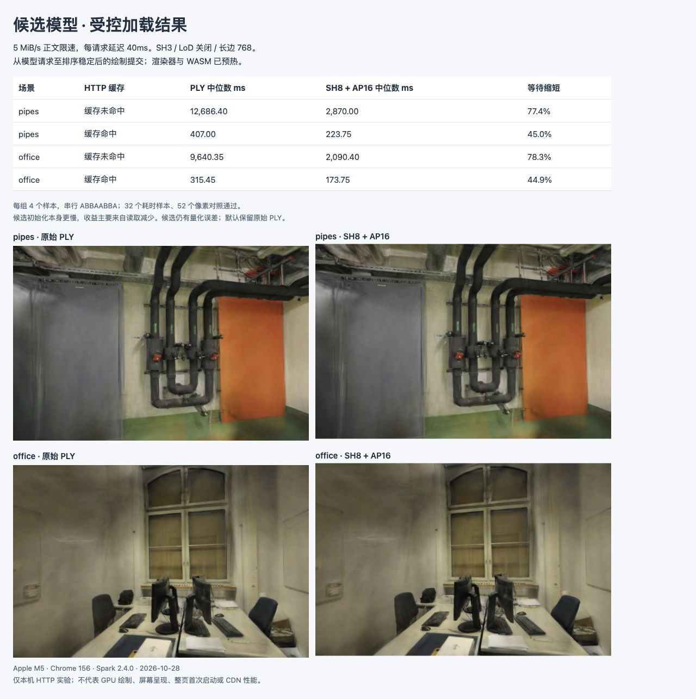

# 受控 HTTP 下的候选加载耗时

2026-10-28，在 **5 MiB/s 正文限速、每请求 40ms 服务器等待**下，SH8 + AP16 候选缩短了模型请求至排序稳定后绘制提交的等待。缓存未命中时，pipes 为 **12.686 → 2.870s**，office 为 **9.640 → 2.090s**；命中缓存后仍有读取、校验和初始化成本。

这是独立候选实验，渲染器与 WASM 已预热，**不是整页冷启动或屏幕首帧呈现时间**。默认仍使用原始 PLY，候选保留已知量化误差。[原始 JSON](benchmarks/paced-model-2026-10-28.json)保存 32 个样本、逐段时间、实际服务器请求及限速记录、52 个像素对照和资源释放情况。

## 设置与计时

基线 `55905ad`；Spark 2.4.0 / Three.js 0.180.0 / Chrome 156 / Apple M5 / ANGLE Metal / WebGL2。pipes / office 使用原文件与摘要、300,000 / 231,428 点、完整 SH3、LoD 关闭、768 长边。照片、标定相机、12/2 与 22/4 训练/留出划分均不变，没有训练或生成新模型。

- [限速实现](../tests/helpers/paced-response.ts)按编码后的正文计量，64KiB 分块，以累计字节预算安排写出，并等待 socket 背压解除。5MiB/s 为 5,242,880B/s，约 41.94Mbps；40ms 是每个请求的服务器持有时间，**不是网络 RTT 模拟**。最后一块最早写出时间为 `40ms + 正文字节 / 5MiB/s`。实际最大分块迟到 3.97ms，最后一块最大迟到 2.57ms；这些是服务器写出时间，不能替代客户端接收或总线上字节。
- [同源 HTTP 服务](../tests/browser/vite-http-model.config.ts)发送 SPZ 原字节，以及带 `Content-Encoding: gzip` 的 PLY/AP16。浏览器自动展开后，加载器仍检查文件摘要。响应 ETag 与既有压缩文件摘要完全一致；没有改默认资产或 HTTP 缓存设置。
- 每场景先加载原始查看器和 Mesh，再以相同 URL 预热两种解析器及 HTTP 缓存；这些请求保存在 `warmups`，不计入样本。每次测量先恢复原始模型并等待稳定，计时期间保留原画面，成功发布后移除。每次都创建和释放新模型，不复用已解码模型。
- `cold-key` 每次采用未使用的 URL，服务器实际收到 PLY 一个或候选两个 200 请求。`warm-key` 重用完全相同的预填 URL，16 个样本均无服务器模型请求。两种条件下浏览器、渲染器、WASM 均已预热；没有测量重启后的磁盘缓存。
- 每场景先测冷缓存键，再测热缓存键，每组串行 **ABBAABBA**（A=PLY，B=候选），各格式 4 次。未并行运行其他重建或 GPU 实验；页面全程 `visible`。每个样本固定同一留出相机，没有自动漫游。
- 总计从 `loader.load()` 前开始，到 `viewer.settle()` 返回：Spark 连续四帧排序安静后提交 Mesh 绘制。它包含帧等待和异步排序相关等待，但**不是独立排序计时、CPU 提交基准、GPU query 或屏幕呈现时间**。截图、像素读取、质量评分、恢复基线、清单/照片/Mesh/页面启动均在区间外。

## 耗时结果

单位 ms，每格为 4 个样本的中位数；括号为最小–最大值，小样本不推断 P95。

| 场景 / HTTP 缓存 | 原始 PLY | SH8 + AP16 | 总等待缩短 |
| --- | ---: | ---: | ---: |
| pipes 未命中 | 12,686.40（12,682.00–12,698.70） | 2,870.00（2,865.50–2,873.80） | 77.4% |
| office 未命中 | 9,640.35（9,631.90–9,640.50） | 2,090.40（2,090.20–2,098.70） | 78.3% |
| pipes 命中 | 407.00（398.10–415.60） | 223.75（215.50–224.90） | 45.0% |
| office 命中 | 315.45（315.30–315.60） | 173.75（173.60–174.00） | 44.9% |

未命中样本的正文分别为 pipes 64,843,796 / 13,071,355B、office 49,050,760 / 9,335,099B；候选包括 SPZ 和 AP16 两个文件。缓存命中均为 0B 服务器正文，但总等待不为零。

| 场景 / 缓存 / 格式 | 读取及读取器验证 | SHA-256 | 格式解析与初始化 | 属性恢复与发布 | 稳定等待 |
| --- | ---: | ---: | ---: | ---: | ---: |
| pipes / 未命中 / PLY | 12448.25 | 43.05 | 117.10 | 0.00 | 78.80 |
| pipes / 未命中 / 候选 | 2592.30 | 10.20 | 179.20 | 0.80 | 88.00 |
| pipes / 命中 / PLY | 207.35 | 24.90 | 113.05 | 0.00 | 61.85 |
| pipes / 命中 / 候选 | 8.05 | 4.90 | 146.20 | 0.40 | 64.00 |
| office / 未命中 / PLY | 9429.70 | 40.10 | 95.60 | 0.00 | 73.65 |
| office / 未命中 / 候选 | 1872.85 | 8.00 | 144.25 | 0.40 | 67.15 |
| office / 命中 / PLY | 157.75 | 20.55 | 87.45 | 0.00 | 48.50 |
| office / 命中 / 候选 | 6.10 | 3.45 | 111.00 | 0.40 | 52.50 |

读取阶段包含 fetch、网络/缓存读取、HTTP 展开，以及读取器的格式与 AP16 有效性验证，未拆成独立纯网络与纯解压时间。SPZ 内部解压位于初始化阶段。两个文件的读取和摘要各自记录于 JSON，这里按样本合计后取中位数。各列中位数不能直接相加得到总中位数；调度及旧模型清理等差额保留在 `otherLoadMs`。0.00ms 表示计时精度内的值，不代表没有执行。

**候选格式解析与初始化比 PLY 慢**：缓存命中时为 146.20 / 111.00ms，PLY 为 113.05 / 87.45ms。总体收益主要来自读取量及 PLY 展开读取成本减少，不能宣称 SPZ 解码更快或稳态渲染更快。后续优先分解初始化与内存峰值，保留相同模型与精度对照。

## 质量与资源



两格式各测全部六个留出相机、每场景首相机 ±0.08rad，共 20 个质量/偏转控制；每个耗时样本另验首个留出画面，共 **52 个像素哈希全部复现既有 PLY / AP16 对照**。偏转无照片真值，不纳入质量均值。JPEG 仅展示，评分使用 RGBA。未新增自由拖动漫游测试；此前[候选加载的交互验证](PAIRED-MODEL.md)仍适用，当前仅改变传输节奏及计时。

| 留出均值 | pipes PSNR / SSIM | office PSNR / SSIM |
| --- | --- | --- |
| 原始 PLY | 16.268912 / 0.730921 | 18.953445 / 0.839018 |
| SH8 + AP16 | 16.268331 / 0.731814 | 18.962445 / 0.839371 |

候选相对原始仍有 3/6 视角 PSNR 较低、1/6 视角 SSIM 较低，不是无损压缩；这些分数不是新的画质提升。照片与衍生画面沿用 ETH3D CC BY-NC-SA 4.0。36 个实验模型各释放一次，每次仅显示一个高斯模型；页面异常及控制台错误为 0。释放计数不代表已测 GPU 内存回收。

## 复现与范围

按 [AP16 准备步骤](SPZ-ALPHA16.md#复现与下一步)准备既有文件。在仓库根目录运行：

```bash
node --import tsx --test tests/paced-response.test.ts tests/paired-model.test.ts
npx vite --config tests/browser/vite-http-model.config.ts
```

打开 `http://127.0.0.1:5180/tests/browser/paced-model.html`，点击「运行串行加载对照」。保持正常 HTTP 缓存和可见文档；每次使用独立运行 ID，不清理用户缓存。页面会拒绝非预期回退、缓存未命中、可见性变化、字节/像素不符和未完成响应。服务只绑定本地地址，测完停止。

新增 3 项回归，覆盖限速字节预算与完整输出、取消后停止写入、直接 PLY 控制的摘要和所有权；共 78 项测试、类型检查和构建通过。新增入口和辅助代码只用于测试，生产 JS/CSS 哈希仍为 `main-Dn9-Sp-Y.js` / `main-CRdM07cY.css`，无需重复部署 Pages。

未测整页/渲染器/WASM 冷启动、显存或进程峰值、独立 GPU/异步排序时长、失败回退耗时、稳态 FPS、训练、真实 CDN、移动端及其他后端。下一步先补冷运行时和内存边界，再决定是否提供候选入口；不由此替换默认资源。

参考 [Spark 2.4.0 Worker](https://github.com/sparkjsdev/spark/blob/ffe210dc0a45d0515a06c9235878108112827d61/src/worker.ts)、[KoalaGS v1](https://arxiv.org/abs/2610.28615v1)和[作者演示说明](https://rdbch.github.io/koalags/)。论文与演示使用不同的表示/带宽模拟条件；仅作为评价方法参考，未采用其模型排序或训练方案，详见[研究记录](RESEARCH.md)。
