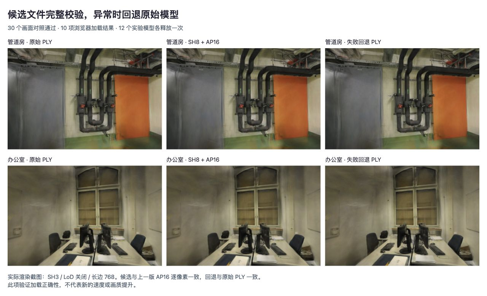

# SH8 + AP16 配对加载与回退

2026-10-27，完成独立候选加载流程：准确配对 SPZ 与 AP16，取消后清理迟到模型；候选失败时回退至原始 PLY。**默认查看器、线上资源与旧耗时夹具未改变。** 这是加载正确性验证，没有新的速度或内存收益结论。

[浏览器原始记录](benchmarks/paired-model-2026-10-27.json)包含 30 个画面对照、10 项加载结果、12 个实验模型的发布/释放计数及环境信息。[实现](../tests/helpers/paired-model.ts)与[浏览器验证页](../tests/browser/paired-model.html)位于测试目录，未进入生产包。

## 基线与加载边界

基线提交为 `ca44e88`。沿用 [AP16 文件实验](SPZ-ALPHA16.md)中已固定的 SPZ、原始 AP16、解压后 PLY 摘要；没有从正在下载的文件重新生成预期摘要。pipes / office 点数仍为 300,000 / 231,428，固定完整 SH3、关闭 LoD、长边 768，照片、相机与训练/留出划分均未改变。

先读取原始模型，复核上一报告的像素哈希，再串行检查候选与回退。每场景覆盖全部留出视角，以及首个留出视角的 ±0.08rad 偏转；三种路径共 30 个画面。

加载器在请求开始时复制配对清单。SPZ 下载完成后检查摘要，再使用有界、可取消的 AP16 读取器；AP16 头绑定 SPZ 摘要，完整数据还要匹配清单里的 AP16 自身摘要，避免同一 SPZ 搭配旧的不透明度数据。只有二者通过后才创建模型，初始化完成后核对实际点数与 SH3、恢复不透明度、准备纹理，最后同步替换当前模型。

新请求取消旧请求，但保留当前已显示的模型。Spark 普通文件初始化没有可用的 AbortSignal 参数，故已开始的初始化仍等待成功或失败；迟到模型只释放一次，不发布、不触发回退。新请求不会被旧请求的清理移除。`dispose()` 也阻止后续加载，并清理迟到结果。

候选的 HTTP、摘要、属性或初始化失败会尝试原始 PLY 一次；回退 PLY 同样校验解压后摘要、点数与 SH3。若两条路径都失败，保留已有画面并返回两个错误。取消是独立状态，不启动回退。加载器只拥有自己创建的模型，查看器最初的 PLY 仍由原有资源作用域负责释放。

## 验证结果

Chromium 156，Apple M5 / ANGLE Metal / WebGL2，Spark 2.4.0。GPU 检查前确认其他重建实验已结束；仅迟到请求测试有意重叠初始化生命周期，不进行性能对照。

| 检查 | 两场景结果 |
| --- | --- |
| 正常 SPZ + AP16 | 通过，候选画面与上一 AP16 报告逐像素一致 |
| 附加文件 HTTP 404 | 通过，回退 PLY 与原始画面逐像素一致 |
| SPZ 摘要不符 | 通过，候选未创建，回退 PLY |
| 附加文件来自另一场景 | 通过，头部检查拒绝，回退 PLY |
| 旧初始化结果迟到 | 通过，旧模型发布 0 次、释放 1 次，场景中仅 1 个模型 |

迟到测试使用真实 Spark 模型，同时人为延迟初始化结果交付，直至新模型完成。它证明生命周期隔离，不表示中断了 WASM/Worker 工作。404 由驱动注入 Response；错配测试读取真实文件。**尚未验证实际 HTTP 缓存、304、CDN 版本切换或服务端中断。**

所有 12 个实验模型在结束时各释放一次；这里记录的是 dispose 调用及场景归属，不能代替显存/内存测量。页面与控制台错误均为 0。

| 场景 | 原始 PLY PSNR / SSIM | 配对候选 PSNR / SSIM | 回退 PLY PSNR / SSIM |
| --- | --- | --- | --- |
| pipes，2 个留出视角均值 | 16.268912 / 0.730921 | 16.268331 / 0.731814 | 16.268912 / 0.730921 |
| office，4 个留出视角均值 | 18.953445 / 0.839018 | 18.962445 / 0.839371 | 18.953445 / 0.839018 |

候选完全复现原 AP16 效果，仍非原始 PLY 无损。两场景候选和回退分别执行同样的自由查看拖动与复位，未见新增异常；偏离照片的原有模糊仍存在，未进行穷尽相机路径评估。



## 复现与后续

先按 [AP16 文件实验](SPZ-ALPHA16.md#复现与下一步)准备 `.qa/spz-sh8/{scene}-sh8.spz`、`.qa/spz-alpha16/{scene}.ap16.bin` 及 `.qa/{scene}-gaussians.bin`；附加文件仍为 gzip，`.bin` 避免开发服务器自动添加压缩编码头。所需摘要来自已提交的 `spz-alpha16-2026-10-27.json`，临时文件不提交。

```bash
node --import tsx --test tests/paired-model.test.ts
npm run dev
```

打开 `http://127.0.0.1:5178/tests/browser/paired-model.html`，点击「验证配对与回退」，保存结果 JSON。独立选择模型后可检查自由查看与复位。

新增 10 项 Node 回归，覆盖正常替换、SPZ/属性错配、有效但陈旧的 AP16、回退失败保留画面、下载及回退中取消、初始化迟到成功/失败、销毁后的迟到清理、错误点数/SH、准备失败和清单快照。72 项测试、类型检查及生产构建通过。生产 JS/CSS 哈希保持 `main-Dn9-Sp-Y.js` / `main-CRdM07cY.css`；本次无需部署 Pages。

下一步先在可控 HTTP 服务上验证冷/热缓存、版本混配与连接中断，再串行测真实端到端首帧及峰值内存。摘要计算、完整 SPZ 缓冲、并存的旧/新模型和失败后 PLY 下载均有成本，不能沿用旧内存输入耗时推断此流程速度。AP16 的 8MiB 上限只限定其结果缓冲，不限制整个模型或浏览器内存。WebGPU、CUDA、移动端尚未验证。

参考 [Spark 分页取消修复 #392](https://github.com/sparkjsdev/spark/pull/392)、[ProGS 论文](https://arxiv.org/abs/2603.09703)及[作者文件清单校验](https://github.com/ZhiyeTang/ProGS-Official/blob/f0e7b5d977fe38bde47eeb45a985c7b15940d0d9/progs/artifact.py)。只采用完整数据发布和文件身份验证这一设计思路，没有移植作者代码、渐进编码或论文跑分；许可和平台条件见[研究记录](RESEARCH.md)。

后续：[真实 HTTP 缓存验证](HTTP-MODEL.md)补充了浏览器缓存命中、304、旧版内容和连接中断，端到端首帧与内存仍待测。
