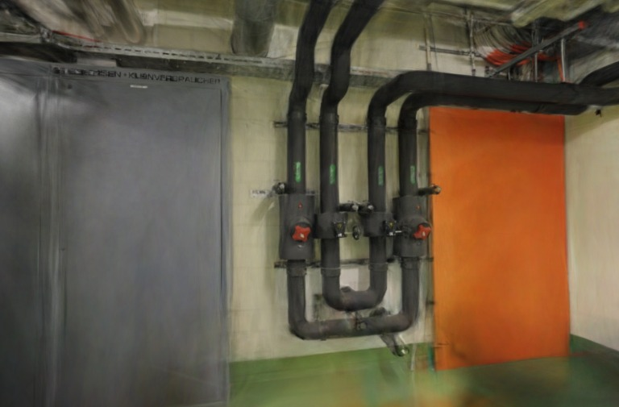

# SPZ 与 AP16 并行读取

2026-10-30。基线为 `6b2f875` 的串行配对加载器，新实现只调整候选文件的请求依赖：SPZ 与 AP16 同时读取和校验，二者都通过后才创建模型。默认页面仍加载原始 PLY。

## 结果与条件

Apple M5、Chrome 156、WebGL2 经 ANGLE Metal、Spark 2.4.0。pipes / office 为 300,000 / 231,428 个高斯，完整 SH3、关闭 LoD、长边 768；照片、相机、训练/留出划分与候选文件均未改变。[原始样本](benchmarks/parallel-pair-2026-10-30.json)保留阶段区间、请求时刻、HTTP 记录、像素及参考图摘要。

每场景、每缓存状态按串行／并行／并行／串行重复两组，共 32 个依次执行的样本；所有样本使用热渲染器和热 WASM，每次重新创建模型。这里的“并行”仅指一项加载内的两份文件，样本之间不并跑。

服务器对**每个请求独立**限制 5MiB/s、64KiB 分块，并在每请求开始等待 40ms；等待不是 RTT，两份文件同时传输时允许各用一份带宽预算。因此以下结果只验证消除串行请求等待，不能外推为共享瓶颈链路、真实 CDN 或整页冷启动的提速。

所有时间为四个样本的中位数，单位 ms。总等待结束于排序稳定后的绘制提交，不是 GPU 完成或屏幕呈现；各列独立取中位数，不能直接相加。

| 场景／HTTP 缓存 | 旧串行加载 | 新并行加载 | 旧排序稳定等待 | 新排序稳定等待 | 旧总等待 | 新总等待 |
| --- | ---: | ---: | ---: | ---: | ---: | ---: |
| pipes／新 URL 未命中 | 2782.35 | 2627.60 | 75.10 | 71.75 | 2857.15 | 2699.00 |
| office／新 URL 未命中 | 2026.50 | 1897.90 | 63.00 | 67.50 | 2090.05 | 1964.40 |
| pipes／已预热 URL 命中 | 160.45 | 159.50 | 55.75 | 54.55 | 215.35 | 215.30 |
| office／已预热 URL 命中 | 127.15 | 126.90 | 48.80 | 46.50 | 175.95 | 173.40 |

未命中时总等待减少 158.15 / 125.65ms（5.5% / 6.0%），加载阶段减少 154.75 / 128.60ms。两请求启动间隔由约 2453.65 / 1758.35ms 降至 0.10 / 0.10ms。命中时加载仅差 0.95 / 0.25ms，不记作稳定性能收益。

SPZ 初始化中位数在未命中组为 179.15→172.90 / 144.25→138.10ms，命中组为 147.20→147.10 / 116.20→117.15ms；解析器并未改动，不据此宣称解码加速。没有测量 GPU 时间、FPS、训练耗时、内存峰值或原生 Metal/CUDA。

未命中每次服务器提供 13,071,355 / 9,335,099B 压缩正文，两个响应均正常完成；预热命中样本没有到达服务器的新模型请求。服务端供给量不是网卡实际流量。

## 画质与失败路径

- 52 次候选 RGBA 摘要全部匹配既有 SH8 + AP16 控制，含全部六个留出视角和每场景首视角的 ±0.08rad 偏航。新旧调度没有增加画质损失；候选本身仍包含既有量化误差，不能称为原始 PLY 无损。
- 六张参考图各读回一次，固定评分输入并记录摘要。新旧调度的每张 PSNR、SSIM、MAE 完全一致：pipes 平均 16.268331dB / 0.731814，office 平均 18.962445dB / 0.839371。固定输入仅用于本实验，未修改生产评分协议，也不跨批次推导微小画质变化。
- 两次真实 Fetch 取消均结束两项请求且未请求 PLY、未创建候选。取消时 SPZ 仍在服务器 40ms 等待阶段（供给 0B），AP16 已供给 1024B；这是同时存在请求的取消检查，不是两份正文均已开始传输的测量。
- 两次 AP16 404 均终止未完成 SPZ，并各完成一次 PLY 回退；两份回退画面匹配原始 PLY。不存在的摘要 URL 在服务器生成记录前返回 404，日志保留其余 SPZ 与 PLY 请求；错误原因保留在结果中。
- 共 38 个模型各释放一次，未发现未处理异常。单元测试另覆盖错误 SPZ 取消侧文件正文、忽略取消后迟到响应、父取消不回退和发布前完整校验；没有将对象释放计数当作 GPU 内存测量。

| 场景 | 旧串行调度 | 新并行调度 |
| --- | --- | --- |
| pipes |  |  |
| office |  |  |

## 实现边界

`PairedModelLoader` 将一次候选尝试的子取消信号与加载生命周期信号组合。任一文件失败会取消同组请求；独立父信号仍允许 PLY 回退，用户取消则直接终止。AP16 先按清单中预期的 SPZ 摘要检查绑定，SPZ 实际内容摘要和 AP16 完整内容摘要仍须通过，不能仅凭头部匹配就发布。

阶段新增相对起止时刻。并行阶段用区间并集核算已记录墙钟时间，避免把重叠读取重复加总；旧的串行控制仍采用原计时。忽略取消的驱动迟到返回时关闭正文，不能再修改已结束加载的阶段列表；未结束的迟到阶段也不在该报告中虚构完成耗时。

当前仅在 `tests/helpers/paired-model.ts` 候选路径采用；`paced-model` 夹具同步修正重叠计时，历史报告不改写。122 项回归、严格类型检查和生产构建通过，生产 JS/CSS 内容哈希未变，无需重新发布 Pages。

## 复现

先按 [SH8](SPZ-SH8.md)、[AP16](SPZ-ALPHA16.md) 生成独立候选文件，启动前停止其他训练、渲染或测量任务。服务器会核对原始资源摘要。以下命令均从仓库目录执行：

```sh
test "$(git rev-parse --show-toplevel)" = "/Users/hongguo/Documents/ChatGPT/3dgs实际项目/3dgs-mesh-compare"
python3 - <<'PY'
import pathlib, subprocess
baseline = subprocess.check_output(
    ["git", "show", "6b2f87522f63e73f7656ab5156bf91b4e71a5c14:tests/helpers/paired-model.ts"],
    text=True)
baseline = baseline.replace('"./alpha16"', '"../../tests/helpers/alpha16"')
baseline = baseline.replace('"./alpha16-stream"', '"../../tests/helpers/alpha16-stream"')
path = pathlib.Path(".qa/parallel-pair/serial-loader.ts")
path.parent.mkdir(parents=True, exist_ok=True)
path.write_text(baseline)
PY
npx vite --config tests/browser/vite-http-model.config.ts
```

打开 `http://127.0.0.1:5180/tests/browser/parallel-pair.html`，点击运行。实验以 DOM 中的 Complete 状态和原始 JSON 为验收依据，需保持文档可见且不在采样期间运行其他性能任务。冷键是新 URL 缓存键，不表示进程或磁盘缓存完全清空。

## 参考与下一步

- [Spark v2.4.0](https://github.com/sparkjsdev/spark/releases/tag/v2.4.0)（2026-10-20 发布）及固定版本 [PagedSplatsFetcher](https://github.com/sparkjsdev/spark/blob/ffe210dc0a45d0515a06c9235878108112827d61/src/PagedSplatsFetcher.ts)：MIT，读取接口传递取消信号；不等于本项目已实现分页或可取消解析。
- [ProGS 原文](https://arxiv.org/html/2603.09703v1)（2026-03-10）和作者 2026-08-28 [公开代码](https://github.com/ZhiyeTang/ProGS-Official/tree/f0e7b5d977fe38bde47eeb45a985c7b15940d0d9)：前缀解码有头部和父级依赖，不能把所有分块任意并行；[清单实现](https://github.com/ZhiyeTang/ProGS-Official/blob/f0e7b5d977fe38bde47eeb45a985c7b15940d0d9/progs/artifact.py)与[解码实现](https://github.com/ZhiyeTang/ProGS-Official/blob/f0e7b5d977fe38bde47eeb45a985c7b15940d0d9/progs/model_codec.py)分别核查文件完整性和模型依赖。只作为后续设计参考，未移植其代码或采用论文跑分。

继续验证共享带宽、真实 CDN 与内存重叠成本；SPZ 解压和属性转换仍为独立待测项。ProGS 需要重训和 CUDA 参考栈、采用非商业研究许可，不能直接替换当前浏览器候选。
