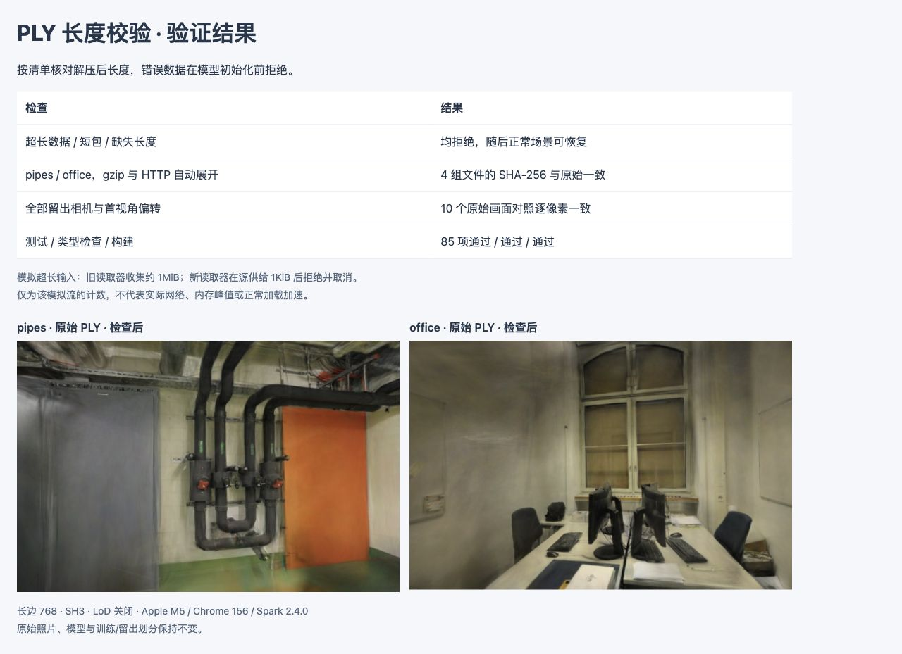

# PLY 解压长度校验

2026-10-28，默认高斯加载现在使用场景清单的 `gaussian.decodedBytes` 校验解压后长度。超长数据在进入结果收集器前拒绝并取消源流，结束时不足预期也拒绝；缺少或非法长度记录不会进入 Spark 初始化。正常模型、SH3、点数和画幅保持不变。

## 问题与修复

基线 `5ceb8c5` 的读取器只检查 `ply\n` 文件头，然后收集直到 EOF。合法文件头后的超长数据会继续占用收集缓冲；短文件也会被返回，留给后续解析处理。场景清单已有准确的解压长度：pipes **70,801,551B**，office **54,618,559B**，此前没有用于读取约束。

[读取器](../src/model-bytes.ts)新增可选的预期解压长度，必须是至少 4 的安全整数；[默认查看器](../src/viewer.ts)始终传入清单值，缺失值按非法配置处理。累计验证发生在解压后、每块入队前。超出剩余额度立即拒绝整块，不截断后继续显示；结束时要求长度完全一致，并仍需通过 gzip 尾部/CRC 检查。错误主动取消原始 reader，最终释放锁。

`Content-Length` 可能表示传输的 gzip 长度，不能替代解压长度。仍通过实际文件魔数区分 gzip 文件和已经被 HTTP 自动展开的 PLY，避免重复解压。为兼容已有独立实验，未传第三参数的读取调用保持原行为；本次不更换候选资源或改动历史耗时夹具。

该约束依赖可信的场景清单，并非通用 PLY 解析或文件真实性证明。它限制进入结果收集器的字节数，不能约束浏览器网络缓存、解压器内部队列、Worker、副本或 GPU 内存峰值。保持原有缓冲收集方式，没有重新采用此前收益不足的[预分配方案](READ-BUFFER.md)。

## 验证结果

[原始浏览器记录](benchmarks/ply-size-2026-10-28.json)来自 Chrome 156 / Apple M5 / ANGLE Metal / WebGL2，Spark 2.4.0。[独立入口](../tests/browser/ply-size.html)对照基线读取器和修复版本。

模拟源以 1KiB 分块异步供给一个以 `ply\n` 开头的 1MiB 负载，设预期解压长度为 64B。这里只验证读取边界，该负载不是可渲染的模型。

| 输入 | 基线供给 / 返回 | 修复后供给 / 结果 |
| --- | --- | --- |
| 原始字节 | 1,048,576B / 1,048,576B | 1,024B / 长度超出，取消 |
| gzip | 1,048,919B / 1,048,576B | 1,024B / 长度超出，取消 |

这些是模拟流向读取器供给的字节，**不是网络节省、峰值内存或速度提升**。到达节奏与运行时会影响预取；1KiB 不是通用上限。Node gzip 回归允许预先供给至 64KiB，检查未到 EOF 即取消，不把浏览器的一次观察硬编码为所有环境的保证。

两场景的原始 gzip 文件和真实 HTTP 自动展开路径共 4 组读取，与已有 PLY 摘要逐字节一致。通过专用 HTTP 元数据分别设置过小长度、比真实长度多 1B 和缺失长度，默认查看器均拒绝加载，不挂载高斯、不留下场景数据或成功加载计时；此处改变的是测试清单，不改模型文件。随后两个正常场景均恢复加载。

固定 768 长边、完整 SH3、LoD 关闭和原训练/留出划分，全部六个留出相机及每场景首相机 ±0.08rad 共 **10 个画面逐像素复现原始 PLY 对照**。留出均值仍为 pipes **16.268912 / 0.730921**、office **18.953445 / 0.839018**（PSNR / SSIM）。未新增自由拖动性能测试或首帧测速。



新增 7 项回归，覆盖正确长度、gzip/HTTP 长度口径、短包/超长包、未结束流的提前取消和非法配置；共 **85 项测试、类型检查和生产构建通过**。浏览器异常及控制台错误均为 0。数据来源、照片、模型和质量指标未改；截图沿用 ETH3D CC BY-NC-SA 4.0。生产加载器变更需发布 Pages，线上核对更新后的 JS 和两场景加载。

## 复现

在目标仓库根目录准备对照读取器；已有原模型链接可复用：

```bash
mkdir -p .qa/ply-size
git show 5ceb8c5:src/model-bytes.ts > .qa/ply-size/model-bytes-baseline.ts
python3 scripts/prepare_spz_experiment.py
node --import tsx --test tests/model-bytes.test.ts
npx vite --config tests/browser/vite-ply-size.config.ts
```

打开 `http://127.0.0.1:5181/tests/browser/ply-size.html`，点击「运行长度检查」。专用服务只绑定本地地址；负面场景仅在此配置下存在，正常网页不会增加实验入口。

下一步继续检查初始化副本、Worker 生命周期与可复现的内存指标。参考 [Spark SplatLoader](https://github.com/sparkjsdev/spark/blob/ffe210dc0a45d0515a06c9235878108112827d61/src/SplatLoader.ts)、[BoundedGS 论文](https://arxiv.org/abs/2610.34233v1)及[作者有界图像预取](https://github.com/XiaoBin2001/BoundedGS/blob/23bca8369a793ab9e29cc2b5d7c5966d4660d850/utils/image_prefetch.py)。论文研究训练中的状态生命周期，本修复没有移植其 CUDA 路径或引用其内存降幅；详见[研究记录](RESEARCH.md)。
