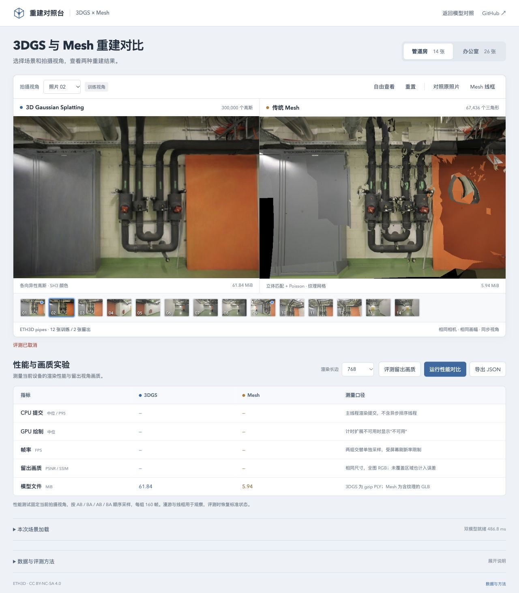

# 画质评测的帧等待与取消恢复

2026-10-29（北京时间）；基线 `d0bfb5b`，Spark 2.4.0、Three.js 0.180.0、Chromium 156 / Apple M5。默认照片、模型、SH3、关闭 LoD、768 长边与评分公式不变。

## 问题与修复

画质评测已在参考照片返回后检查取消，但仍有两处等待没有连接信号：高斯评分与 Mesh 评分之间的动画帧，以及 `finally` 恢复原相机的排序等待。停止提供帧时，取消后控件继续锁住；在评分结束、相机尚未恢复时取消，还会保留本次画质报告。

现在两处等待都使用本次评测信号。取消后恢复原相机参数，清空本次画质报告并恢复操作；后续预览由现有按需渲染机制继续推进。恢复阶段收到取消也会清空结果，提示统一为“评测已取消”。已释放或失效的查看器继续跳过相机恢复。

## 确定性对照

夹具加载真实应用与模型，暂存 `requestAnimationFrame` 回调，在指定等待点点击取消或发送合成可见性事件。取消后观察 80ms，再释放旧版积压回调完成清理。80ms 是检查窗口，不是响应延迟跑分，也不是原生后台限流测试。

| 场景（pipes / office 各一项） | 旧版 | 修复后 |
| --- | --- | --- |
| 首次排序准备中取消 | 进入不可取消的恢复等待 | 无下一帧也能结束 |
| 高斯评分后、Mesh 评分前取消 | 帧等待不结束 | 回调撤销，停止评分 |
| 评分间隔进入后台 | 帧等待不结束 | 结束并恢复相机参数 |
| 恢复相机时点击取消 | 等待不结束，报告残留 | 结束，清空报告 |
| 恢复相机时进入后台 | 等待不结束，报告残留 | 结束，清空报告 |

10 项旧版检查均未结束；其中 4 项在释放帧后仍能导出取消的报告。修复后 10 项均结束，待处理帧为 0，全部恢复原照片视角、解锁控件，报告界面与 JSON 均为空；观察窗口内取消后像素读回及绘制为 0。详情见[基线](benchmarks/quality-frames-baseline-2026-10-29.json)与[修复记录](benchmarks/quality-frames-2026-10-29.json)。夹具在处理器结束后暂停预览，以免把合法预览帧当作残留等待。

## 画面与评分

每个场景完成取消检查后重新执行完整评分。补充输入摘要的对照中，6 个留出视角的参考图、3DGS 和 Mesh 共 18 份 RGBA 摘要逐项一致，PSNR、SSIM、MAE 及平均值完全一致，原相机恢复正常。另有 6 个高斯画面与此前原始 PLY 控制摘要一致。

初测没有保存评分输入摘要，两个场景的首张照片曾出现小幅差异，最大 PSNR 差为 0.00091731dB；当时单独检查的高斯画面摘要一致。随后增加实际评分输入摘要，复测全部一致。生产构建检查也出现首张照片的微小波动；成因尚未确认，原数值及生产报告保留在[评分对照记录](benchmarks/quality-frames-comparison-2026-10-29.json)，不将差异写成画质提升，也不推断已消除浏览器图像读取波动。



既有“参考图解码后永久离页”回归通过：销毁后无像素读取、绘制或相机操作，不重新启用控件。107 项 Node 测试、类型检查和生产构建通过。生产页面两个场景取消后均可重新运行，导出完整的 2 / 4 个留出视角并恢复照片 02；无浏览器错误。

## 边界与复现

- 不中断已经开始的 `Image.decode()`；等待参考照片返回或失败的边界仍与[之前的检查](QUALITY-CANCELLATION.md)一致。
- 不抢占同步 PSNR/SSIM 计算或已提交的 GPU/排序任务；未测 FPS、峰值内存、取消延迟、原生后台或系统睡眠。
- 固定原照片、相机、划分及尺寸。不同浏览器和旧版训练器的评分不直接合并。

```bash
npm ci
npm test
npm run build
npm run dev -- --port 5186 --strictPort
```

打开 `/tests/browser/quality-frames.html` 并点击“运行画质取消检查”。测试入口不进入生产构建。复现旧版时，将 `git show d0bfb5b:src/main.ts` 保存至 `.qa/quality-frames/main-before.ts`，把导入中的 `./` 改为 `/src/`，再使用 `?variant=baseline`；其余依赖相同。

## 参考

[Brush 1388f74](https://github.com/ArthurBrussee/brush/commit/1388f74c6fe0236f68ee4915564bf00e9d2e3747)对像素读回、帧身份及上传资源分别管理，提醒后续不要把停止重绘等同内存回收。[WebSplatter v1 §4](https://arxiv.org/html/2602.03207v1#S4)将运行失败与性能分开记录；其 WebGPU 工作组同步不替代应用层的取消与帧调度。版本、许可和平台条件见[研究索引](RESEARCH.md)。
