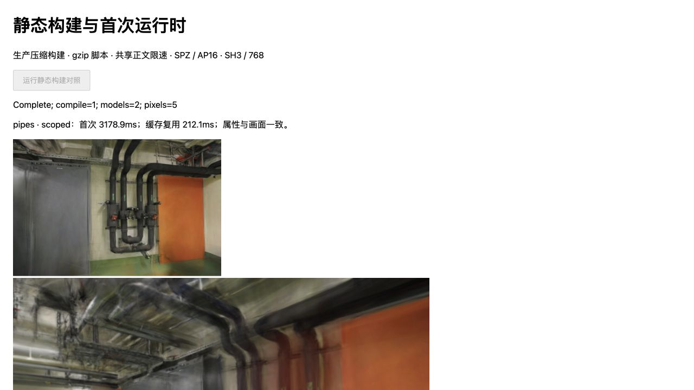
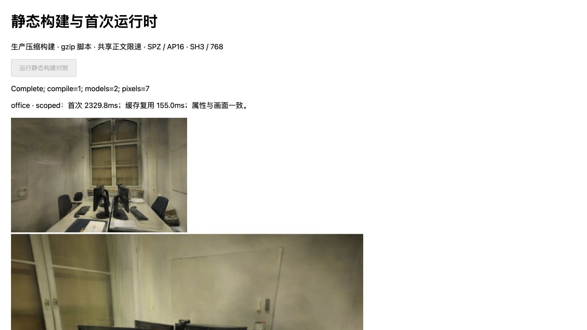

# 静态发布构建与首次加载

日期：2026-11-06。基线 `2cc5134`，Spark 2.4.0 / Three.js 0.180.0，沿用 [SPZ 专用 SH 入口](SH-SCOPED.md)与[首次运行时夹具](SCOPED-STARTUP.md)。实验入口与线上首页分开构建，默认网页仍使用原始 PLY。

## 结果

专用入口在静态压缩构建中仍缩短初始化，但首次总等待没有两场景一致的改善：pipes 增加 2.60ms，office 减少 33.45ms。下载供给波动和排序稳定等待会抵消局部收益，不能据此宣称网页首开稳定提速。缓存复用总等待分别减少 32.95 / 32.50ms（13.67% / 16.95%）；继续保留独立候选，先补进程冷启动、真实网络和峰值内存证据。

Apple M5，Chrome 156，WebGL2 / ANGLE Metal。以下均为每组四份文档的中位数，单位 ms；各阶段中位数不能相加还原总中位数。完整最小值、最大值和每份原始样本见[记录](benchmarks/release-startup-2026-11-06.json)。

| 场景 | 构建 | 首次总等待 | 首次导入 | 首次 SPZ 初始化 | 缓存复用总等待 | 缓存复用 SPZ 初始化 |
| --- | --- | ---: | ---: | ---: | ---: | ---: |
| pipes | rebuilt | 3176.25 | 78.95 | 172.70 | 240.95 | 152.75 |
| pipes | scoped | 3178.85 | 81.90 | 144.25 | 208.00 | 122.45 |
| office | rebuilt | 2370.55 | 80.80 | 150.00 | 191.70 | 116.55 |
| office | scoped | 2337.10 | 81.40 | 122.90 | 159.20 | 91.30 |

首次初始化减少 28.45 / 27.10ms（16.47% / 18.07%）。首次总等待的范围分别为 pipes 3155.20–3228.50 / 3171.60–3204.90ms，office 2330.10–2404.70 / 2329.70–2371.20ms，均有重叠。模型正文供给实测中位约 4.43–4.45MiB/s，低于设定上限；5MiB/s 是供给上限，不是实际链路吞吐。编译 Promise 为约 1.45–2.15ms，可能命中未重置的编译缓存，不能解释为进程冷编译成本。上述差值仅比较本次同条件两构建，不与历史开发服务器耗时推导倍数。

| 运行时组成 | rebuilt 原文 B | scoped 原文 B | rebuilt gzip B | scoped gzip B |
| --- | ---: | ---: | ---: | ---: |
| 独立入口，含嵌入 WASM | 3,045,972 | 3,051,642 | 988,988 | 994,179 |
| 共享 Three.js chunk | 593,192 | 593,192 | 150,822 | 150,822 |
| 两文件合计 | 3,639,164 | 3,644,834 | 1,139,810 | 1,145,001 |

专用入口增加 5,191B gzip（合计约 0.46%），WASM 原文增加 4,237B。逐响应 `encodedBodySize` / `decodedBodySize` 与表中构建文件一致。此处不含 HTTP 头、HTML、实验页脚本、清单和模型，不代表完整页面流量；实际 GitHub Pages 的压缩算法和 CDN 尚未测量。

## 测量方法

两个构建均从同一份 Spark 固定源码及既有匹配的主线程/Worker WASM 产物生成，使用 Vite 6.4.4、esbuild 0.28.2、ES2022、生产压缩、共享 Three.js chunk，不生成 source map。静态服务器预先生成 gzip level 6，JavaScript 返回 `Cache-Control: no-store`，逐文件核对原文及 gzip 摘要和 Resource Timing 中的解压前后字节；浏览器不再访问开发转换或依赖预构建接口。源码、编译产物与输入摘要保存在[原始记录](benchmarks/release-startup-2026-11-06.json)。

每场景按 rebuilt / scoped / scoped / rebuilt 重复两组，共 16 个新文档、32 次串行模型加载，没有丢弃首次或慢样本。首次区间从清单/相机就绪后的运行时动态导入开始，包含 WASM 就绪、查看器构造、SPZ/AP16 并行下载及校验、初始化、恢复不透明度和排序稳定后的绘制提交；首模型属性与画面核验后，第二个区间复用该文档及同一缓存 URL。脚本无正文限速，模型两响应共用 5MiB/s 正文供给上限，各响应服务器等待 40ms，块上限 64KiB。不是 RTT、丢包或 CDN 模拟。

HTML 导航与实验页准备不在首次区间内。浏览器进程、JIT、WASM 编译缓存和着色器缓存没有重置；新文档并不等于进程冷启动。compile Promise 与导入可能重叠，不能重复相加；Worker RPC 为往返墙钟时间，绘制提交不等于 GPU 执行完成或屏幕呈现。模型的缓存命中也仍包含读取、摘要、解码与首帧准备。

## 画质与生命周期

模型字节、点数、SH3、关闭 LoD、标定相机和训练/留出集合均不变；pipes / office 分辨率固定 768×505 / 768×500。逐模型核对六组完整属性缓冲，并将首视角、全部留出视角及首视角 ±0.08rad 偏转的 RGBA 摘要与既有 SH8 + AP16 控制核对。没有重新计算照片评分，不把候选相对原始 PLY 的既有量化差异写成无损或新画质提升；历史 PSNR/SSIM 及各视角限制见 [AP16 画质报告](SPZ-ALPHA16.md#留出画质与漫游)。连续运动性能和自然后台暂停未在本次验证。

16 份文档的 96 次画面、32 组完整属性均一致，32 个模型各释放一次。每份文档主线程只编译所选 WASM 一次，创建一个解析及一个排序 Worker；第二次复用，排序 Worker 在清理时结束，解析池在本页清理后仍存活。没有把模型释放计数当作进程或显存峰值证明。153 项回归、项目类型检查和生产构建通过，三个新增脚本的独立严格类型检查通过；生产主包仍为 `main-maiyedTw.js`。





两图取各场景 scoped 的 doc=6。上方小图保留首个留出视角，下方为后续控制画面；页面显示的是该文档单次耗时，不是表中中位数。模型与照片来自 ETH3D，沿用原数据的 CC BY-NC-SA 4.0 许可及仓库来源说明。

## 复现

先按[既有构建说明](SCOPED-STARTUP.md#复现与下一步)准备 `.qa/scoped-startup/build`、固定 WASM 和模型产物；构建脚本校验输入摘要并拒绝覆盖已有实验目录。在仓库根目录运行：

```bash
node --import tsx scripts/build_release_startup.ts
node --import tsx scripts/serve_release_startup.ts
```

打开 `http://127.0.0.1:5194/tests/browser/release-startup.html?scene=pipes&variant=rebuilt&doc=0`，点击「运行静态构建对照」。按上述顺序切换 doc=0…7；office 同序。每份文档显示 Complete 后才开启下一份，避免 GPU 竞争。结果自动写到 `.qa/release-startup/samples/`，重复编号拒绝覆盖；保持文档可见。服务器只绑定 loopback，并仅提供固定清单内文件。

```bash
node --import tsx scripts/report_release_startup.ts
npm test
npm run build
```

预检构建在收集样本前修复 HTTP 夹具遗漏的旧版 AP16 字段，正式样本没有复用该构建。采样后补齐构建脚本数组的类型声明：保留原始样本清单，核对类型擦除后的脚本以及重建的 JavaScript/gzip 均逐字节一致，没有替换或重跑计时样本。若清单中的构建脚本摘要不同，报告脚本会额外核对 `.qa/release-startup/measured-builder.ts` 的原文摘要及类型擦除结果；通常从当前源码重新采样无需该存档。

参考 [Spark 运行时初始化](https://github.com/sparkjsdev/spark/blob/ffe210dc0a45d0515a06c9235878108112827d61/src/wasm.ts)、[MoQSplat 论文](https://arxiv.org/abs/2609.18624)与[作者缓存实现](https://github.com/emanuele-artioli/MoQSplat/blob/15e02a669456d767abf5d68f9fb1f909f260dde0/src/moq3dgs/render/cache.py)。基础层可见、完整质量完成和缓存复用采用不同口径；当前没有采用其协议、剪枝或 CUDA 渲染路径，版本、许可与新上游旋转布局的限制见[研究索引](RESEARCH.md)。
