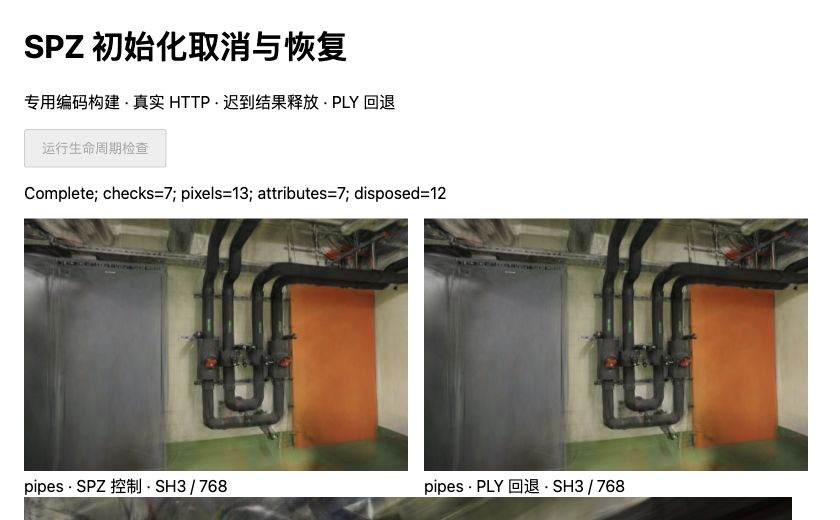
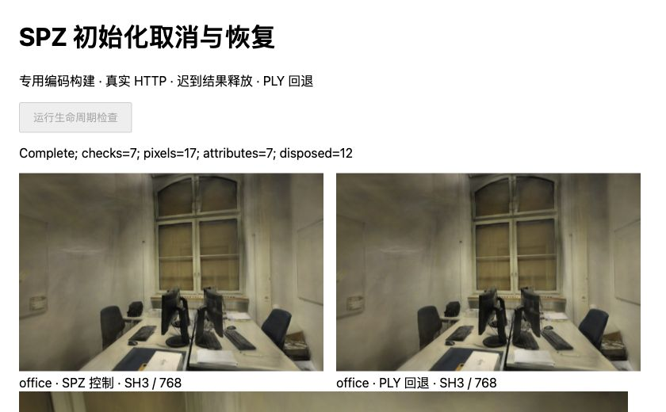

# SPZ 候选：初始化取消及时返回

2026-11-01，基线 `777a1a3`。独立配对加载器在等待 Spark 初始化时，取消仍需等解码 Promise 结束。现在取消立即结束调用方等待；尚在初始化的模型继续由收尾逻辑持有，成功或失败后各释放一次，不发布迟到结果，也不因取消触发 PLY 回退。

本次在已验证的 [SPZ 专用编码构建](SH-SCOPED.md)上修复加载生命周期。默认网页和模型未改；不是新的解码或渲染速度优化。完整记录见 [JSON](benchmarks/scoped-cancel-2026-11-01.json)。

## 复现与修复

新增四项单元回归，交叉覆盖 SPZ / PLY 与迟到成功 / 失败。旧逻辑全部失败：取消后到下一次事件循环，调用方仍 pending；新逻辑全部通过。既有一项测试原来把“取消 Promise 结束”当作“解码清理完成”，现改为分别等待，避免错误的同步释放假设。

[配对加载器](../tests/helpers/paired-model.ts)为初始化增加取消监听。取消先拒绝外层等待，底层 Promise 的两条结果分支仍被接住；完成后才释放废弃模型。正常成功、失败和取消均移除监听，只有正常初始化成功的模型能继续校验、恢复 AP16 并发布。未尝试强行终止共享 Worker。

## 真实浏览器验证

Apple M5、Chromium 156、ANGLE Metal / WebGL2、Spark 2.4.0、Three.js 0.180.0。旧/新加载器使用相同专用 Worker/WASM，文件和模块均核对摘要。保持 300,000 / 231,428 点、SH3、关闭 LoD、DPR=1、768×505 / 768×500，照片、相机和 12/2、22/4 训练/留出划分不变。

每种加载器分别在两个新文档中运行 pipes / office。真实文件完成网络读取与摘要验证后，夹具调用真实 Spark 初始化，但用闸门延后结果交付；迟到失败是解码成功后注入的异常，不是破坏模型或触发 WASM trap。取消后等待 30ms 检查调用方是否返回，再保持闸门关闭进行重试，最后释放闸门检查清理。

| 检查 | 旧版 | 修复后 |
| --- | --- | --- |
| 两场景 × 两格式 × 迟到成功/失败 | 8/8 在闸门释放前仍 pending | 8/8 在闸门释放前返回 AbortError |
| 初始化未结束时提前释放 | 0 | 0 |
| 迟到模型发布 | 0 | 0 |
| 迟到模型最终释放 | 各一次 | 各一次 |
| 重试画面和报告被迟到结果改写 | 0 | 0 |
| HTTP 首次读取、同 URL 缓存命中 | 两场景通过 | 两场景通过 |
| 双正文已开始后取消 | 两场景关闭请求、未创建模型 | 两场景关闭请求、未创建模型 |
| AP16 返回 404 | 两场景各一次 PLY 回退 | 两场景各一次 PLY 回退 |

修复后记录的取消返回为 **0–0.10ms**，受浏览器计时精度限制，不代表零开销。旧版为 pipes 164.40–172.60ms、office 129.20–140.80ms；这些时间包含人为闸门、30ms 观察和重试等待，**不能计算解码提速倍数，也不代表自然网络下的取消耗时分布**。本次关键验收是返回先于闸门释放。

HTTP 使用本地固定内容摘要 URL：首次两份正文完整返回，同键重复没有新增服务器请求；双文件取消在 SPZ 和 AP16 均已发送前缀后触发，两条连接均关闭且未完成。错误 AP16 只触发一次原 PLY 请求。没有测真实 CDN、进程冷启动或端到端网络提速。

## 画面与资源

四份文档合计 **60 次像素摘要、28 组完整属性缓冲全部一致**，**48 个模型各释放一次**。覆盖全部六个留出相机、每场景首相机 ±0.08rad、取消后重试和 PLY 回退。SPZ 对齐既有 SH8 + AP16，PLY 对齐原模型，未将两种格式误作相同画质。



管道房：左侧为 SPZ 控制，右侧为 PLY 回退；取消后重试也保持对应历史像素。



办公室：全部留出视角、两次偏转及重试控制通过。照片衍生画面沿用 ETH3D CC BY-NC-SA 4.0。

没有重算 PSNR/SSIM：渲染像素未改变，SPZ 仍保留 [SH8 + AP16 量化差异](SPZ-ALPHA16.md#留出画质与漫游)。离散偏转不代表完整连续漫游验证。

预检曾因固定“两 Worker”断言失败：并发重试时实际存在一个排序 Worker 和两个解析 Worker。保留该失败记录后修正夹具，要求每个 Worker 都收到同一固定 WASM。四份正式文档均观测到三个 Worker；排序 Worker 在查看器销毁时终止，解析池由文档持有，实验后关闭标签页。释放次数不能证明 JS/驱动内存立即回收，峰值内存仍未测量。

143 项测试、严格类型检查与生产构建通过。生产 JS/CSS 产物保持原摘要。若底层初始化永不结束，其模型仍待收尾；本次没有加入任意超时或强制销毁，不能宣称已解决解码器卡死、WASM trap 或内存泄漏。

## 复现

按 [SH-SCOPED](SH-SCOPED.md#复现与下一步)准备固定构建与模型。在项目根目录从 `777a1a3:tests/helpers/paired-model.ts` 导出旧加载器到 `.qa/scoped-cancel/baseline-loader.ts`，只将两个同目录 alpha 辅助模块的导入改为 `../../tests/helpers/...`。报告脚本会验证这一变换，防止基线被无意修改。

```sh
npm run dev -- --config tests/browser/vite-http-model.config.ts --port 5193 --strictPort
```

逐份打开 `/tests/browser/scoped-cancel.html?scene=pipes&variant=baseline`，点击“运行生命周期检查”；分别替换 scene 为 pipes / office、variant 为 baseline / fixed。每份完成后保存页面 `#result` 到 `.qa/scoped-cancel/{scene}-{variant}.json`，关闭标签页后开始下一份。执行：

```sh
node --import tsx scripts/report_scoped_cancel.ts
npm test
npm run build
```

下一步优先测量专用构建的冷启动、真实 HTTP 端到端耗时和重叠解码峰值内存；不因取消更快返回而扩大并发，也不重复已有编码等价性矩阵。

## 参考

- [Spark #480](https://github.com/sparkjsdev/spark/pull/480)及[实际补丁](https://github.com/sparkjsdev/spark/commit/ea822f9841a9d286b2dfb86cb06f27ed104205f6)：2026-10-12 合入，处理 WASM trap 后池内 Worker 替换；与调用方取消是不同边界。
- [Gaussian Splat Lite 资源释放补丁](https://github.com/WilliamLiu-1997/Gaussian-Splat-Lite/commit/808dbfb3fc2bd8faa9df1ad9208df2933cd9c564)：2026-10-31 的 CPU 纹理数据及空闲绑定清理，提示后续需单独测内存持有，不能用 dispose 次数替代内存证据。
- [PRoGS 原文](https://arxiv.org/html/2409.01761v1)：区分部分模型先显示与完整结果。当前仍等待完整配对模型，取消响应不等于渐进首帧；实现与许可边界见[研究索引](RESEARCH.md#加载生命周期与渐进首帧的边界)。
