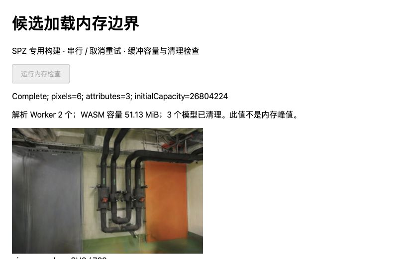
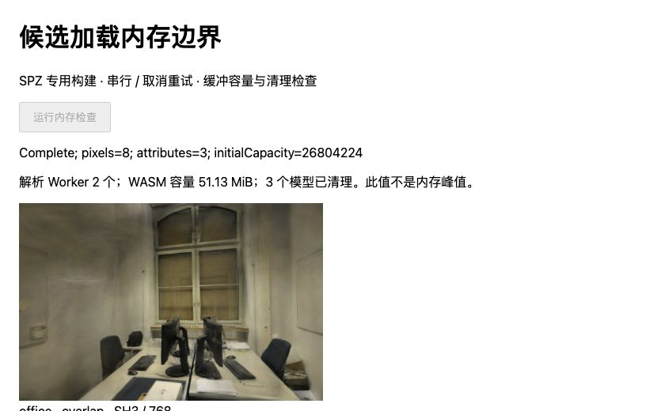

# 候选加载的缓冲与 Worker 容量

日期：2026-11-01。基线 `da5ddf2`，Spark 2.4.0、Three.js 0.180.0，沿用 [SPZ 专用构建](SH-SCOPED.md)及其固定 WASM。原始记录见 [JSON](benchmarks/scoped-memory-2026-11-01.json)。

## 结论

模型释放后，所检查的属性数组、SH 数组和已创建纹理的数据引用均被清空；需要继续控制的是解析任务重叠带来的 Worker 池容量。取消返回并不终止已开始的解码，重试可占用第二个解析 Worker。两个 Worker 在模型与查看器释放后仍存活，空闲一秒时容量不变。

| 场景 | 加载方式 | 解析 Worker 数 | 空闲时解析 WASM 容量合计 | 单个初始化模型的六个属性缓冲 |
| --- | --- | ---: | ---: | ---: |
| pipes | 三次串行 | 1 | 25.5625 MiB | 27.5625 MiB |
| pipes | 取消后重试，受控重叠 | 2 | 51.1250 MiB | 27.5625 MiB |
| office | 三次串行 | 1 | 25.5625 MiB | 21.3750 MiB |
| office | 取消后重试，受控重叠 | 2 | 51.1250 MiB | 21.3750 MiB |

这里是 `WebAssembly.Memory.buffer.byteLength` 容量和指定对象持有的 ArrayBuffer 容量，**不是堆内存有效分配量、进程 RSS、显存或总峰值**。两列不能相加作为峰值。没有据此声称泄漏、节省幅度或渲染提速。相同 WASM 容量也不意味着两个场景的有效分配量相同。

## 对照方法

- 四个新文档按 pipes 串行、pipes 重叠、office 重叠、office 串行顺序运行。每个文档三次真实 SPZ 解码；先获取同一对 SPZ/AP16，后续复用完全相同的缓存 URL。每个文档只记录到两次模型 HTTP 请求。
- 串行控制完成三次加载与替换。重叠控制在第二次真实解码完成、结果尚未转移到主线程时设置交付闸门，取消调用方并完成第三次加载，随后释放第二次结果。等待闸门的任务仍占用一个解析 Worker；这模拟可复现的结果重叠，不代表自然网络或解码延迟。
- 独立 Worker 探针记录解码前后 WASM 容量，以及输出对象中的去重 ArrayBuffer 数量/容量；专用 WASM 未修改。主动快照分别在首次加载、重试重叠、释放前、释放后、空闲一秒采集。排序 Worker 单独列出，查看器释放时已终止；解析池没有被强行终止。
- 主线程分别检查两组 ExtSplats 数组和四组 SH 数组。按 backing store 去重，区分视图长度和实际缓冲容量；释放后再次检查旧 ExtSplats 对象及其原纹理对象。未遍历整个堆，也未强制垃圾回收。

重叠阶段，迟到 Worker 保留的输出缓冲为 pipes 28,901,376B / office 22,413,312B；其输入 SPZ 长度为 12,545,116B / 8,927,279B。以上是指定边界上的对象计数，不包括全部 JS 临时对象、HTTP 缓冲、驱动分配或 GC 尚未回收的对象。原始报告分别记录这些范围，没有拼成一个“测得峰值”。

## 正确性与限制

12 个模型各释放一次，取消的两个模型从未发布；释放后模型数组容量为零、旧 ExtSplats 数组为空、extra 字段为空，所有实际创建的纹理均清空 `source.data`。10 个已显示模型各检查六个纹理，两个未发布模型各检查两个主纹理；后者未创建 SH 纹理。

28 次 RGBA 摘要和 12 组完整属性摘要与既有候选控制一致，覆盖六张留出照片及首个留出视角的 ±0.08 rad 偏转。所有 GPU 绘制串行；点数、SH3、768 长边、相机、照片和划分均不变。没有重新计算 PSNR/SSIM或连续漫游评分；原候选相对 PLY 的量化损失仍沿用 [SH8 + AP16 报告](SPZ-ALPHA16.md)，不能称为原模型无损。

首次预检错误地假设未发布的迟到模型也已创建所有 SH 纹理，导致探针读取空值并超时。已改为仅检查实际拥有的纹理，四个正式文档重新运行通过；这不是生产释放缺陷。预检记录保留在本地 `.qa/scoped-memory/preflight-*.json`。

浏览器报告 Chrome 156、ANGLE Metal Renderer: Apple M5，完整环境字符串保存在 JSON。当前文档没有跨源隔离，也没有可调用的 `measureUserAgentSpecificMemory`。本实验不推导整机峰值或实际显存释放，不测冷启动、HTTP 端到端、GPU 时间或耗时改善。145 项单元测试、strict TypeScript 和生产构建通过；既有主包尺寸提示仍在。默认网页、依赖和模型没有修改，因此没有重复部署。



管道房：候选控制画面与原摘要一致；页面显示两个解析 Worker 的合计容量及清理结果。



办公室：同样保留两个解析 Worker，模型属性缓冲较小；不能据图中文字推导整机占用。

## 后续决策与参考

[Spark 的池实现](https://github.com/sparkjsdev/spark/blob/ffe210dc0a45d0515a06c9235878108112827d61/src/SplatWorker.ts)默认最多四个解析 Worker，并把空闲 Worker 放回 freelist；本实验只验证一到两个，没有测试池饱和或自然高频取消。下一步先在独立候选加载器中对照“初始化排队”与当前重叠方式，同时测重试等待、取消响应、迟到清理和容量，再决定是否限制并发。不要直接销毁共享池或增设常驻预热。

[Gaussian Splat Lite 808dbfb](https://github.com/WilliamLiu-1997/Gaussian-Splat-Lite/commit/808dbfb3fc2bd8faa9df1ad9208df2933cd9c564)的纹理数据清空补丁提供了检查方向；[Spark ExtSplats](https://github.com/sparkjsdev/spark/blob/ffe210dc0a45d0515a06c9235878108112827d61/src/ExtSplats.ts)已具备这类清理，实测无需重复移植。

[NVGS 论文](https://arxiv.org/abs/2511.19202v2)和[作者 CUDA 查看器](https://github.com/UHasselt-DigitalFutureLab/NVGSViewer/tree/0038a9ec8fc1b2ac4c16f90f4123c073336ff274)通过共享资产、先剔除再实例化减少渲染阶段 VRAM，与这里的加载池容量问题不同。其后端和评分边界见[研究记录](RESEARCH.md#加载池容量与渲染显存分开处理)，未套用论文跑分。

## 复现

先按 [SH-SCOPED](SH-SCOPED.md)准备固定构建，以及 [SPZ-ALPHA16](SPZ-ALPHA16.md)中的同摘要文件。本地派生产物不提交，不覆盖原始照片或模型。

```bash
node --import tsx scripts/prepare_scoped_memory.ts
npx vite --config tests/browser/vite-http-model.config.ts --port 5193
```

每组使用新文档打开 `/tests/browser/scoped-memory.html?scene=pipes&mode=serial`，将 scene 替换为 pipes/office、mode 替换为 serial/overlap。点击「运行内存检查」，等待 Complete，把页面 `#result` JSON 分别保存为 `.qa/scoped-memory/{scene}-{mode}.json`，然后关闭文档。

```bash
node --import tsx scripts/report_scoped_memory.ts
```

准备脚本检查固定 Worker 摘要且拒绝覆盖已有派生文件。报告核对构建摘要、模型释放、容量、像素/属性数量与 HTTP 请求数，并保存探针和加载器源码摘要；探针不进入生产打包。
