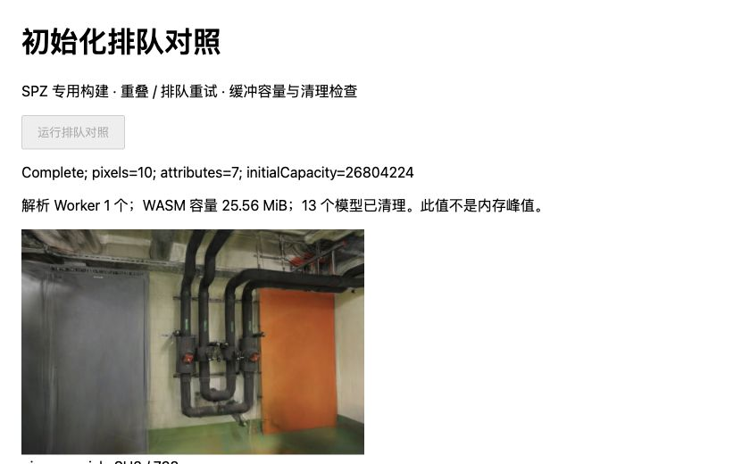
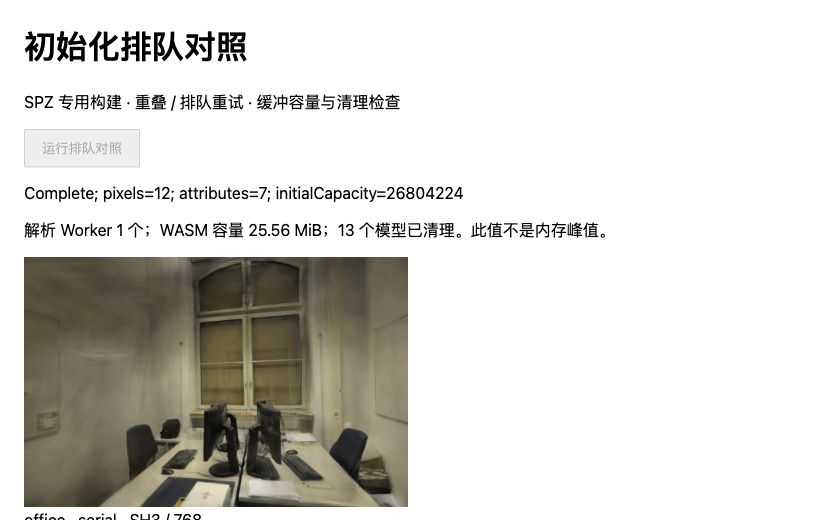

# 初始化排队的容量与重试代价

日期：2026-11-01。基线 `65112b7`，Spark 2.4.0、Three.js 0.180.0，继续使用 [SPZ 专用构建](SH-SCOPED.md)和[容量探针](SCOPED-MEMORY.md)。[完整样本与源码摘要](benchmarks/scoped-queue-2026-11-01.json)。

## 结果与决定

每加载器增加可选的串行初始化入口：先完成下载与校验，再等待槽位，获准后才创建模型。取消等待中的请求不会创建模型；已开始的解码仍占槽位，直到实际成功或失败后才放行下一个请求。不会把“调用方取消返回”误当作“解码已经结束”。

两场景都避免了第二个解析 Worker，但重试更慢。**暂不默认启用**，只保留独立候选的实验选项；默认查看器、原始 PLY、模型、依赖和生产打包入口不变。

| 场景 | 策略 | 最终解析 Worker 数 | 释放后空闲一秒的 WASM 容量 | 自然重试排队中位数 | 加载完成中位数 | 稳定绘制提交前总等待中位数（最小—最大） |
| --- | --- | ---: | ---: | ---: | ---: | ---: |
| pipes | 原重叠方式 | 2 | 51.1250 MiB | 0 ms | 136.00 ms | 195.95 ms（184.00—207.70） |
| pipes | 串行入口 | 1 | 25.5625 MiB | 107.10 ms | 238.05 ms | 296.00 ms（285.20—308.90） |
| office | 原重叠方式 | 2 | 51.1250 MiB | 0 ms | 101.25 ms | 154.00 ms（148.60—154.60） |
| office | 串行入口 | 1 | 25.5625 MiB | 79.75 ms | 178.80 ms | 229.35 ms（221.50—246.80） |

每行八个正式样本，另保留两个预热样本。总等待中位数分别增加 100.05 / 75.35ms，加载完成增加 102.05 / 77.55ms；各阶段中位数不能直接相加。容量仅是解析 Worker 的线性内存容量，不是有效分配量、进程 RSS、堆/显存峰值或物理内存节省量。两个策略在首次加载时都只有一个解析 Worker；本表容量是在自然重试与独立受控检查都完成后读取。

取消响应在全部正式样本中约为 0–0.1ms，浏览器计时粒度下的 0 不能解释成零成本。该指标从取消调用开始计到加载 Promise 拒绝，与底层解码完成、GPU 时间无关。

## 方法与范围

按每个场景 overlap、serial、serial、overlap 顺序运行八个新文档。浏览器报告 Chrome 156、ANGLE Metal Renderer: Apple M5；环境原文保存在 JSON。每个文档先初始化并显示一个模型，再执行一次预热和四次正式取消重试：

1. 在真实 `loadExtSplats` RPC 已提交后立即取消，等待调用方返回 AbortError；不人为延迟解码结果。
2. 用同一对带摘要版本的 HTTP URL 重试。缓存字节仍重新读取并校验；这些阶段在初始化入口外，SPZ/AP16 下载维持并行。
3. 分别记录排队、初始化、恢复不透明度/发布、排序稳定及绘制提交。总等待不包含随后进行的画面摘要和截图；不是屏幕呈现时间。
4. 等旧模型迟到并释放，核对从未发布，再采集新模型的属性和首个留出画面。

每个文档仅两次模型服务器请求，其余复用缓存；WASM 模块与探针在样本前准备。结果适用于热运行时、缓存重试，没有测冷启动、真实 CDN、训练、GPU 绘制耗时或连续漫游帧率。所有绘制与文档串行运行。

另设一个 **200ms 结果交付闸门**，在真实解码完成后保持旧任务占槽，并在取消后重试。实际放行延迟为 200.10–204.90ms。串行入口下 pipes / office 重试加载耗时为 347.30–347.40 / 317.60–319.10ms，排队为 191.50–192.10 / 194.00–194.30ms；原方式在闸门打开前可完成新模型。计时起点包含重试读取与校验，因此排队值小于闸门时长。此项只验证重叠与等待机制，**不混入上述自然耗时统计**。

## 正确性

- 88 次 RGBA 摘要与 56 组完整属性摘要均匹配既有 SH8 + AP16 候选控制。覆盖六张留出照片、首个留出视角 ±0.08 rad 偏转及每次自然重试后的首个画面。
- pipes / office 保持 300,000 / 231,428 个高斯、SH3、关闭 LoD、768×505 / 768×500 分辨率。照片、相机和划分未变。此处相同的是候选控制，不是原始 PLY 无损；已有 PSNR/SSIM 与量化代价见 [SPZ-ALPHA16](SPZ-ALPHA16.md)，没有重新计算指标或宣称连续漫游质量改善。
- 104 个模型各释放一次，48 个取消模型均未发布；模型和旧 ExtSplats 的指定属性缓冲归零、extra 清空、432 个实际创建的纹理数据引用清空。排序 Worker 全部终止，解析池按原设计保留。
- 新增八项测试，覆盖等待取消、重复释放、已取消请求、SPZ/PLY 迟到成功/失败、创建失败与 PLY 回退、加载器释放。旧加载器在六项入口控制中五项失败，改后通过；基线与修复日志保存在本地 `.qa/scoped-queue/`。
- 153 项测试、strict TypeScript 和生产构建通过。主包仍为 `main-maiyedTw.js`；既有体积提示保留。生产资源未改，没有重复部署。



管道房：单个解析 Worker 保留，13 个模型完成清理；同视角画面匹配既有候选摘要。



办公室：容量边界相同，重试等待小于管道房，但仍显著高于原重叠方式。

## 限制与下一步

入口只限制同一个 PairedModelLoader；不会缩减已经扩张的共享池，也不约束其他加载器。等待期间仍保留已读取的输入字节。如果真实解码永不结束，串行槽位也不会释放；等待者仍可取消，但没有实现强制终止或超时恢复。当前没有为此销毁共享 Worker，也没有增加常驻预热。

降低容量不是免费优化。现阶段保留 overlap 默认值；除非有明确容量预算与可接受的等待目标，不把串行方式接入交互路径。接下来优先补足 SPZ 专用构建的冷运行时与 HTTP 端到端对照，再决定候选是否值得上线，不继续重复同样的热缓存排队矩阵。

参考 [Spark 分页入口限制](https://github.com/sparkjsdev/spark/blob/ffe210dc0a45d0515a06c9235878108112827d61/src/SplatPager.ts)和[解析池生命周期](https://github.com/sparkjsdev/spark/blob/ffe210dc0a45d0515a06c9235878108112827d61/src/SplatWorker.ts)。新读 [BoundedGS 论文](https://arxiv.org/abs/2610.34233)与[作者有界预取实现](https://github.com/XiaoBin2001/BoundedGS/blob/23bca8369a793ab9e29cc2b5d7c5966d4660d850/utils/image_prefetch.py)，关注同时存活任务与等待分开统计；其 CUDA 训练实现、分层许可和后端限制见[研究记录](RESEARCH.md#有界初始化与等待代价)，没有移植代码或套用论文数字。

## 复现

复用 [SCOPED-MEMORY](SCOPED-MEMORY.md#复现)的固定构建、模型文件和容量探针，无需重新构建 Rust。新文档按上述 ABBA 顺序打开：

```text
/tests/browser/scoped-queue.html?scene=pipes&mode=overlap&doc=0
/tests/browser/scoped-queue.html?scene=pipes&mode=serial&doc=1
/tests/browser/scoped-queue.html?scene=pipes&mode=serial&doc=2
/tests/browser/scoped-queue.html?scene=pipes&mode=overlap&doc=3
```

点击「运行排队对照」，等待 Complete，保存页面 `#result` 到 `.qa/scoped-queue/{scene}-{mode}-{doc}.json` 后关闭文档；office 同样执行。每个文档必须处于可见状态，避免后台节流影响计时。

```bash
npx vite --config tests/browser/vite-http-model.config.ts --port 5193
node --import tsx scripts/report_scoped_queue.ts
```

汇总脚本核验固定 Worker/WASM 与资产摘要、所有属性/像素参考、取消模型发布状态、资源清理、样本数和容量，再生成含预热、分文档中位数、自然样本及受控检查的完整报告。原始照片、历史模型和派生文件保持原样。
