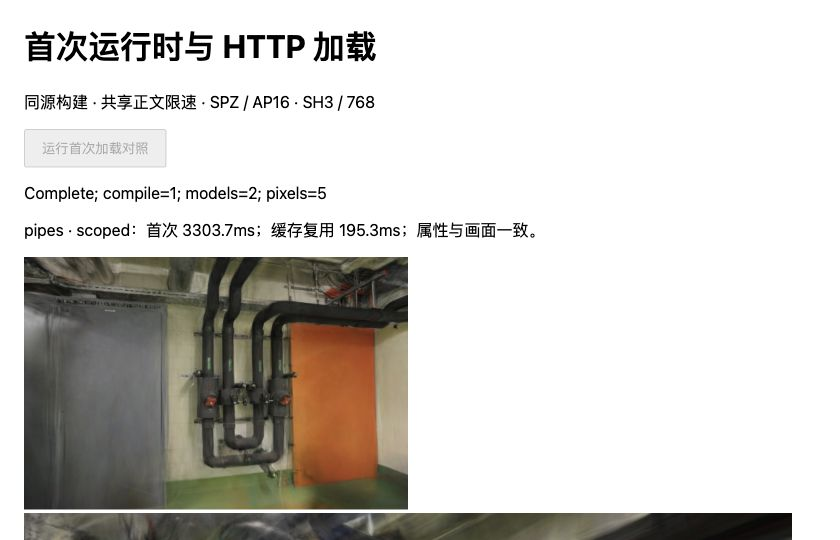
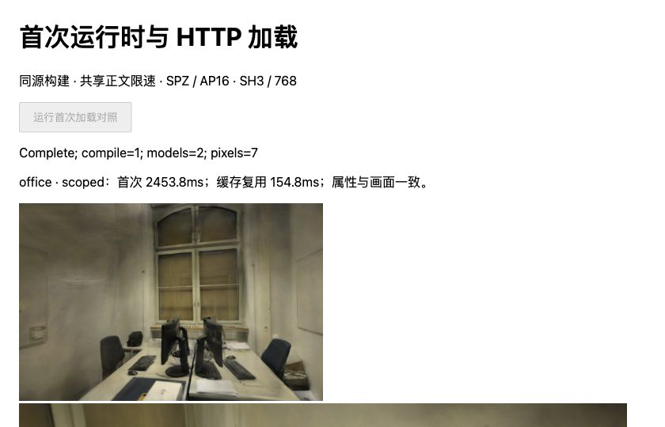

# 首次运行时与 HTTP 配对加载

日期：2026-11-02。基线 `374146f`，Spark 2.4.0 / Three.js 0.180.0，沿用 [SPZ 专用 SH 编码构建](SH-SCOPED.md)。[完整样本、源码和产物摘要](benchmarks/scoped-startup-2026-11-02.json)。

## 结果

专用入口的初始化收益在新文档、实际 HTTP 模型读取下仍然存在。pipes / office 首次初始化中位数减少 **38.90 / 34.20ms**；同页缓存复用减少 **31.15 / 23.65ms**。完整属性及控制画面一致。

首次总等待主要由模型下载决定，不能用初始化降幅代表网站打开速度。此次总等待中位数减少 **77.00 / 37.00ms（2.27% / 1.48%）**；缓存复用减少 **41.15 / 20.55ms（17.41% / 11.72%）**。这是本机开发服务器的四样本中位数差，不是生产、真实 CDN、进程冷启动或统计显著性结论。默认网页仍使用原始 PLY。

| 场景 / 状态 | 构建 | SPZ 读取 | SPZ 初始化 | 排序稳定与绘制提交等待 | 总等待中位数（最小—最大） |
| --- | --- | ---: | ---: | ---: | ---: |
| pipes 首次 | 未修改源码重建 | 2863.05 | 190.20 | 82.75 | 3397.55（3354.00—3401.50） |
| pipes 首次 | SPZ 专用入口 | 2859.75 | 151.30 | 69.00 | 3320.55（3303.70—3342.80） |
| pipes 缓存复用 | 未修改源码重建 | 10.05 | 153.20 | 65.95 | 236.40（228.30—251.70） |
| pipes 缓存复用 | SPZ 专用入口 | 9.75 | 122.05 | 59.95 | 195.25（194.90—216.00） |
| office 首次 | 未修改源码重建 | 2057.70 | 156.75 | 63.40 | 2506.30（2487.20—2527.60） |
| office 首次 | SPZ 专用入口 | 2053.95 | 122.55 | 65.65 | 2469.30（2453.80—2500.30） |
| office 缓存复用 | 未修改源码重建 | 6.15 | 113.65 | 51.10 | 175.35（171.70—188.40） |
| office 缓存复用 | SPZ 专用入口 | 7.10 | 90.00 | 53.60 | 154.80（154.20—154.90） |

单位 ms，每行四个样本。阶段中位数不能相加；总等待另含运行时导入、WASM 就绪、查看器构造、摘要检查及 AP16 处理等。首次与缓存复用具有不同起点，分别比较同状态的两个构建，不跨状态计算优化幅度。

## 计时与构建边界

每个场景按 rebuilt / scoped / scoped / rebuilt 顺序重复两组，共 **16 个新文档、32 个串行加载**。没有把首次样本当作预热丢弃。浏览器为 Chrome 156，WebGL2 / ANGLE Metal Renderer: Apple M5，原始环境字符串保存在 JSON。

首次区间在实验页、清单与相机准备后开始：动态导入所选运行时 → 等待 WASM 就绪 → 构造查看器 → 并行读取 SPZ/AP16 → 校验并初始化 → 恢复不透明度 → 排序稳定后的绘制提交。不预载模型字节，不计之前的 HTML 导航和页面准备，也不计之后的属性摘要、像素读取和截图。第二个区间复用该文档、查看器、WASM 与 Worker，从相同 URL 的模型读取开始；缓存命中仍需读取、校验、解码和准备绘制。

此前替换 Worker 的热运行时夹具还会导入 npm 版本的主线程 WASM，不能直接充当专用构建的首次运行时证据。本次从同一固定上游源码生成两套完整入口，主线程和 Worker 均使用各自匹配的 WASM / 生成绑定，不在已初始化的 npm 运行时里注入第二套模块。

- 源码固定为 `ffe210dc0a45d0515a06c9235878108112827d61`，保留 MIT 许可；复用既有 Rust/WASM 产物，没有重新训练或修改模型。
- 两套 TypeScript / GLSL 源码、esbuild 0.28.2 配置、外部 Three.js 和引导代码相同。磁盘入口分别为 3,227,064 / 3,232,735B，差 5,671B；WASM 为 2,074,046 / 2,078,283B，差 4,237B。
- **Vite 开发服务转换和内联 source map 在导入计时内。** 浏览器实际收到的入口正文为 9,455,623 / 9,472,070B；不能用磁盘入口大小描述网络传输，也不能把这份数据作为压缩生产包大小。运行时脚本没有施加模型限速。
- 初始预检使用通用 HTTP 配置时，新增依赖触发 Vite 重新加载，未产生完整样本。独立配置固定预构建全部四个 Three.js 入口，隔离缓存目录；正式样本使用这一配置，期间没有依赖重载。
- 每文档只观测到一次所选主线程 `WebAssembly.compile` 调用，Worker 接收对应模块。**浏览器进程、JIT、WASM 编译缓存、着色器及脚本 HTTP 缓存没有清空**，因此“新文档/新对象”不等于真正冷编译。

| 场景 / 构建 | 运行时导入 | 导入后 WASM 就绪等待 | 查看器构造 | compile Promise 墙钟耗时 |
| --- | ---: | ---: | ---: | ---: |
| pipes rebuilt | 225.20 | 0.85 | 11.05 | 2.20（1.40—2.80） |
| pipes scoped | 224.60 | 0.40 | 11.70 | 2.55（1.40—3.40） |
| office rebuilt | 208.90 | 0.90 | 11.50 | 2.45（1.40—2.60） |
| office scoped | 209.80 | 0.50 | 10.75 | 1.40（1.30—2.40） |

单位 ms，均为中位数，compile 附范围。compile 区间与模块导入重叠，不能再加到总等待；这些很小的值不能解释为首次编译 CPU 成本。JSON 另保留解码与排序 RPC 的开始/结束时间；往返时间不是纯 CPU 或 GPU 时间。绘制提交终点也不是屏幕实际呈现。

## HTTP、画质与清理

模型请求共用 **5MiB/s 正文供给上限**，各响应等待 40ms，块上限 64KiB；这是 loopback HTTP/1.1 服务器调度，不模拟真实 RTT、丢包或 CDN。实际合并正文供给率（从最早 ready 到最后 write）为 **4.41–4.47MiB/s**，原始逐块时刻保留。JavaScript、相机和清单不受该限速约束。

每个文档使用新的带摘要 URL：首次 SPZ/AP16 各有一次 200 正文传输；复用时 Resource Timing 显示 `cache`、transferSize=0，服务器记录仍只有两次请求。没有把 0B 传输误写成零加载成本。两个构建使用完全相同的压缩模型文件。

**96 次 RGBA 摘要、32 组完整六缓冲属性摘要均匹配既有 SH8 + AP16 控制。** 覆盖六张留出视角、每场景首视角 ±0.08rad 偏转及每次首次加载后的首画面。保持 pipes / office 300,000 / 231,428 个高斯、SH3、关闭 LoD、768×505 / 768×500、相同照片/标定相机/训练与留出集合。未做连续运动帧率或新的照片解码评分。

这是对既有候选的等价验证，不是原始 PLY 无损声明。既有 [PSNR/SSIM 对照](SPZ-ALPHA16.md#留出画质与漫游)中，候选相对原始平均 PSNR 差为 −0.00058 / +0.00900dB、SSIM 差为 +0.00089 / +0.00035；仍有个别视角下降。本次没有改变数量、SH 或 LoD，未重新计算这些历史分数，也未声称画质提升。

32 个模型各释放一次，排序 Worker 在查看器释放后终止；解析 Worker 按池设计保留到文档关闭。此项不证明 RSS、堆、WASM 或显存峰值下降，已有[容量边界](SCOPED-MEMORY.md)仍适用。153 项测试、strict TypeScript 和生产构建通过，主包仍为 `main-maiyedTw.js`；未改变生产入口、依赖或默认资产，无需重新部署 Pages。



管道房专用构建，第 6 号文档。截图中的 3303.7 / 195.3ms 为单个文档的首次/缓存样本，不是表中的四文档中位数。



办公室专用构建，第 6 号文档。窗口、桌椅与显示器轮廓匹配候选控制画面。截图及衍生画面遵循 ETH3D CC BY-NC-SA 4.0。

## 复现与下一步

先按 [固定构建](WASM-INTERNAL.md#复现与预检记录)、[专用入口](SH-SCOPED.md#复现与下一步)和 [AP16 文件](SPZ-ALPHA16.md#复现与下一步)准备既有产物。以下命令在仓库根目录执行；准备脚本拒绝覆盖已有构建：

```bash
node --import tsx scripts/prepare_scoped_startup.ts
npx vite --config tests/browser/vite-scoped-startup.config.ts --port 5193
```

新文档打开 `/tests/browser/scoped-startup.html?scene=pipes&variant=rebuilt&doc=0`。按上述顺序设置 variant 和 doc=0…7；office 同序。点击「运行首次加载对照」，保持文档可见直至 Complete，将 `#result` 保存为 `.qa/scoped-startup/{scene}-{variant}-{doc}.json`，关闭后再开启下一份。后台自动化面板是否显示与文档 `visibilityState` 不等价，报告会拒绝隐藏或发生可见性变化的样本。

```bash
node --import tsx scripts/report_scoped_startup.ts
npm test
npm run build
```

报告脚本核对构建/输入/源码摘要、HTTP 缓存证据、WASM 调用数、模型释放、完整属性和既有像素，再输出 JSON。下一步优先用无开发转换的发布包核对导航/运行时启动及实际传输体积，再补真实网络和峰值内存；不重复相同热运行时矩阵。专用编码可以继续作为候选，但当前证据不足以宣称线上首帧已改善。

参考 [Spark 主线程 WASM 初始化](https://github.com/sparkjsdev/spark/blob/ffe210dc0a45d0515a06c9235878108112827d61/src/wasm.ts)、[Worker 模块传递](https://github.com/sparkjsdev/spark/blob/ffe210dc0a45d0515a06c9235878108112827d61/src/SplatWorker.ts)，以及 [MoQSplat 论文](https://arxiv.org/abs/2609.18624)和[作者缓存实现](https://github.com/emanuele-artioli/MoQSplat/blob/15e02a669456d767abf5d68f9fb1f909f260dde0/src/moq3dgs/render/cache.py)。渐进基础层可见、完整 SH 质量完成、HTTP 缓存与运行时复用应分别计量；后端、版本与许可限制见[研究记录](RESEARCH.md#首次运行时与渐进质量完成)。
