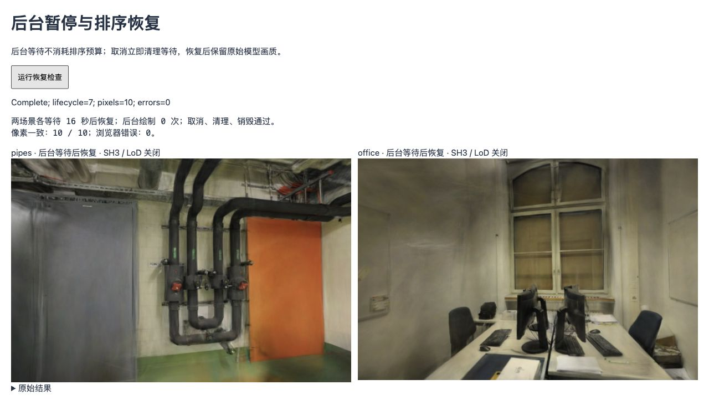

# 后台排序等待与取消

2026-10-28；基线 `96c45c2`，Spark 2.4.0，WebGL2 / Chrome 156 / Apple M5（ANGLE Metal）。本次修复等待生命周期，不测排序算法速度，也不修改默认照片、PLY、SH3、点数、LoD 或相机。

## 问题与修改

旧 `CompareViewer.settle()` 用墙钟计算 15 秒超时，循环只等待 `requestAnimationFrame`。动画帧在后台可能暂停：回来后还没等满四个稳定帧，就会因后台停留而报错。等待期间即使取消场景，也必须等下一帧才检查取消信号。

用旧方法、可控时钟和帧队列先复现两个边界：模拟跨越 20 秒后抛出“高斯排序未就绪”；没有下一帧时，取消后 Promise 仍未结束。这是调度模拟，不是 GPU 性能基线；[原始结果](benchmarks/settle-visibility-baseline-2026-10-28.json)保留基线版本和两项结果。

新等待器只累计文档可见时间，隐藏时撤销自己的动画帧和超时计时器，恢复后重新等待连续四个稳定帧。累计可见时间仍限 15 秒，并有独立计时器，前台没有动画帧也会结束超时。调用方取消、场景清理、查看器销毁或上下文丢失均可中止等待；完成和失败都会移除监听器与待执行回调。不会强行终止 Spark 已提交的 GPU/Worker 作业。

加载分段继续使用墙钟：`settle` 和总耗时仍包含后台停留，`visibility` 标为 `backgrounded`，没有把暂停时间从报告里扣掉。公开界面和错误提示不变。

## 验证

| 检查 | 结果 |
| --- | --- |
| 管道、办公室首次排序前各模拟隐藏 16 秒 | 都成功恢复；隐藏期间查看器绘制各 0 次 |
| 两场景的调用方取消及 clear | 等待立即以 AbortError 结束，不依赖下一帧；clear 后模型与加载记录为空 |
| 隐藏状态下 dispose | 等待结束，无遗留场景 |
| 6 个留出视角、各场景首视角左右偏转 0.08rad | 共 10 个画面哈希与原始 PLY 控制完全一致 |
| 测试 | 9 项新增调度回归；覆盖前台超时、累计预算、取消、异常和回调清理；类型检查及生产构建通过 |

管道 PSNR / SSIM 均值仍为 **16.268912 / 0.730921**，办公室 **18.953445 / 0.839018**。评分长边 768，SH3、LoD 关闭；两场景依次运行。相机偏转用于外观回归，未测移动排序延迟、CPU 提交或 GPU 绘制时间。



[浏览器原始记录](benchmarks/settle-visibility-2026-10-28.json)保存加载墙钟分段、像素哈希、逐视角质量、设备与错误列表。后台条件通过夹具覆盖 `document.hidden` 并派发合成 `visibilitychange`，实际等待 16 秒、使用真实模型和 WebGL2；不等价于原生后台限流、系统睡眠或移动设备恢复测试。这些情况继续待验。

线上旧版曾观察到一次排序超时，重试后管道和办公室都加载成功；当时没有记录可见性过程，不能把该次失败直接归因于这个缺陷。

## 复现

```bash
npm ci
npm test
npm run build
npm run dev -- --port 5182 --strictPort
```

打开 `http://127.0.0.1:5182/tests/browser/settle-visibility.html`，点击“运行恢复检查”。约需两次 16 秒等待和模型读取时间。夹具使用仓库原始照片与模型、已记录的 PLY 像素控制，并展示可复制的 JSON。生产构建不包含测试入口。

## 参考

- [MDN：requestAnimationFrame](https://developer.mozilla.org/en-US/docs/Web/API/Window/requestAnimationFrame)说明后台标签页通常暂停动画帧；因此不能单凭长墙钟间隔判断排序失败。
- [Spark 2.4.0 的 driveSort](https://github.com/sparkjsdev/spark/blob/ffe210dc0a45d0515a06c9235878108112827d61/src/SparkRenderer.ts)依次异步读取深度和调用排序 Worker。此次保持库的排序与画质路径，只修正查看器等待。
- [WebSplatter 论文 v1 §3.3](https://arxiv.org/html/2602.03207v1)、[作者实现](https://github.com/websplatter/WebSplatter/blob/16bb06e86b8fb12193d4bb4cd2b0b3d4f3ab62be/src/gaussian-renderer.ts)讨论 WebGPU 工作组间的排序推进保证。这与网页后台调度是不同问题，未据其结果声称本项目排序变快；版本、许可及候选条件见[研究记录](RESEARCH.md)。
