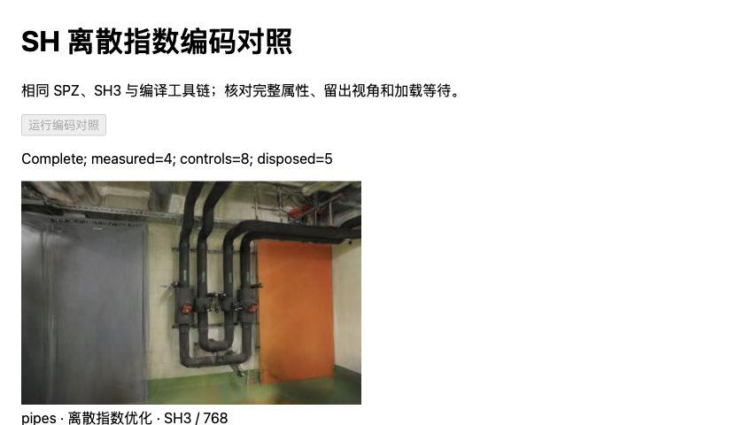
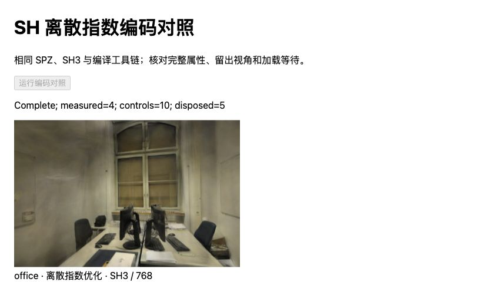

# SH 离散指数编码：保持输出，缩短候选初始化

2026-10-31，基线 `9f8f886`。在固定 Spark 2.4.0 的独立构建中，为 SPZ 常见的离散 SH 最大值增加整数指数路径。pipes / office 初始化中位数减少 **31.85 / 23.75ms（21.40% / 21.02%）**，完整属性和画面保持一致。

这是候选加载构建的改进，尚未接入默认 PLY 页面。原始样本、逐文档结果、源码及二进制摘要见 [JSON](benchmarks/sh-grid-2026-10-31.json)。

后续[通用 PLY 回归检查](SH-SCOPED.md)发现本页通用判断使初始化变慢，已改为 SPZ 专用入口。以下数据保留为历史实验；后续候选以专用构建为准。

## 修改与数值边界

此前[内部分段](WASM-INTERNAL.md)定位 SH 状态机成本较高。此次仅替换 `spark-lib/src/splat_encode.rs` 中 `encode_ext_rgb` 的指数/除数计算，其余数值舍入、符号、位布局、属性写回与着色器保持原样。

SPZ 将 SH 字节展开为 `(byte - 128) / 128`。当三通道最大绝对值精确落在 `[0, 1]` 的 `1/128` 网格时，令 `m = maxAbs × 128`：非零指数为 `ceil(log2(m)) + 8`，用整数前导零计数求得；零保留原指数 0。除数的二次幂直接由 f32 指数字段构造，再除以 255。最大值不在该网格时，保留原 log2/exp2 路径。其他通道可不是网格值；它们仍按原除数和舍入计算。

没有将除法改成乘倒数，没有降低 SH 阶数、点数、精度或分辨率。保留 [Spark #465](https://github.com/sparkjsdev/spark/pull/465) 的指数向上取整，不能使用旧的 floor 语义。

实际 Rust 原函数与修改函数被编译到同一独立 WASM 校验器：

- 全部 **16,777,216** 个 SPZ 离散三通道组合逐位一致，覆盖正负、零值与各幂次。
- **3,000,000** 个控制样本一致：固定种子浮点位模式、网格最大值搭配非网格小通道、幂次相邻浮点值；另有 **4,096** 个特殊组合，含 ±0、NaN、±∞、次正规数和极值。
- 这是原编码行为的等价性检查，不是精度重新定义；通用浮点三元组未穷举，其他格式的性能尚未验证。

修改片段：[sh-grid-exponent.rs](../tests/helpers/sh-grid-exponent.rs)；校验循环：[sh-grid-verifier.rs](../tests/helpers/sh-grid-verifier.rs)。校验器使用真实 WASM f32 运算，不用 JavaScript 双精度重写原函数。

## 同条件浏览器结果

同一台 Apple M5、Chromium 156、ANGLE Metal / WebGL2，Three.js 0.180.0。两侧均使用[固定工具链](WASM-INTERNAL.md#固定构建与正确性)：Rust 1.99.1、wasm-bindgen 0.2.117、相同 Cargo.lock 和 SIMD/bulk-memory 选项，无 wasm-opt。基线为未修改源码构建，候选无内部计时探针；两者 Worker 源码相同。

每场景按原编码/候选/候选/原编码顺序打开四份新文档，每文档一份预热加四份正式样本，串行执行。合计 **32 个正式样本、8 个预热**。预载相同 SPZ/AP16，保持 300,000 / 231,428 点、SH3、无 LoD、黑背景、DPR=1，画幅 768×505 / 768×500。照片、相机与 12/2、22/4 训练/留出划分不变。

下载、外部输入副本、摘要核对、WASM 编译及主模块导入在计时外；内部输入副本、模型解析、AP16 恢复、排序稳定等待和绘制提交计入总等待。首个模型单列预热，不能称为整页或进程冷加载。没有把 CPU 等待当作 GPU 绘制时间。

单位 ms，中位数，每格 8 个正式样本；括号为最小–最大值，未剔除慢样本。

| 场景 / 构建 | 初始化 | Worker 往返 | AP16 与准备 | 稳定等待 | 总等待 |
| --- | ---: | ---: | ---: | ---: | ---: |
| pipes / 原编码 | 148.85（147.70–151.20） | 147.25 | 1.15 | 59.95 | 210.85（202.70–218.20） |
| pipes / 候选 | 117.00（116.10–118.60） | 115.75 | 1.05 | 52.55 | 170.45（169.10–186.00） |
| office / 原编码 | 113.00（112.00–114.40） | 112.15 | 0.60 | 48.60 | 162.95（154.80–170.70） |
| office / 候选 | 89.25（88.60–90.90） | 88.25 | 1.00 | 48.55 | 138.60（137.30–146.90） |

初始化节省 **31.85 / 23.75ms**；总等待节省 **40.40 / 24.35ms（19.16% / 14.94%）**。pipes 的稳定等待也有波动，不能将总差值全部归为编码器 CPU 时间。各阶段中位数不能直接相加。本次未重新插桩，没有独立的函数 CPU 耗时或 GPU 帧率提升结论。

## 画面与回归

**40 组完整属性、72 次像素校验全部一致**，每个模型的六个属性缓冲（含填充）与既有未修改构建相同。覆盖全部六个留出相机、各场景首个相机 ±0.08rad，以及每份模型首视角。40 个模型各释放一次，未出现页面错误或可见性变化。解析 Worker 池随实验文档关闭回收，未测实际内存峰值。



管道房：候选完成四个正式样本，管线、门与墙面和原编码像素一致。



办公室：桌椅、窗框与显示器保持控制画面。衍生图片沿用 ETH3D CC BY-NC-SA 4.0。

相同像素无需重算 PSNR/SSIM。仍沿用 [SH8 + AP16 既有画质代价](SPZ-ALPHA16.md#留出画质与漫游)：相对 PLY，pipes 平均 PSNR −0.00058dB / SSIM +0.00089，office +0.00900dB / +0.00035；3/6 个视角 PSNR 更低，1/6 个 SSIM 更低。此次计算优化没有新增损失，也没有消除原来的量化误差。离散偏转不代表连续漫游所有视角已验证。

139 项测试、严格类型检查与生产构建通过。生产 JS/CSS 文件名及内容构建标识保持 `main-maiyedTw.js` / `main-CRdM07cY.css`，保留已有体积告警；没有更新默认模型、依赖或 Pages 页面。

## 复现与后续

先按 [WASM-INTERNAL](WASM-INTERNAL.md#复现与预检记录) 准备固定归档、35 份原始源文件、隔离工具链及未修改的 `rebuild/` 产物，然后在仓库根目录执行：

```bash
node --import tsx scripts/prepare_sh_grid.ts
npm run dev -- --port 5192 --strictPort
```

脚本先核对源码及工具版本，在独立目录执行完整编码校验，再生成无计时探针的候选。拒绝覆盖既有实验目录，不修改原始源码、全局工具链或默认依赖。打开 `/tests/browser/sh-grid.html?scene=pipes&variant=rebuilt&doc=0`，按上述 ABBA 顺序更改 `scene`、`variant` 和 `doc`，分别保存页面 JSON 到 `.qa/wasm-build/sh-grid/browser-<scene>-<doc>.json`；运行 `node --import tsx scripts/report_sh_grid.ts` 核对历史属性/像素并生成报告。

下一步先验证此分支在默认 PLY 等通用浮点输入下的成本，再决定是否将快路径仅放到 SPZ 专用入口；随后验证候选 HTTP、取消与失败回退的完整流程。现阶段不扩大位宽搜索、训练或 LoD 实验，也不重复原编码诊断矩阵。WebGPU、CUDA、其他设备、冷启动和峰值内存均未验证。

研究依据仍区分加载与渲染：[Spark 原编码及 #465 修复](https://github.com/sparkjsdev/spark/commit/8779cbd8ba07cfed50ff30d50063c358a8743881)（MIT）提供数值语义；[Visionary 论文](https://arxiv.org/html/2512.08478v1)的一次 FP16 预打包和每帧排序属于不同阶段，其 Spark 0.1.10 / RTX 4090 对照不作为本实验收益依据。
