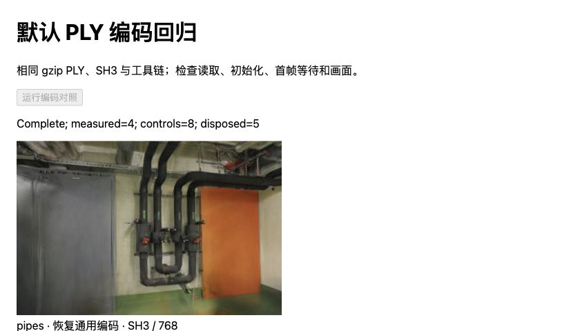
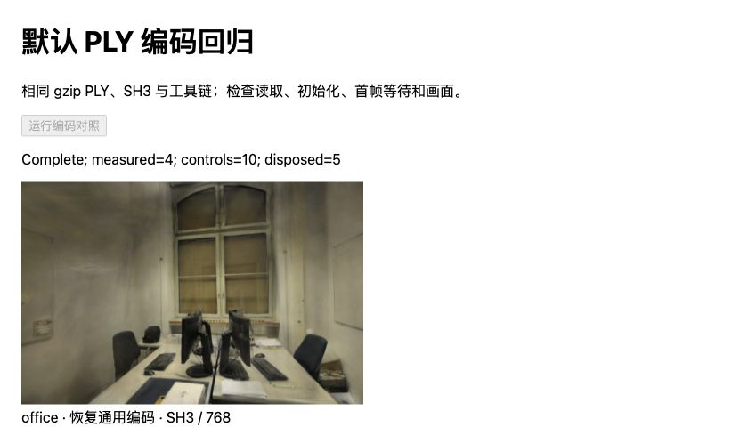
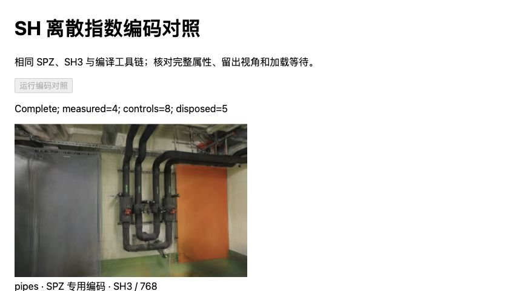
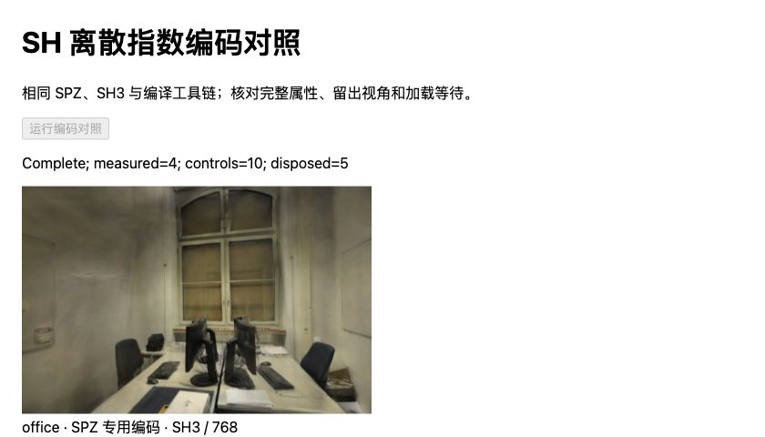

# SH 编码分流：消除 PLY 回归，保留 SPZ 收益

2026-10-31，基线 `700f8c3`。[上一版候选](SH-GRID.md)在通用编码函数内增加网格判断，导致默认 PLY 的初始化增加 5.55% / 9.66%。将快路径限制在 SPZ 接收入口后，PLY 初始化回到基线范围，SPZ 初始化仍减少 **30.35 / 23.20ms（20.28% / 20.24%）**。

这是独立构建的修复，尚未接入生产加载器。三组对照、逐文档样本、源码与二进制摘要完整保留在 [JSON](benchmarks/sh-scoped-2026-10-31.json)；负面结果未删除。

## 修改范围

[构建脚本](../scripts/prepare_sh_scoped.ts)从固定 Spark `ffe210dc0a45d0515a06c9235878108112827d61` 复制并校验源码，只改四个 Rust 文件：

- `splat_encode.rs` 保留原 `encode_ext_rgb`，另加上一版已验证的网格编码函数。
- `decoder.rs` 增加 `set_sh_spz` 接口，默认仍调用原 `set_sh`，其他接收器无需改变。
- `spz.rs` 只在 SPZ 的 SH 输出处调用新接口。
- `ext_splats.rs` 增加专用 SH 批处理方法；从固定原实现生成，通用 SH、代码本方法和 PLY 路径保持原源码。

没有在 PLY 每个系数前增加条件判断。SPZ 仍保留网格边界检查和原舍入语义。复用了此前穷举通过的函数，**没有再次执行 16,777,216 组合穷举**；新构建以完整缓冲及真实画面校验入口分流。

Rust 1.99.1、wasm-bindgen 0.2.117、Cargo.lock、SIMD/bulk-memory 选项和 Worker 源码与原构建一致，无内部计时探针、无 wasm-opt。WASM 从 2,074,046B 增至 2,078,283B，增加 4,237B；这不是下载体积优化。新 WASM SHA-256 为 `b51fcb232a097324ab4683ec4328f0d99f63784698cd360f7be5a34a8b91fbec`。

## 条件与计时

Apple M5、Chromium 156、ANGLE Metal / WebGL2、Three.js 0.180.0。每组每场景按原构建/候选/候选/原构建串行打开四份新文档，各一份预热加四份正式样本。三组共 **96 个正式样本、24 个预热**；下表每格八个正式样本，单位 ms，中位数，括号为最小–最大值。

固定 pipes / office 的 300,000 / 231,428 点、SH3、无 LoD、DPR=1、黑背景和 768×505 / 768×500 画幅。照片、相机、12/2 与 22/4 训练/留出划分不变。源文件、解码后 PLY、SPZ/AP16 和 WASM 均先核对摘要。

预载压缩输入。PLY 的读取包含浏览器 gzip 解压和长度校验；SPZ 的 gzip 消费仍在初始化内。WASM 编译、主模块导入、外部输入副本及摘要检查在计时外，内部解析、传递、模型准备、AP16 恢复和排序稳定等待计入相应区间。终点是稳定后的绘制提交，不是 GPU 完成或屏幕呈现。各阶段中位数不能相加。

### 1. 通用判断导致 PLY 初始化退化

| 场景 / 构建 | 读取 | 初始化 | Worker 往返 | 稳定等待 | 总等待 |
| --- | ---: | ---: | ---: | ---: | ---: |
| pipes / 原构建 | 192.35 | 118.90（114.60–144.10） | 111.55 | 50.40 | 375.30 |
| pipes / 通用网格判断 | 180.60 | 125.50（122.70–133.30） | 120.15 | 57.35 | 366.25 |
| office / 原构建 | 134.65 | 90.60（87.50–92.60） | 86.20 | 50.00 | 276.60 |
| office / 通用网格判断 | 136.45 | 99.35（95.40–105.20） | 93.40 | 51.00 | 285.50 |

初始化增加 6.60 / 8.75ms（5.55% / 9.66%）。pipes 的原构建读取范围为 176.90–224.90ms，存在明显波动；其总等待较短不能抵消编码退化，也不能归为优化收益。此方案不再作为接入候选。

### 2. 限制入口后，PLY 恢复基线范围

| 场景 / 构建 | 读取 | 初始化 | Worker 往返 | 稳定等待 | 总等待 |
| --- | ---: | ---: | ---: | ---: | ---: |
| pipes / 原构建 | 192.80 | 119.45（115.80–127.70） | 110.85 | 57.55 | 369.65 |
| pipes / SPZ 专用入口 | 178.45 | 117.85（115.00–127.30） | 112.00 | 58.85 | 358.25 |
| office / 原构建 | 134.40 | 91.00（89.40–92.60） | 86.55 | 51.35 | 277.40 |
| office / SPZ 专用入口 | 134.20 | 91.00（89.00–91.80） | 86.35 | 52.40 | 277.10 |

两场景初始化范围重叠，office 中位数相同。结论为消除观测到的回归；不宣称 PLY 提速，不把读取阶段的波动归给 SH 分流。

### 3. SPZ 初始化保留约 20% 收益

| 场景 / 构建 | 初始化 | Worker 往返 | AP16 与准备 | 稳定等待 | 总等待 |
| --- | ---: | ---: | ---: | ---: | ---: |
| pipes / 原构建 | 149.65（148.40–151.00） | 148.60 | 1.25 | 53.30 | 203.65（195.20–218.80） |
| pipes / SPZ 专用入口 | 119.30（118.10–120.30） | 118.15 | 1.15 | 56.45 | 177.75（169.60–178.60） |
| office / 原构建 | 114.60（114.00–115.60） | 113.65 | 1.00 | 48.75 | 163.35（162.10–171.40） |
| office / SPZ 专用入口 | 91.40（89.50–92.80） | 90.55 | 0.70 | 52.60 | 145.75（138.40–147.00） |

初始化减少 30.35 / 23.20ms（20.28% / 20.24%），总等待减少 25.90 / 17.60ms（12.72% / 10.77%）。只比较本组串行对照；不跨矩阵或与历史 GPU 时间计算速度倍数。

## 画面、回归与局限

**120 组完整属性缓冲、216 次像素摘要全部一致**。PLY 对齐原始 PLY，SPZ 对齐既有 SH8 + AP16 控制；覆盖六个留出相机、各场景首相机 ±0.08rad 与每份模型首视角。120 个模型各释放一次，文档内无错误和可见性变化；实际 Worker 内存回收及峰值尚未测量。



管道房 PLY：专用构建仍使用原通用编码，管线和墙面与原模型像素一致。



办公室 PLY：初始化恢复基线范围，窗框、桌椅与显示器保持原模型画面。



管道房 SPZ：保持候选属性，初始化由 149.65ms 降至 119.30ms。



办公室 SPZ：保持候选属性，初始化由 114.60ms 降至 91.40ms。衍生图片沿用 ETH3D CC BY-NC-SA 4.0。

像素完全一致，未重复计算 PSNR/SSIM。SPZ 仍承担 [SH8 + AP16 的既有量化差异](SPZ-ALPHA16.md#留出画质与漫游)：相对 PLY，pipes 平均 PSNR −0.00058dB / SSIM +0.00089，office +0.00900dB / +0.00035；3/6 个视角 PSNR 更低，1/6 个 SSIM 更低。此次分流没有新增损失，也未消除该误差；PLY 路径没有引入 SPZ 量化。

139 项测试、严格类型检查与生产构建通过，生产 JS/CSS 产物保持原摘要。未改默认依赖、照片、模型、评分或页面。尚未验证其他模型/格式、连续漫游全视角、整页/进程冷启动、真实 HTTP、取消回退、峰值内存及其他后端；ANGLE Metal 不等于自编 Metal compute。

## 复现与下一步

先按 [SH-GRID](SH-GRID.md#复现与后续)准备固定原始构建、网格构建和输入，再在项目根目录执行：

```sh
node --import tsx scripts/prepare_sh_scoped.ts
npm run dev -- --port 5192 --strictPort
```

构建脚本拒绝覆盖已有输出。浏览器逐份运行，场景依次为 pipes、office，文档序号 0–3：

| 对照 | 页面 | variant 顺序 | 保存 #result JSON |
| --- | --- | --- | --- |
| 通用判断 / PLY | /tests/browser/sh-ply.html | rebuilt, candidate, candidate, rebuilt | .qa/sh-ply/browser-{scene}-{doc}.json |
| 专用入口 / PLY | /tests/browser/sh-ply.html | rebuilt, scoped, scoped, rebuilt | .qa/sh-ply/scoped-ply-{scene}-{doc}.json |
| 专用入口 / SPZ | /tests/browser/sh-grid.html | rebuilt, scoped, scoped, rebuilt | .qa/sh-ply/scoped-spz-{scene}-{doc}.json |

参数为 `?scene=pipes&variant=rebuilt&doc=0`，每份完成后关闭文档再开始下一份。PLY 夹具需要原 gzip 文件副本 `.qa/pipes-gaussians.bin` / `.qa/office-gaussians.bin`，会核对历史资产摘要，避免 Vite 自动解压改变测试输入。

完成三组后执行 `node --import tsx scripts/report_sh_scoped.ts`，跨文档核对属性和历史像素，生成原始样本与分布报告。后续接入候选 HTTP 加载器时优先验证取消、失败回退与冷加载/峰值内存；没有新改动不重复本矩阵。

## 参考边界

[Spark #418](https://github.com/sparkjsdev/spark/pull/418)于 2026-09-08 合入，允许在构建时裁掉格式、表示及 LoD 功能；这是包体候选，与本次运行时接收入口分流不同，不能据此移除 PLY 回退。

新读 [Compact Neural Appearance Models for Efficient Gaussian Splatting](https://arxiv.org/abs/2609.05255)及[作者实现](https://github.com/nerficg-project/efficient-gaussian-appearance/tree/5235b9b96ccd36f1b87c5b9be84faff45b233fe1)，其 SH/神经外观与计时边界见[研究索引](RESEARCH.md#新候选紧凑神经外观与打包-sh)。这些是后续布局研究，未移植论文模型或套用其性能数字。
