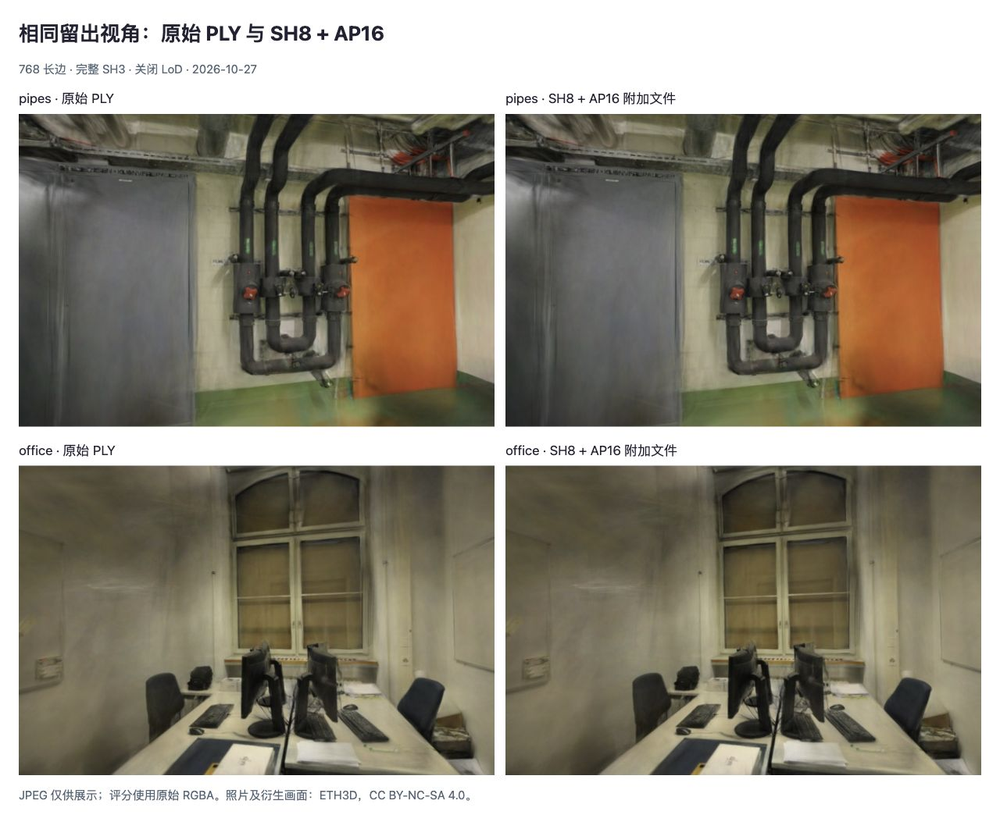

# 高精度不透明度：真实附加文件与加载成本

2026-10-27，完成 SH8 SPZ3 + AP16 的独立文件验证。pipes / office 总体积为 **12.47 / 8.90MiB**，比原始 gzip PLY 小 **79.84% / 80.97%**；20 个画面逐像素复现[上次不透明度诊断](SPZ-NONSH.md)。这是候选格式实验，默认模型和线上加载流程尚未更改。

[原始数据](benchmarks/spz-alpha16-2026-10-27.json)包含文件 SHA-256、16 次串行加载分段、20 个画面与交互记录。新结果来自真实文件保存、重新读取和恢复，未沿用旧 SPZ 的耗时。

## 文件与精度

保留[现有 SH8 文件](SPZ-SH8.md)，另存每个高斯在 Spark 原始 PLY 解码结果中的 binary16 不透明度。AP16 是本实验自定义的附加文件，**不是标准 SPZ3 扩展，也不由通用 SPZ 解码器自动识别**。其 gzip 解压后布局如下，所有整数为 little-endian：

| 偏移 | 字段 |
| --- | --- |
| 0–3 | ASCII `AP16` |
| 4–7 | 版本 1，uint32 |
| 8–11 | 高斯数量，uint32 |
| 12–15 | 保留字段，必须为 0 |
| 16–47 | 对应 SH8 SPZ3 压缩文件的 SHA-256 |
| 48 起 | 按相同点序排列的 binary16 不透明度，每点 2 字节 |

编码直接复制 Spark [ExtSplats](https://github.com/sparkjsdev/spark/blob/ffe210dc0a45d0515a06c9235878108112827d61/src/ExtSplats.ts) A 数组第四字段的低 16 位，不重新计算 sigmoid，也不恢复到原始 float32 PLY 精度。附加文件绑定准确的模型字节和点序；加载器计算摘要后验证数量、完整长度、版本、保留位和全部取值，确认有效后才写入。负数、非有限数及大于 1 的值被拒绝。其余属性、SH、保留位和尾部填充不变。

恢复发生在候选模型首次渲染前，随后标记对应纹理待上传并更新生成器。源码位于 [alpha16.ts](../tests/helpers/alpha16.ts)，仅供实验使用。gzip 的完整性检查不等于安全签名；模型摘要用于防止错配。尚未加入生产加载的取消、并发、解压大小限制和回退策略。

| 文件体积 | pipes | office |
| --- | ---: | ---: |
| 原始 gzip PLY | 64,843,796 B | 49,050,760 B |
| SH8 SPZ3 | 12,545,116 B | 8,927,279 B |
| AP16 原始数据，含头部 | 600,048 B | 462,904 B |
| AP16 gzip 文件，含头部及 gzip 开销 | 526,239 B | 407,820 B |
| 两文件合计 | 13,071,355 B | 9,335,099 B |
| 合计 MiB | 12.46582 | 8.90264 |
| 比单独 SH8 增加 | 4.19% | 4.57% |
| 比原始 gzip PLY 减少 | 79.84% | 80.97% |

使用 Chromium `CompressionStream("gzip")` 生成，先保存磁盘，再读取测量。实验入口使用 `.ap16.bin` 文件名以保留原始 gzip 字节，避免开发服务器根据 `.gz` 后缀自动处理内容编码；这不改变文件内容或计量体积。实际部署仍须验证 HTTP 头和自动解压行为。压缩文件哈希可能随 gzip 实现改变，原始 AP16 数据和模型绑定可独立核验。

## 留出画质与漫游

固定 `c5dbc92` 基线，Spark 2.4.0 / Three.js 0.180.0，Chromium 156，Apple M5 / ANGLE Metal / WebGL2。两场景 300,000 / 231,428 点，完整 SH3，关闭 LoD，768 长边。照片、标定相机、12/2 和 22/4 的训练/留出划分均保持原样；没有训练、剪枝、参数搜索或使用留出照片拟合编码。

| 组合 | pipes PSNR（dB） | pipes SSIM | office PSNR（dB） | office SSIM |
| --- | ---: | ---: | ---: | ---: |
| 原始 PLY | 16.26891 | 0.73092 | 18.95345 | 0.83902 |
| SH8 + AP16 文件 | 16.26833 | 0.73181 | 18.96245 | 0.83937 |
| 相对原始的差值 | −0.00058 | +0.00089 | +0.00900 | +0.00035 |

原始和候选各渲染全部 6 个留出相机，并在每场景首个相机偏转 ±0.08rad，共 20 个画面。所有像素哈希与此前原始 PLY / 恢复不透明度诊断对应画面完全一致，说明文件路径没有引入额外误差。偏转画面没有照片真值，不纳入均值。

这不代表相对原始模型无损：仍有 3/6 个视角 PSNR 更低、1/6 个 SSIM 更低。此次分数与此前诊断一致，不能算作新增画质提升；新增证据是恢复效果确实可由小型附加文件承载。其他属性的既有量化误差仍在。

两场景分别检查原始/候选模型的同一自由查看拖动、复位和场景切换；每次场景中仅有一个高斯模型。没有观察到新的外观缺陷，离开标定视角后的模糊在原始模型中同样存在。JPEG 仅供展示，评分使用原始 RGBA；照片及衍生画面沿用 ETH3D CC BY-NC-SA 4.0。

## 加载耗时及边界

**测量对象是预加载内存字节到模型初始化和排序稳定后的等待，不是网站冷加载。** 两场景分别按 PLY / 候选 / 候选 / PLY 顺序重复两组，共 16 个串行样本，每种每场景 4 次。每次新建模型，完成后释放；渲染器、运行时、相机与 Mesh 已就绪，照片评分和截图在计时区间外。页面全程未进入后台，实验无浏览器错误。

PLY 路径包括 gzip 读取/解压和 PLY 初始化；候选的 SPZ gzip 解压包含在模型初始化内，另计 AP16 解压、模型 SHA-256、验证及写回。`settle` 包含绘制提交、纹理准备、异步排序和帧等待，直到排序稳定；没有把它当作 GPU 查询时间或屏幕呈现时间。

| 中位数，ms | pipes PLY | pipes 候选 | office PLY | office 候选 |
| --- | ---: | ---: | ---: | ---: |
| PLY 读取/解压 | 177.25 | — | 136.55 | — |
| 模型初始化，含格式解码 | 122.65 | 157.85 | 97.80 | 117.90 |
| 初始化后恢复及生成器准备 | 0.00 | 7.45 | 0.00 | 4.80 |
| 绘制与排序稳定等待 | 67.70 | 67.20 | 62.35 | 63.05 |
| 总等待 | 366.65 | 233.25 | 296.55 | 188.05 |
| 总等待范围 | 366.50–389.10 | 231.10–237.60 | 291.70–308.50 | 183.00–191.70 |

各阶段中位数不能直接相加得到总中位数。当前小样本下候选总等待较低，但单独的 SPZ 初始化比 PLY 初始化慢；主要差异还涉及 PLY gzip 读取成本。附加处理的具体中位数：

| AP16 附加处理，ms | pipes | office |
| --- | ---: | ---: |
| gzip 解压 | 1.50 | 1.20 |
| SH8 文件 SHA-256 | 4.45 | 3.20 |
| 验证及数组写回 | 1.50 | 0.40 |
| 合计 | 7.40 | 4.80 |

没有同次测量单独 SH8 的完整加载，所以附加处理合计不能当作端到端增加量；恢复后的 GPU 上传包含在后续等待中。没有测量下载、冷/热 HTTP 缓存、冷启动、峰值内存、稳态 FPS、GPU 绘制或训练耗时，不能将这些数据解释为对应收益。与旧报告的加载流程不同，不跨报告计算速度提升。

## 复现与下一步

1. 按 [SH8 报告](SPZ-SH8.md#复现与边界)准备 `.qa/spz-sh8/` 文件和输入记录；`python3 scripts/prepare_spz_experiment.py` 准备原始 gzip 链接。默认资源不被覆盖。
2. 在仓库根目录运行 `npm run dev`，打开 `http://127.0.0.1:5178/tests/browser/spz-alpha16.html`。
3. 点击「生成附加文件」，下载两个 `.ap16.bin` 文件并保存到仓库的 `.qa/spz-alpha16/` 目录。它们内部仍是 gzip；也可从页面文本框读取 Base64 并解码保存。
4. 点击「验证文件与加载」。页面重新读取磁盘文件，与原始解码不透明度核对，再输出样本、画面和 JSON。生成压缩文件、保存及来源验证均不在加载计时内。
5. 可单独选择场景/模型后「查看模型」，检查自由查看与复位。报告哈希核对依赖已提交的上一份诊断数据。

4 项新的单元检查覆盖模型错配、头部/长度错误、异常不透明度的原子拒绝，以及不相关字段和填充不变。51 项 Node 测试、类型检查、生产构建通过；生产 JS/CSS 内容哈希未变，本次不重复部署 Pages。

下一步在独立候选加载流程中加入取消与错误回退、解压上限、缓存一致性，再测受控网络下的冷/热端到端首帧及内存；同时记录每视角画质差值。达到这些条件前不替换默认模型。当前仅验证 WebGL2 / ANGLE Metal，WebGPU、CUDA、手机与其他解码器没有实测。

参考 [MesonGS++ v2 论文](https://arxiv.org/abs/2604.26799v2)及[作者大小核算实现](https://github.com/mmlab-sigs/mesongs_plus/blob/0004153458b73387e0044b6f553f62116117388d/splatwizard/model_zoo/mesongs_plus/qbit_search_tool.py)：总传输量必须包括各属性和元数据，不能只统计主码流。此处未移植其编码器、混合精度搜索或采用论文跑分，适用条件见[研究索引](RESEARCH.md)。
