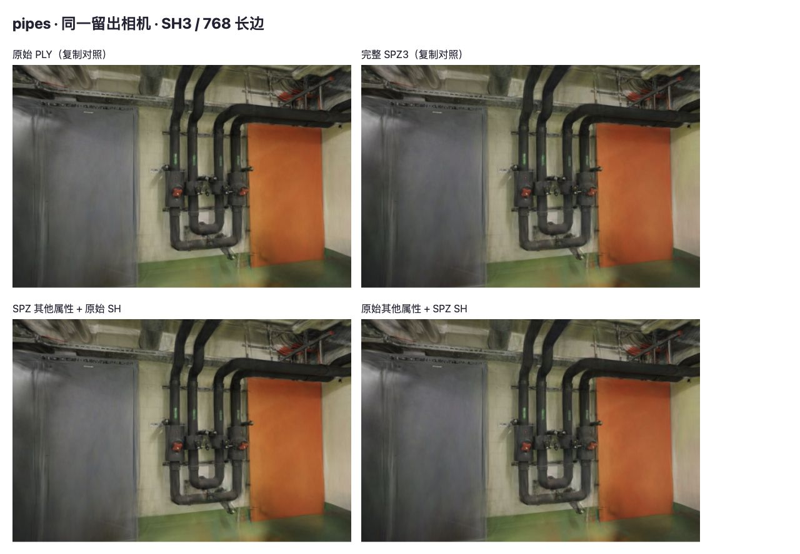
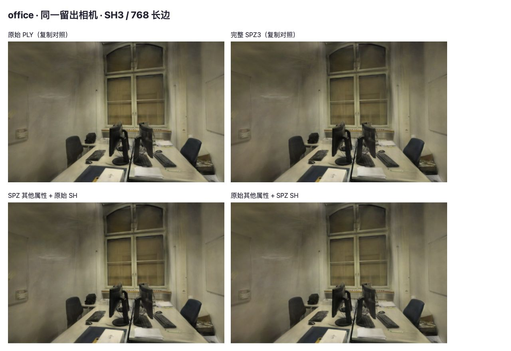

# SPZ3 属性误差对照

2026-10-27，结论：**优先验证更高精度 SH，默认模型继续保留原始 PLY**。在既有 SPZ3 候选上恢复原始 SH，两场景平均 PSNR 分别回升 0.522 / 0.462 dB，但仍比原始模型低 0.170 / 0.296 dB。只调整 SH 不能消除全部压缩损失。

这是对[格式实验](SPZ-FORMAT.md)的误差定位，不是新的压缩格式或上线提速。[原始记录](benchmarks/spz-attributes-2026-10-27.json)保留 40 次画面比较、20 组复制控制、全部留出评分和输入哈希。未重新测量加载、首帧、CPU/GPU 帧时间、显存或训练耗时。

## 输入与方法

- 项目基线 `7794ff5`，Spark 2.4.0，Three.js 0.180.0；Apple M5 / ANGLE Metal / Chromium 156，WebGL2，长边 768，完整 SH3，关闭 LoD。
- 沿用已有 SPZ3 文件及其哈希：位置小数位 12、SH1 5bit、SH2/3 4bit；不重新训练、剪枝或调整高斯数。pipes 为 300,000 点、12/2 训练/留出照片；office 为 231,428 点、22/4 照片，划分和相机不变。
- 两个输入都解码成 `ExtSplats`，将 `extArrays` 与原始 `sh1/sh2/sh3a/sh3b` 数组分别复制；不共享 GPU 纹理和释放所有权。“其他属性”包含位置、尺度、旋转、不透明度及 DC 颜色，SH 指一至三阶方向颜色系数，不包含 DC。
- 对全部点检查按索引对应的位置：两场景最大单轴误差均为 1/8192，符合 12 位小数定点的半步误差；结合源码中保持顺序的转换路径核对点序。Spark `getSplat()` 返回共用临时对象，检查时必须先复制中心坐标。
- 每场景串行渲染四种组合。每种覆盖全部留出相机，另外在首个留出相机本地 Y 轴旋转 ±0.08rad；共 10 个姿态 × 4 组。对照片计算 PSNR/SSIM/MAE，仅将 yaw=0 纳入场景平均；偏转位置没有参考照片，只比较渲染图像。
- 原始/完整 SPZ 两组复制结果在全部 10 个姿态上与直接加载结果逐像素一致，20 项控制全部通过；两组像素也分别与前一份格式实验一致。控制台无错误，页面没有进入后台。

四组定义：A = 原始其他属性 + 原始 SH；B = SPZ 其他属性 + SPZ SH；C = SPZ 其他属性 + 原始 SH；D = 原始其他属性 + SPZ SH。A/B 是装配正确性的控制组，C/D 分离两组属性的影响。

## 留出画质

下表为各场景留出视角等权平均，数值针对原始照片。

| 场景 | 组合 | PSNR（dB） | SSIM | MAE |
| --- | --- | ---: | ---: | ---: |
| pipes | A 原始 | 16.26891 | 0.73092 | 33.46223 |
| pipes | B 完整 SPZ3 | 15.57693 | 0.72324 | 36.06247 |
| pipes | C 恢复原始 SH | 16.09862 | 0.72945 | 34.05922 |
| pipes | D 仅替换 SPZ SH | 15.73699 | 0.72501 | 35.47978 |
| office | A 原始 | 18.95345 | 0.83902 | 23.84466 |
| office | B 完整 SPZ3 | 18.19572 | 0.82925 | 26.27685 |
| office | C 恢复原始 SH | 18.65785 | 0.83587 | 24.67676 |
| office | D 仅替换 SPZ SH | 18.50162 | 0.83258 | 25.40600 |

C 相比 B 改善，但六个留出视角仍全部低于 A。D 的场景平均也下降，但并非每一个视角都下降，不能把平均值推广成所有视角的固定损失。PSNR 是非线性指标，两组属性存在相互作用，不能将 dB 差值当作可相加的“误差占比”。

包括偏转位置在内，相对 A 的渲染间 PSNR：B 为 31.36–34.22 dB，C 为 37.17–42.63 dB，D 为 32.66–36.15 dB。这些值只描述两张渲染图的差异，不是对真实照片的重建成绩。

## 同视角截图

每张图按左上 A、右上 B、左下 C、右下 D 排列。恢复 SH 后，门板、墙面及桌椅附近的亮度与细节更接近原始模型；其他属性量化仍留下差异。截图是浏览器捕获的展示用 JPEG，数值来自 JPEG 压缩前的 RGBA 像素。照片及衍生画面沿用 ETH3D CC BY-NC-SA 4.0。





本次检查离散相机姿态；未重新测量连续漫游的排序稳定性或帧时间，完整 SPZ 的交互检查沿用前次记录。没有更换线上渲染器或默认模型。

## 实现边界与后续

本实验定位的是 **Spark PLY → GsplatArray → SPZ → ExtSplats 整条转换路径** 的属性差异，不只是不受其他因素影响的 SPZ 位宽误差。[GsplatArray](https://github.com/sparkjsdev/spark/blob/ffe210dc0a45d0515a06c9235878108112827d61/rust/spark-lib/src/gsplat.rs)在写 SPZ 前已将颜色、尺度、旋转、不透明度与 SH 存成半精度；解码后的 ExtSplats 也有自身打包精度。后续应分别验证 SH 量化步长/裁剪与中间表示，不能仅凭这次结果认定单一编码步骤有缺陷。

Spark 的 [SH 共享指数修复 #465](https://github.com/sparkjsdev/spark/pull/465)于 2026-10-02 合并，当前 2.4.0 已包含，不重复修补。SPZ 头 flags=1 则来自 `GsplatArray.flag_antialias()` 固定返回 true；[当前解码初始化](https://github.com/sparkjsdev/spark/blob/ffe210dc0a45d0515a06c9235878108112827d61/rust/spark-lib/src/spz.rs)没有用 bit 0 设置渲染选项，已修正前份报告中“保留原有抗锯齿标志”的表述。

下一步先试独立高精度 SH 候选，并同时记录实际文件体积和全部留出画质；再拆分 DC 颜色、尺度、旋转及不透明度的剩余误差。C/D 只是内存混合属性，**没有对应压缩文件大小或加载速度结果**，不能套用完整 SPZ3 的约 89% 体积减少。

新查阅的 [Transforming Harmonic Coefficients for 3D Splat Compression](https://arxiv.org/abs/2609.15735)（v1，2026-09-14）讨论以图像空间失真约束方向颜色压缩。其第 4.1 节实际使用稀疏体素、RAHT 与 KLT；本次没有找到可核实的匹配作者代码及代码许可，不能直接移植成 WebGL2 优化。论文为 CC BY-NC-ND 4.0；只记录研究思路，不复制内容或采用论文跑分。后续若估计变换，只能使用训练相机拟合，留出照片继续用于评价。

## 复现

```bash
python3 scripts/prepare_spz_experiment.py
npm run dev
```

打开 `http://127.0.0.1:5178/tests/browser/spz-attributes.html`，点击「运行属性对照」。存在 `.qa/pipes-candidate.spz` 和 `.qa/office-candidate.spz` 时复用文件；缺失时使用相同 Spark 参数从 PLY 转换，随后必须匹配已记录的 SPZ 哈希才能继续。原始 gzip 链接由准备脚本创建。页面展示 JSON 和三个姿态的四组图片，不更改生产加载器。

数组复制仅用于诊断，会增加实验内存，不能作为线上资源分配方案。此次没有验证跨解码器互操作、手机设备或更长相机路径；未采用新编码或新渲染后端。Spark 引用代码采用 MIT 许可；WebGL2 经当前设备的 Metal 后端运行，无需 CUDA，WebGPU 路径未验证。
