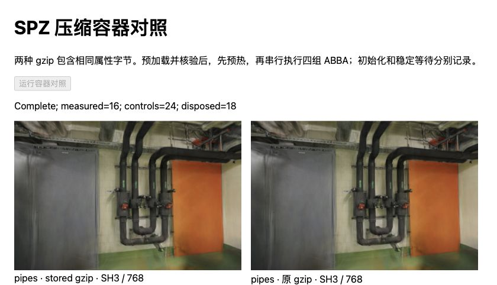
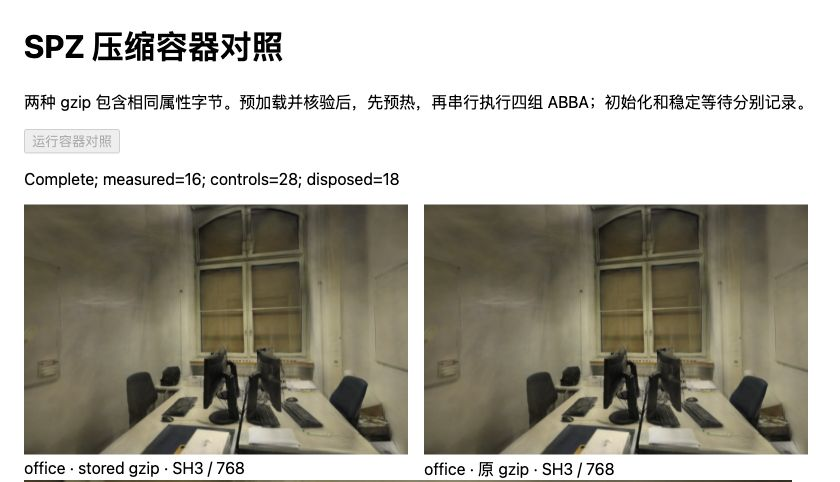

# SPZ 压缩容器与初始化成本

2026-10-30，基线 `0f9a9c1`。接续[运行时初始化对照](RUNTIME-INIT.md)，保持 SPZ 解压后的字节完全一致，仅把原 gzip 重封装为 level 0 的 stored DEFLATE。管道房 / 办公室初始化中位数减少 **47.45 / 37.85ms**，但 SPZ 文件增大 **55.5% / 68.5%**。这是定位加载瓶颈的诊断，未替换默认 PLY 或候选下载格式。

## 对照设置

- “原 gzip”指已有 SH8 + AP16 候选，不是生产 PLY。两种容器均为 v3、完整 SH3、关闭 LoD，pipes / office 分别 300,000 / 231,428 点。照片、相机和训练/留出划分不变；首个留出相机计时，画幅 768×505 / 768×500、DPR=1、黑色背景。
- Chromium 156、Apple M5、ANGLE Metal / WebGL2、Spark 2.4.0、Three.js 0.180.0。每场景新文档，同一查看器和 Worker 池；先各预热一次，随后四组 ABBA（A=原 gzip，B=stored），每种 8 个正式样本，共 32 个。逐次新建和释放模型，串行运行，计时期间没有可见性变化或其它重建实验。
- 输入在计时前预加载、展开并验证摘要；每次供给 Spark 的压缩缓冲副本也在计时外生成。两种解压后字节 SHA-256 相同，包含点顺序与全部属性；AP16 原始值序列相同，但头部重新绑定各自的实际压缩文件摘要。原候选文件未改写。
- `initialize` 从构造 SplatMesh 到 initialized 完成，包含 Worker 调度、输入传递、gzip 处理、属性转换和结果返回。随后单列不透明度恢复/发布和 settle；合计终点为排序稳定后的绘制提交，不是屏幕呈现或 GPU 查询。查看器空 Mesh 一侧的绘制提交仍包含在 settle 中。

## 耗时与体积

以下均为中位数，单位 ms，每格 8 个样本。完整范围、预热样本、ABBA 顺序、摘要和环境见[原始记录](benchmarks/spz-container-2026-10-30.json)。

| 场景 / 容器 | 初始化 | 恢复与发布 | 稳定等待 | 合计 |
| --- | ---: | ---: | ---: | ---: |
| pipes / 原 gzip | 153.25 | 0.60 | 54.80 | 210.90 |
| pipes / stored | 105.80 | 0.50 | 56.95 | 164.30 |
| office / 原 gzip | 120.15 | 0.50 | 52.40 | 174.55 |
| office / stored | 82.30 | 0.40 | 48.00 | 129.10 |

各列中位数不能直接相加。每个 ABBA 块分别求两种初始化均值之差，pipes 四块均在 45.60–49.05ms，office 为 33.10–50.25ms；office 原 gzip 最大值 144.40ms，存在调度波动。未用小样本推断 P95 或普遍收益。

| 场景 | 原 SPZ 文件 | stored SPZ 文件 | 增量 |
| --- | ---: | ---: | ---: |
| pipes | 11.96MiB | 18.60MiB | 55.5% |
| office | 8.51MiB | 14.35MiB | 68.5% |

上表只列 SPZ；AP16 在测试中作为已验证的内存输入，不测其网络压缩体积或下载。展开的 SPZ 分别为 19,500,016 / 15,042,836 字节。生成器使用 Node 20.20.2 / zlib 1.3.1，源与结果摘要保留在记录的 manifest 中；不同 zlib 版本可能生成不同容器字节，必须重新核验绑定。

**支持的结论**：在属性字节和点序固定时，改变 gzip 编码足以减少当前初始化路径的等待，值得进一步拆分容器处理。**尚不支持**：差值就是纯 inflate CPU 时间，或者 stored 文件使网页加载更快。容器体积、传入 WASM 的字节数、分块方式、分配与调度也会变化；没有独立 Worker CPU 采样、内存峰值、网络冷/热缓存或浏览器原生解压计时。不能将本批数值与历史 PLY 样本相减宣称格式提速。

## 画面与资源

52 次 RGBA 摘要检查全部匹配已有 SH8 + AP16 控制：覆盖每次模型首个留出视角、两种容器的全部六个留出相机，以及每场景首相机 ±0.08rad。没有修改模型数值、分辨率或 SH，故未重新计算照片 PSNR/SSIM；[候选已有量化误差](SPZ-ALPHA16.md)仍存在。偏转检查不等于新的连续自由漫游实验。



管道房，左侧 stored gzip，右侧原 gzip：相同首个留出相机，管道、门和墙面像素摘要一致。



办公室，左侧 stored gzip，右侧原 gzip：相同首个留出相机，桌面、椅子和窗框像素摘要一致。

36 个模型（含 4 个预热模型）各释放一次。正式样本没有新建 Worker，每个文档创建一个解析 Worker 和一个排序 Worker；查看器销毁终止排序 Worker，解析 Worker 留在上游池内，随后关闭/导航文档。没有把 dispose 次数当作系统内存或显存回收证据。

## 复现与下一步

先按 [SH8 + AP16](SPZ-ALPHA16.md#复现与下一步)准备原候选文件，然后在仓库根目录执行：

```bash
node --import tsx scripts/prepare_spz_container.ts
npm run dev -- --port 5190
```

生成器只写 `.qa/spz-container/`，已有同名文件会拒绝覆盖。源 SPZ、AP16 摘要与绑定须匹配历史清单；展开结果必须为预期长度、点数、v3 SH3 且无扩展。重封装后验证逐字节一致，再重新绑定独立 AP16，保留相同值序列。

分别打开 `/tests/browser/spz-container.html?scene=pipes` 和 `?scene=office`，点击运行。前一个完成后再导航到另一个，保存页面 JSON。夹具再次验证两种原始属性摘要和实际 AP16 绑定，再创建任何模型；界面与结果均需显示成功。

新增 3 项回归覆盖容器变换后绑定、错误来源、点数/版本/扩展错误与截断；132 项测试、项目及准备脚本类型检查、生产构建通过。生产 JS/CSS 内容哈希不变，未重新部署 Pages。

不采用 level 0 文件作为默认资源。下一步可在独立产物中测原生解压与属性转换的组合总耗时、取消和缓冲峰值，避免先假定它一定快。Spark 当前裸 NGSP 分支用于 v4，浏览器预解压后的 v3 **不能直接传给该接口**；需要明确的解析适配边界。KISS-GS 的图像格式路径另列候选，需先核实编码器版本、许可及同场景质量。

参考：[Spark v2.4.0 发行说明](https://github.com/sparkjsdev/spark/releases/tag/v2.4.0)、[SPZ flate2 实现](https://github.com/sparkjsdev/spark/blob/ffe210dc0a45d0515a06c9235878108112827d61/rust/spark-lib/src/spz.rs)、[KISS-GS 论文](https://arxiv.org/abs/2608.26948)与[作者解码脚本](https://fraunhoferhhi.github.io/KISS-GS/decode_sogxt.py)。代码状态及平台边界见[研究索引](RESEARCH.md#已验证spz-容器成本与图像编码候选)。
