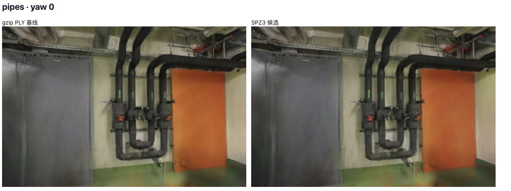
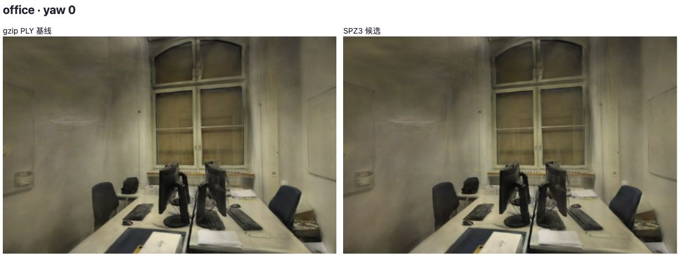

# SPZ3 格式对照

2026-10-26，结论：**暂不替换默认模型**。SPZ3 明显减少文件体积和本地内存输入下的加载等待，但全部六个留出视角的 PSNR、SSIM 均下降。先分离属性量化误差，再评估保真度更高的编码选项。

[原始记录](benchmarks/spz-format-2026-10-26.json)包含 16 次加载、10 对图像比较、源文件/候选哈希和转换参数。默认照片、模型、相机及训练/留出划分均未改动。

## 输入与版本

- 基线：`db828fa` 的加载流程，gzip PLY → 浏览器解压 → Spark PLY 初始化。
- 候选：Spark 2.4.0 的 `transcodeSpz` 从原始 PLY 转为 **SPZ 格式版本 3**，`maxSh=3`、`fractionalBits=12`、`opacityThreshold=0`，不裁剪、剪枝或变换坐标；随后交给 Spark SPZ 初始化。
- pipes 300,000、office 231,428 个高斯。候选 gzip 内的 SPZ 头再次确认数量、SH3、位置小数位；本地独立解压核验相同。头部 flags=1 来自 Spark `GsplatArray.flag_antialias()` 的固定返回值，不能作为原模型抗锯齿元数据被保留的证据；当前 SPZ 解码初始化未将 bit 0 转成渲染选项。
- Spark 的[写入实现](https://github.com/sparkjsdev/spark/blob/ffe210dc0a45d0515a06c9235878108112827d61/rust/spark-lib/src/spz.rs)使用位置定点量化、不透明度/颜色/对数尺度量化、SPZ3 旋转编码以及 SH1 5bit、SH2/3 4bit 量化。**保留 SH3 不等于保留原始浮点精度**。
- Spark 2.4.0 已有 [SPZ4 读取支持](https://github.com/sparkjsdev/spark/pull/484)，当前公开 `SpzWriteVersion` 仍只有 2/3。本实验没有使用 SPZ4/ZSTD，不能套用 SPZ4 的宣传数字。

## 方法与计时边界

Apple M5、ANGLE Metal、Chromium 156，WebGL2，DPR=1，长边 768，完整 SH3，关闭 LoD。先将两种模型、元数据和 GLB 预读到内存，再以 64KiB 分块的模拟响应提供给同一个查看器。预热各格式一次，随后每场景按 A/B/B/A/A/B/B/A 串行加载，各四个样本。上一模型由原资源所有权流程释放；没有并行运行其他重建实验。全程页面未进入后台。

计时包含加载时模型清理、并行 Gaussian/Mesh 处理及排序稳定前的绘制提交；不包含网络传输、导航脚本下载或前置格式转换。模型均已在内存，不是 HTTP 冷/热缓存测试，也不测内存峰值。转换仅记录一次，pipes 514.4ms、office 320.7ms；首个转换可能包含 WASM 初始化，不能作为稳定编码吞吐。

**读取/解压与初始化的划分因格式而异**：PLY 在应用读取阶段解压，SPZ 的解压放在 Spark 初始化阶段，因此应查看两阶段的总路径和整体等待，不能只比较“读取/解压”一栏。Mesh 与 Gaussian 并行，主线程/任务调度会影响 Mesh 的阶段时间；阶段不能相加为总时间。首帧准备含异步排序等待和绘制提交，不是 GPU 查询或实际屏幕呈现时间。

## 文件与耗时

| 场景 | gzip PLY | SPZ3 | 文件减少 |
| --- | ---: | ---: | ---: |
| pipes | 61.84 MiB | 6.89 MiB | 88.86% |
| office | 46.78 MiB | 4.89 MiB | 89.55% |

下表为毫秒中位数，括号为最小–最大；每格四个样本。

| 场景 / 格式 | 加载至稳定提交 | Gaussian 读取/解压 | Gaussian 初始化 | 首帧准备 |
| --- | ---: | ---: | ---: | ---: |
| pipes / gzip PLY | 417.65（408.4–425.1） | 181.70 | 126.40 | 107.85 |
| pipes / SPZ3 | 244.55（237.3–248.7） | 4.90 | 133.00 | 105.30 |
| office / gzip PLY | 392.30（371.4–400.2） | 144.45 | 104.05 | 140.55 |
| office / SPZ3 | 232.70（227.4–237.1） | 2.10 | 108.70 | 118.25 |

这是同设备、同会话的内存输入对照。没有测网络总首帧、FPS、GPU 帧时间或显存收益；SPZ 解码后仍使用现有 ExtSplats 表示，文件变小不能推出 GPU 内存同比减少。

## 画质与外观

每个场景计时采样完成后，按同一标定相机与 768 长边捕获六个留出视角，逐视角对同尺寸照片计算 PSNR/SSIM/MAE，再等权平均。当前浏览器版本与历史记录不同，以下差值仅使用本次同会话基线，不与历史成绩混算。

| 场景 | PLY PSNR | SPZ3 PSNR | PSNR 差值 | PLY SSIM | SPZ3 SSIM |
| --- | ---: | ---: | ---: | ---: | ---: |
| pipes（2 视角） | 16.26891 | 15.57693 | −0.69199 dB | 0.73092 | 0.72324 |
| office（4 视角） | 18.95345 | 18.19572 | −0.75773 dB | 0.83902 | 0.82925 |

逐视角 PSNR 下降 0.323–1.159 dB；没有把两个渲染结果间的 PSNR 当作对原照片的成绩。另在每场景首个留出相机上绕本地 Y 轴旋转 ±0.08rad，检查四对偏转画面；这些位置没有对应参考照片，只报告候选与基线的图像差异。十对画面的图像间 PSNR 为 31.36–34.22 dB。



管道房的模型方向与主要结构保持对应，墙面、门板及管线附近存在亮度和细节变化。



办公室的墙面和桌椅细节同样存在差异。两格式均实际拖动漫游并复位，控制台无错误；这只验证交互和外观，不是移动相机帧时间或排序稳定性测量。截图为展示用 JPEG；数值来自压缩前的 RGBA 像素。照片及衍生画面沿用 ETH3D CC BY-NC-SA 4.0。

## 复现

```bash
python3 scripts/prepare_spz_experiment.py
npm run dev
```

打开 `http://127.0.0.1:5178/tests/browser/spz-format.html`，点击「准备独立 SPZ3 模型」后运行 ABBA 对照。准备脚本从固定基线生成 `.qa/spz-viewer.ts`，只更换候选的读取与格式分派；线上查看器不修改。原始 gzip 使用硬链接，避免开发服务器自动 HTTP 解压混淆输入。

页面显示完整 JSON 和同视角图片。只重新检查截图时可使用 `?qualityOnly=1`，不会重复性能采样。候选字节保留在该页 `#assets` 表单字段（场景名到 Base64 的 JSON），用于本地归档；本次已独立保存在忽略的 `.qa/pipes-candidate.spz`、`.qa/office-candidate.spz`，文件哈希见报告。模型未提交到默认资产或在线站点。

范围限制：没有验证候选取消/失败回滚、手机设备、独立 SPZ 解码器互操作或更长漫游路径。2026-10-27 的[属性对照](SPZ-ATTRIBUTES.md)已分离 SH 与其余属性组合，位置、颜色、尺度、旋转及不透明度还没有逐项分离。下一步先验证更高精度 SH 或 SPZ4 参考编码器，再以相同质量约束比较实际网络加载。

## 参考

- [Spark 2.4.0 发行说明](https://github.com/sparkjsdev/spark/releases/tag/v2.4.0)、[转换 API](https://github.com/sparkjsdev/spark/blob/ffe210dc0a45d0515a06c9235878108112827d61/src/spz.ts)（MIT）。
- [Niantic SPZ 参考实现](https://github.com/nianticlabs/spz/tree/affd0ecea7fbb4c265ee119475af7ee5b2997482)、[SPZ4 格式发布说明](https://www.nianticspatial.com/blog/spz4)；库发布标签 v3.0.0 与 SPZ 文件格式版本 4 是两套版本号。
- [GPU-friendly Graphics Texture Coding 论文](https://arxiv.org/abs/2607.14513)，提醒区分传输压缩与渲染驻留格式；未在本实验移植其编码方法，研究边界见 [RESEARCH](RESEARCH.md)。
