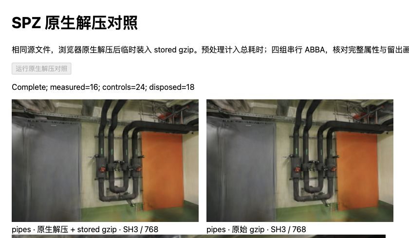
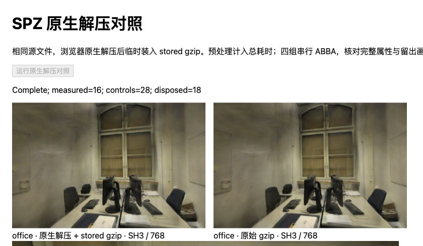

# SPZ 原生解压与临时容器对照

2026-10-31，基线 `7c618b3`。保持原始压缩文件不变，尝试用浏览器原生解压，再临时装入 stored gzip 交给 Spark。**32 个正式样本中，总等待中位数仅减少 0.10 / 0.30ms（pipes / office），不足以作为加载优化采用。** 原生解压及适配成本抵消了大部分 Spark 初始化节省，默认页面与候选加载器均未接入。

## 方法与计时

接续 [gzip 容器诊断](SPZ-CONTAINER.md)，固定已有 SH8 + AP16 的 300,000 / 231,428 点、SH3、关闭 LoD、点序、坐标和不透明度。实验只改变压缩容器的处理位置，不重新量化或训练。

- A：原始 gzip SPZ 直接传入 Spark。
- B：同一份原始 gzip 通过 `DecompressionStream("gzip")` 展开；将输出块直接写入预分配的 stored gzip，再交给相同 Spark 路径。每个 deflate stored block 最多 65,535B，保留所有解码字节。
- 适配器只接受固定头、SH3、12 位小数、antialiased v3 控制文件，按已核验点数限制长度。在原生解码成功读到 EOF、完成 CRC/ISIZE 检查之后才复制尾部校验值；错误、截断、超长不返回模型。它不是通用 SPZ 解析器。
- 两路使用同一原始 SPZ 摘要核验 AP16。临时容器是已验证原始输入的无损内存变换，AP16 没有被伪称绑定到临时容器摘要，也没有另存一份可独立分发的配对文件。浏览器预检临时容器的完整展开摘要；每次运行后再逐一比较 Spark 全部六个属性/SH 缓冲，包含填充区。
- 适配器没有保留第二份完整裸 SPZ 缓冲，但 Blob、原生流、输入副本、Spark Worker 传递和结果数组仍有内存开销。没有测量内存峰值，不能据此称为低内存或零复制。

设备：Apple M5、Chromium 156、ANGLE Metal / WebGL2、Spark 2.4.0、Three.js 0.180.0。每场景新文档，同一查看器/Worker 池，每路预热一次，再按 ABBA 重复四组；共 32 个正式样本与 4 个预热。两场景串行运行，全程可见，没有并行训练。

下载、模块导入、原始摘要与绑定核验、参考展开及适配器完整性预检、每次输入副本在计时外，两路口径相同。**B 的 Blob 创建、原生展开、长度/头校验、stored 容器分配和填充全部位于计时内**，没有将预处理移出总耗时。

`adapterMs` 是原生解压与适配墙钟，`initializeMs` 是 Spark 初始化墙钟，`decodeReadyMs` 是两者合计；初始化仍包含 Worker 调度、传递、WASM 属性消费和返回，不能称作纯 CPU 解码。后续 AP16 恢复/发布、排序稳定等待分别记录。总计结束于稳定后的绘制提交，不是屏幕呈现或 GPU 查询时间；空 Mesh 场景提交也在稳定等待内。

## 耗时

单位 ms，各格 8 个正式样本的中位数；各阶段中位数不能直接相加。预热、慢样本、分组差值、摘要及环境均保留在[原始记录](benchmarks/spz-native-2026-10-31.json)。

| 场景 / 路径 | 原生展开与适配 | Spark 初始化 | 两者合计 | 恢复/发布 | 稳定等待 | 总计 |
| --- | ---: | ---: | ---: | ---: | ---: | ---: |
| pipes / 原始 | 0.00 | 147.45 | 147.45 | 0.50 | 55.10 | 203.10 |
| pipes / 原生适配 | 43.90 | 100.70 | 144.35 | 0.50 | 57.45 | 203.00 |
| office / 原始 | 0.00 | 112.85 | 112.85 | 0.40 | 50.00 | 163.30 |
| office / 原生适配 | 32.15 | 78.65 | 111.20 | 0.40 | 50.85 | 163.00 |

Spark 初始化单列减少 46.75 / 34.20ms，但算入适配后只减少 3.10 / 1.65ms。总等待差异约为采样波动量级，**不宣称稳定提速，也不从八个样本外推 P95**。

pipes 各 ABBA 块的总等待均值差（B−A）为 +0.70、0.00、−4.40、−3.65ms；office 为 −0.75、−0.60、0.00、−16.10ms。最后一块 office 原始路径有一个 195.40ms 总等待慢样本，完整保留，不能用它证明候选普遍更快。原始 / 候选总等待范围分别为 pipes 195.20–210.50 / 194.80–203.60ms，office 155.70–195.40 / 154.80–163.50ms。

两路从磁盘预载的原始 SPZ 均为 12,545,116 / 8,927,279B，AP16 也相同。候选临时 Spark 输入扩大到 19,501,524 / 15,044,004B；这是内存中不同于前次 zlib level-0 文件的 stored 分块方式，没有增加线上文件大小，也没有测得网络收益。

## 画面与资源

36 组解码属性完全一致；52 次 RGBA 摘要匹配已有 SH8 + AP16 控制，覆盖全部六个留出相机及每场景首相机 ±0.08rad。每个正式和预热模型均检查首个留出画面。固定 pipes 768×505、office 768×500、DPR=1、黑色背景，照片与训练/留出划分保持原值。



管道房：左侧为原生展开与临时 stored 容器，右侧为原始 gzip；管道、门和墙面一致。



办公室：左侧为原生适配，右侧为原始 gzip；桌椅与窗框一致。图片及衍生画面沿用 ETH3D CC BY-NC-SA 4.0。

没有新增量化或画面误差，未重新读取照片计算 PSNR/SSIM；[SH8 + AP16 既有分数与相对原始 PLY 的代价](SPZ-ALPHA16.md#留出画质与漫游)仍然适用。该方案不是相对生产 PLY 无损，离散偏转检查也不代表连续自由漫游测试。

36 个模型各释放一次，没有浏览器错误或可见性变化。正式样本没有新增 Worker；查看器释放终止排序 Worker，解析 Worker 池随文档关闭结束。未测实际内存回收、GPU 绘制、稳态帧率和训练耗时。

## 上游实现与结论

2026-10-31 复核 Spark main 仍为 [ffe210d / 2.4.0](https://github.com/sparkjsdev/spark/tree/ffe210dc0a45d0515a06c9235878108112827d61)（提交及发行 2026-10-20，MIT）。新检索到的 [#181](https://github.com/sparkjsdev/spark/pull/181) 已于 **2025-09-25** 合并：它将旧 TypeScript 解码器的 fflate 换成原生流，不能把当时的加速数字套用到当前架构。[#485](https://github.com/sparkjsdev/spark/pull/485) 则于 **2026-10-16** 将 Rust SPZ gzip 改为 flate2 / zlib-rs；当前 [SPZ 解码](https://github.com/sparkjsdev/spark/blob/ffe210dc0a45d0515a06c9235878108112827d61/rust/spark-lib/src/spz.rs)在 WASM 中按 32KiB 输入消费属性，裸 NGSP 路径要求 v4。本实验的 stored 适配保留该属性路径，因此仍经过一次 gzip 消费。

[Visionary 论文 v1](https://arxiv.org/abs/2512.08478)（2025-12-09）与[作者 SPZLoader](https://github.com/Visionary-Laboratory/visionary/blob/76a2b93cec0e0dfaeb598fd320b6ceabf4b39d48/src/io/spz_loader.ts)提供另一种原生展开后转换属性的参考。main 最新提交为 2026-10-15、Apache-2.0、无 GitHub Release；其 WebGPU 渲染与 RTX 4090 论文测量不是当前 WebGL2/M5 加载对照。本实验独立实现容器适配，没有复制其属性转换器或运行 WebGPU/ONNX 管线。原生 gzip 本身不依赖 WebGPU、Metal compute 或 CUDA；浏览器必须支持 Compression Streams，跨浏览器结果未验证。

结论是**暂不采用这层临时容器适配**：在现有 Spark 路径上新增预处理和更大内存输入，没有足够总等待收益。下一步应先给 Worker/WASM 解压、属性消费、结果缓冲与传递建立直接分段证据，再评估避免重复容器消费的接口；未经剖析，不认定属性转换或某次复制就是剩余瓶颈。冷运行时、HTTP、取消/失败回退、峰值内存尚未验证；不重复扫描容器参数或替换默认资源。

## 复现

复用 [SH8 + AP16](SPZ-ALPHA16.md#复现与下一步)及[容器实验](SPZ-CONTAINER.md)的原始输入。如果 `.qa/spz-container/manifest.json` 已存在且核验成功，直接使用；尚未生成时，在仓库根目录运行：

```bash
node --import tsx scripts/prepare_spz_container.ts
```

脚本拒绝覆盖已有文件。原生实验只读取清单中的 original 分支，不加载离线 stored 分支。然后运行：

```bash
npm run dev -- --port 5190
```

依次打开 `/tests/browser/spz-native.html?scene=pipes` 与 `?scene=office`，点击运行，前一个完成后再切换，保存页面 JSON 与截图。任何摘要、属性或像素检查失败均不记为通过。

新增 3 项 Node 回归覆盖跨 stored 块字节一致性、CRC 损坏/截断/尾随内容、点数与展开长度界限、拼接 gzip 及不支持的 SPZ 头。未将 Node 错误路径等同于跨浏览器或网络取消验证。

全部 139 项测试、类型检查和生产构建通过。生产 JS/CSS 哈希保持原值；本次仅提交实验夹具、数据和文档，不重复部署 Pages。
