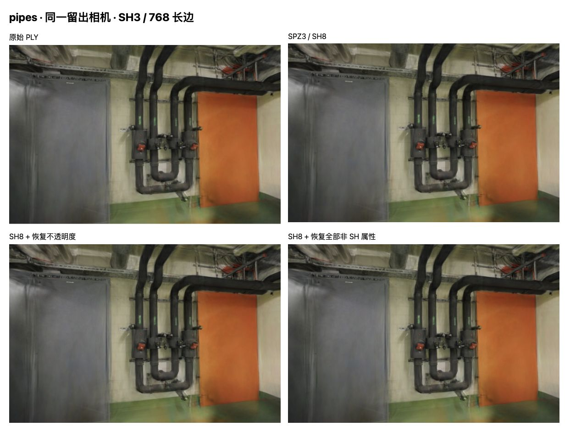
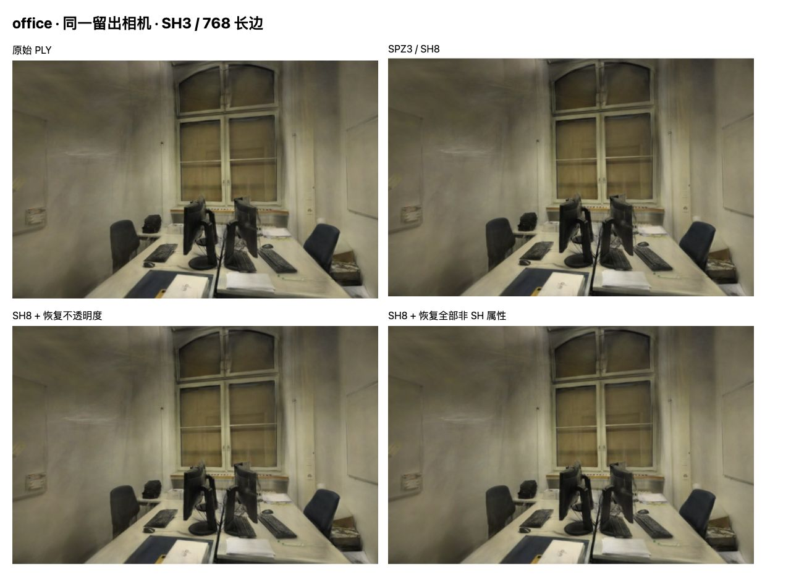

# SPZ3 剩余属性误差：优先保留不透明度精度

2026-10-27，结论：**在固定 8 位 SH 的条件下，不透明度是当前两场景最值得优先处理的剩余属性**。只恢复原始不透明度，pipes / office 的平均 PSNR 相对 SH8 文件回升 0.171 / 0.306dB，接近原始 PLY；其他单项恢复的影响较小，且不总是改善。

这是[SH8 文件实验](SPZ-SH8.md)的内存属性诊断，尚未形成新的压缩文件或线上方案。默认资产保持原样；不能把旧 SPZ 的体积和加载耗时套用于恢复属性后的组合。[画质原始记录](benchmarks/spz-nonsh-2026-10-27.json)保存 80 个画面、20 项复制控制及输入哈希，[不透明度字节检查](benchmarks/spz-opacity-bytes-2026-10-27.json)单列 CPU 数值结果。

## 固定条件与方法

基线 `1010002`，Spark 2.4.0 / Three.js 0.180.0，Chromium 156、Apple M5 / ANGLE Metal、WebGL2。长边 768、完整 SH3、关闭 LoD。pipes / office 分别为 300,000 / 231,428 点，训练/留出为 12/2、22/4；照片、相机、划分、点序和已有 SH8 文件不变。

先直接加载原始 PLY 与 SH8 SPZ3，再复制解码后的数组建立控制组。其他组合固定 SH8 数组，只恢复位置、DC 颜色、不透明度、尺度或旋转中的一项，另加“恢复全部非 SH 属性”组合。各组合串行渲染全部留出相机，并在首个相机偏转 ±0.08rad，共 10 个姿态 × 8 组，另有 20 次直接加载渲染用于复制控制；偏转画面没有照片真值，不纳入留出均值。

恢复操作使用 Spark [扩展属性布局](https://github.com/sparkjsdev/spark/blob/ffe210dc0a45d0515a06c9235878108112827d61/src/utils.ts)的字节掩码，不经过 `getSplat → setSplat` 的重新编码，避免额外的旋转/尺度舍入。两份数组各有 4 个 uint32 字段：

| 属性 | 恢复位置 |
| --- | --- |
| 位置 | A 的前三个完整字段 |
| 不透明度 | A 第四字段的低 16 位 |
| DC 颜色 | B 第一字段及第二字段的低 16 位 |
| 对数尺度 | B 第二字段的高 16 位及第三字段 |
| 旋转 | B 第四字段 |

源数组、SH 数组、保留位和尾部填充不被写入；新模型独立持有复制数组及纹理。20 项原始/SH8 复制控制逐像素相同，也与前份 SH8 文件实验的对应哈希和评分完全一致。按索引检查位置的最大单轴误差仍为 1/8192，符合既有 12 位小数定点设置。页面没有进入后台，数值实验无浏览器错误。

## 留出结果

每行是场景全部留出照片的等权平均。除原始 PLY 外，SH 均为相同的 8 位版本；“恢复”指从原始 PLY 解码结果中恢复该属性。

| 组合 | pipes PSNR（dB） | pipes SSIM | office PSNR（dB） | office SSIM |
| --- | ---: | ---: | ---: | ---: |
| 原始 PLY | 16.26891 | 0.73092 | 18.95345 | 0.83902 |
| SH8 SPZ3 | 16.09737 | 0.72948 | 18.65671 | 0.83595 |
| 恢复位置 | 16.09766 | 0.72931 | 18.66074 | 0.83617 |
| 恢复 DC 颜色 | 16.09549 | 0.72940 | 18.65774 | 0.83593 |
| 恢复不透明度 | 16.26833 | 0.73181 | 18.96245 | 0.83937 |
| 恢复尺度 | 16.10058 | 0.72890 | 18.64291 | 0.83539 |
| 恢复旋转 | 16.09788 | 0.72948 | 18.65554 | 0.83595 |
| 恢复全部非 SH 属性 | 16.26983 | 0.73097 | 18.95284 | 0.83907 |

恢复不透明度后的平均 PSNR 相对原始 PLY 为 −0.00058 / +0.00900dB，但 6 个留出视角中仍有 3 个 PSNR 更低、1 个 SSIM 更低。不能据此宣称逐像素无损或优于原始模型；相对原始渲染图的 PSNR 为 45.58–46.85dB，仍有可测差异。

恢复尺度在办公室反而降低平均分数；全部非 SH 属性恢复也并非每项指标的最高分。参数误差与遮挡、投影和混合存在相互作用，单项 dB 差值不能相加，也不能转成独立“误差占比”。此次只覆盖两个固定模型，没有用留出照片搜索量化参数或训练权重。

## 不透明度量化检查

[Spark SPZ3 编码器](https://github.com/sparkjsdev/spark/blob/ffe210dc0a45d0515a06c9235878108112827d61/rust/spark-lib/src/spz.rs)在当前非 LoD 路径将不透明度乘以 255，再裁剪和舍入到 uint8；解码为字节值 / 255。PLY 的 sigmoid 不透明度先经过 `GsplatArray` 的半精度中间表示，最终扩展数组也以半精度存储。

CPU 检查从原 PLY 重建这条路径，并复现两场景全部 531,428 个 SPZ 不透明度字节。

| 检查项 | pipes | office |
| --- | ---: | ---: |
| 输入最小不透明度（半精度后） | 0.00329018 | 0.00291634 |
| 输入最大不透明度 | 0.99951172 | 0.99609375 |
| 正值量化为零的数量 | 0 | 0 |
| 解码相对半精度输入的最大绝对误差 | 0.00196075 | 0.00196075 |
| 平均绝对误差 | 0.00098015 | 0.00098192 |

因此当前损失不能解释成高斯被量化为完全透明。较小的参数误差仍可能改变多个高斯的累积混合，尤其是相对误差较大的低不透明度值；这是待进一步验证的机制，表中数值并不是最终像素误差上界。没有在本实验中更改 alpha 阈值、尺度或光栅化行为。

## 截图与交互检查

四格依次为原始 PLY、SH8 SPZ3、恢复不透明度、恢复全部非 SH 属性，均取同一留出相机。整体几何一致，恢复不透明度后画面更接近原始模型；细小差异以 RGBA 指标为准。JPEG 仅用于展示，照片及衍生画面沿用 ETH3D CC BY-NC-SA 4.0。





两场景的原始/恢复不透明度模型均检查了自由查看、相同拖动和复位。离开标定视角后的模糊也存在于原始模型中，未将其称为压缩新增问题。实验页的手动模型切换另修正了复制对象的清理，连续切换时确认场景只有一个高斯模型，避免跨场景叠加。数值采样流程本来就在每组结束恢复受加载作用域管理的原始对象后清理，未受该手动查看问题影响。

## 复现与下一步

先按 [SH8 报告](SPZ-SH8.md#复现与边界)生成 `.qa/spz-sh8/` 候选及准备记录，然后在仓库根目录运行：

```bash
.venv/bin/python scripts/check_spz_opacity.py
npm run dev
```

打开 `http://127.0.0.1:5178/tests/browser/spz-nonsh.html`，点击「运行属性对照」。页面显示全部分组图片与 JSON；需要单独检查交互时，可直接选择场景和属性后点击「查看模型」，无需重复整套采样。重新运行数值对照需要刷新页面。输入哈希必须匹配准备记录。

新增 3 项检查验证共享字段的位掩码隔离、保留位/填充/源数组不变和无效长度拒绝；47 项 Node 测试、类型检查和生产构建通过。未新增训练、下载、解码、首帧或 CPU/GPU 帧时间样本；生产包和默认资产没有变化，不部署 Pages。

下一步优先生成保留较高精度不透明度的独立文件，例如可核对布局的格式扩展或单独的属性数据，并测总文件体积、读取/解码/上传成本和全部留出画质。任何附加数据及处理成本都须计入，不能沿用仅 SH8 文件的大小；仍须明确区分半精度中间表示和格式量化。WebGL2 / ANGLE Metal 已用于此诊断，WebGPU、CUDA、其他解码器和手机未验证。

新查阅的 [PLEDGE 论文](https://arxiv.org/abs/2610.17605)提醒区分属性误差约束与最终合成画质，适用条件及代码可用性见[研究索引](RESEARCH.md)；未采用其论文跑分或编码器。
