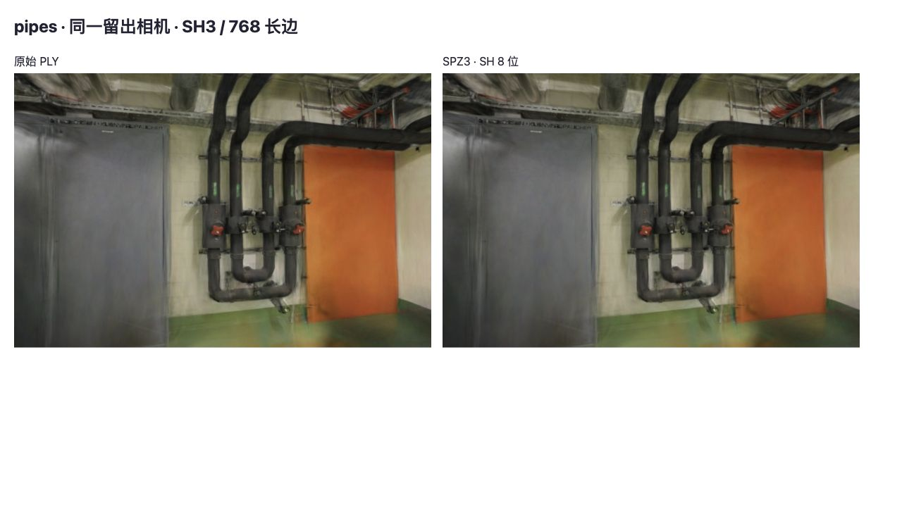
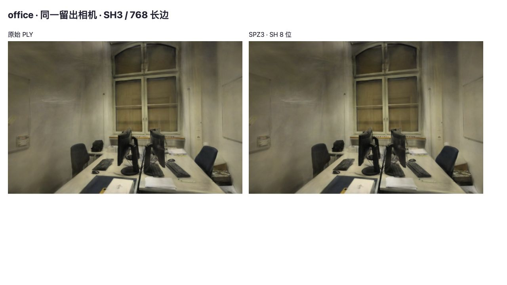

# SPZ3 高精度 SH 文件对照

2026-10-27，结论：**8 位 SH 能追回大部分已定位的方向颜色损失，但默认模型继续保留 PLY**。相对原 SPZ3，pipes / office 留出平均 PSNR 回升 0.520 / 0.461dB；独立候选文件为 11.96 / 8.51MiB，比原始 gzip PLY 小 80.65% / 81.80%。六个留出视角仍低于 PLY，不能作为无损替换上线。

这是[属性对照](SPZ-ATTRIBUTES.md)之后的真实文件实验。[原始 JSON](benchmarks/spz-sh8-2026-10-27.json)包含文件哈希、量化检查、30 次画面对照和全部留出分数。没有新增加载、首帧、CPU/GPU 帧时间、显存或训练性能结论。

## 输入与隔离方法

- 基线 `e52b11d`，复用 `db828fa` 的独立格式查看器；Spark 2.4.0、Three.js 0.180.0、Chromium 156、Apple M5 / ANGLE Metal / WebGL2。长边 768、完整 SH3、关闭 LoD。
- pipes 为 300,000 点、12/2 张训练/留出照片；office 为 231,428 点、22/4 张照片。照片、相机、模型、点序和划分不变，没有重新训练、剪枝或拟合颜色。
- 从已有 SPZ3 文件开始，保留头部及全部非 SH 属性字节。原编码器对 SH1 使用 5 位、SH2/3 使用 4 位量化；本次只将一至三阶的 45 个系数统一提高到 8 位，不包含 DC 颜色。
- 从原始 PLY 读取 SH，先转换为半精度再回到 float32，匹配 Spark `GsplatArray` 的中间表示。按原编码器的通道顺序、舍入和裁剪重建 5/4 位字节，两个场景共 23,914,260 个系数逐字节一致后，才生成 8 位候选。
- 原布局每个 SH 系数本来就占一个字节；提高精度改变桶间距和 gzip 可压缩性，不增加未压缩体长度。8 位量化步长为 1/128，两个场景均无系数超出字节表示范围，相对半精度输入的最大系数误差为 1/256。
- pipes / office 的前 6,000,016 / 4,628,576 字节完全不变，包括 flags=1；该标志的来源和解码限制见[前份报告](SPZ-ATTRIBUTES.md)。未将它解释为启用了新的抗锯齿模式。

本次事先选择 8 位精度验证上限，没有用留出照片搜索 6/7 位参数。半精度中间表示和解码后属性打包仍保留，因此不是原始浮点 SH 的无损编码。

## 文件大小与准备耗时

| 场景 | 原始 gzip PLY | 原 Spark SPZ3（5/4 位） | 同 gzip 实现重压控制 | SPZ3（8 位 SH） |
| --- | ---: | ---: | ---: | ---: |
| pipes | 61.840 MiB | 6.890 MiB | 7.020 MiB | 11.964 MiB |
| office | 46.778 MiB | 4.888 MiB | 4.971 MiB | 8.514 MiB |

候选由 Python 3.12.14 / zlib 1.2.12、gzip level 6、mtime=0 生成。控制列将原 SPZ 的相同未压缩字节交给同一 gzip 实现，文件比 Spark 输出略大，但解压内容完全一致。相对这个控制，8 位候选体积增加 70.44% / 71.26%；不能把与原 Spark 文件的全部差值都归到 SH 位宽。候选的精确字节数为 12,545,116 / 8,927,279，未压缩体仍分别为 19,500,016 / 15,042,836 字节。

候选准备的单次 CPU 样本为 **581.43ms / 454.48ms**，包括 PLY 的 SH 提取、原量化控制校验、8 位量化和候选 gzip；不包括文件读取、输入初次解压及控制组重压。这不是完整转换流水线、浏览器解码、训练耗时或稳定性能统计。此前原 SPZ 的内存加载数据不能套用于当前较大的候选文件。

## 留出画质与画面检查

下表为各场景留出照片的等权平均；PSNR/SSIM 越高越好，MAE 越低越好。

| 场景 | 文件 | PSNR（dB） | SSIM | MAE |
| --- | --- | ---: | ---: | ---: |
| pipes | 原始 PLY | 16.26891 | 0.73092 | 33.46223 |
| pipes | SPZ3，SH 5/4 位 | 15.57693 | 0.72324 | 36.06247 |
| pipes | SPZ3，SH 8 位 | 16.09737 | 0.72948 | 34.06659 |
| office | 原始 PLY | 18.95345 | 0.83902 | 23.84466 |
| office | SPZ3，SH 5/4 位 | 18.19572 | 0.82925 | 26.27685 |
| office | SPZ3，SH 8 位 | 18.65671 | 0.83595 | 24.67871 |

六个留出视角的 PSNR/SSIM 全部相对原 SPZ 改善，也全部仍低于原始 PLY；场景平均 PSNR 距离 PLY 为 0.172 / 0.297dB。8 位候选距前份报告“恢复原始 SH”组合仅约 0.00125 / 0.00114dB，提示下一步应拆分其余属性误差，而非继续只提高 SH 精度。该比较不能转成可相加的误差占比，也不证明所有设备和场景都有相同结果。

每场景串行加载 PLY、原 SPZ、8 位 SPZ，覆盖全部留出相机，并在首个相机额外偏转 ±0.08rad；总共 30 次画面。20 个 PLY/原 SPZ 控制画面的像素哈希与前份属性实验完全一致。8 位候选相对 PLY 的渲染间 PSNR 为 37.15–42.56dB，仅表示两张渲染图之间的差异，不是对照片的重建分数。记录中没有后台切换或浏览器错误。

两个场景均实际检查了原始 PLY 和 8 位候选的自由查看、拖动和复位。未发现新增的明显缺失或结构错位；偏离训练相机后的模糊也出现在原始模型中。此检查不代替更长路径的排序稳定性或帧时间测量。

下图为同一留出相机，左侧原始 PLY、右侧 8 位候选。细节与整体亮度接近，但数值检查仍能检测到差异。展示图片使用 JPEG，评分直接取压缩前 RGBA；照片及衍生画面沿用 ETH3D CC BY-NC-SA 4.0。





## 复现与边界

先按[格式实验](SPZ-FORMAT.md#复现)准备查看器，并将该页 `#assets` 中的 Base64 候选解码归档到 `.qa/pipes-candidate.spz`、`.qa/office-candidate.spz`。已有归档可直接复用；准备脚本会核对其哈希与原始 PLY。该前置步骤不能省略，脚本不会自动下载历史候选。

在仓库根目录、具有 NumPy 的 Python 环境中执行（本次 NumPy 2.2.6）：

```bash
python3 scripts/prepare_spz_experiment.py
.venv/bin/python -m unittest discover -s tests -p test_spz_sh8.py
.venv/bin/python scripts/prepare_spz_sh8.py
npm run dev
```

打开 `http://127.0.0.1:5178/tests/browser/spz-sh8.html`，点击「运行文件画质对照」。结果在页面 JSON 中，候选和准备记录保存在被忽略的 `.qa/spz-sh8/`。不同 zlib 版本可能改变 gzip 字节和体积，必须同时核对解压体哈希，不能悄悄沿用当前文件大小。Python 脚本拒绝覆盖内容不同的同名候选。

3 项 Python 检查覆盖量化边界、非 SH 字节保留和不支持布局的拒绝；44 项现有 Node 测试、类型检查与生产构建通过。Python 检查在本地运行，现有远程 CI 运行 Node 测试和构建。生产包与默认资产没有变化，本次不部署 Pages。

这里只验证 Spark 的 SPZ3 解码互操作与当前 WebGL2 / Metal 绘制；没有测试独立 Niantic 解码器、WebGPU、CUDA 或手机。下一步逐项检查 DC 颜色、尺度、旋转及不透明度；达到画质要求后，再测受控网络、解码和首帧。文件缩小不代表 GPU 驻留显存或帧率改善。

## 参考

- [Spark 2.4.0 SPZ 编码器](https://github.com/sparkjsdev/spark/blob/ffe210dc0a45d0515a06c9235878108112827d61/rust/spark-lib/src/spz.rs)与 [GsplatArray](https://github.com/sparkjsdev/spark/blob/ffe210dc0a45d0515a06c9235878108112827d61/rust/spark-lib/src/gsplat.rs)，当前主分支提交日期 2026-10-20，MIT；用于核对顺序、半精度中间表示和量化规则。
- [Niantic SPZ](https://github.com/nianticlabs/spz/tree/affd0ecea7fbb4c265ee119475af7ee5b2997482)（2026-08-05，MIT）及 [v3.0.0 发行](https://github.com/nianticlabs/spz/releases/tag/v3.0.0)，其 SPZ4 仍是后续独立候选，不混作本次 SPZ3。
- [CCT-GS 论文](https://arxiv.org/abs/2610.26920)（v1，2026-10-17，VCIP 2026）研究 SH 的学习式压缩与标准视频编码。已阅读原文，但[作者仓库 73c4f3e](https://github.com/yfffffy/CCT-GS/tree/73c4f3e917a7ea0938180935bd7b62cdcbebb0fe)目前仅有 README，代码和预训练模型待发布，未提供代码许可。没有移植或采用论文数字；适配条件与后续核查项见[研究记录](RESEARCH.md)。
