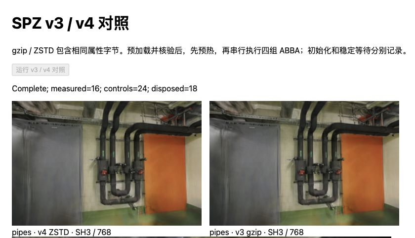
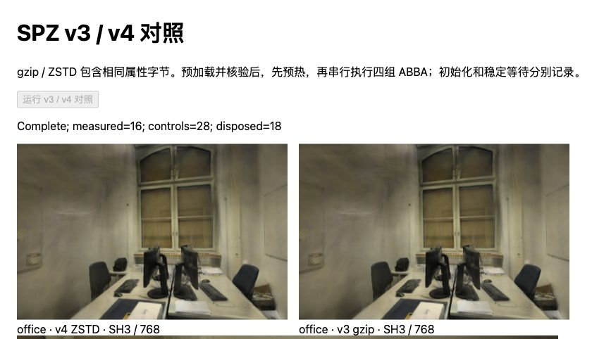

# 相同属性的 SPZ v3 / v4 对照

2026-10-30，基线 `69afbca`。将已有 SH8 + AP16 候选的属性字节直接转装为 SPZ v4：文件减少 **8.8% / 10.2%**，但当前 Spark 2.4.0 下的初始化中位数增加 **16.95 / 10.80ms**（pipes / office）。不把 v4 当作已验证的初始化加速方案，默认 PLY 和现有候选加载器保持原样。

## 方法

- 接续 [gzip 容器诊断](SPZ-CONTAINER.md)，仍固定 300,000 / 231,428 点、SH3、关闭 LoD；不重训、不再次量化、不调整坐标或点顺序。仅使用无扩展的 v4 子集，保留源 antialiased 标志及 12 位小数设置。
- v3 gzip 展开后按 positions / alphas / colors / scales / rotations / SH 拆为六段，每点分别 9 / 1 / 3 / 3 / 4 / 45 字节。用 Zstandard CLI 1.5.7、level 12、单线程、无帧 checksum、显式输入长度分别压缩，再写 32 字节明文头和 6×16 字节目录。级别 12 对照上游默认值，但本生成器不是调用 Niantic 完整编码器。
- 生成器用独立 ZSTD 解压逐段核验字节、长度及 SHA-256。AP16 值序列相同，只把独立副本的头绑定到实际 v4 压缩文件摘要；原 SPZ 和 AP16 文件未改写。v4 头的格式版本与 v3 不同，因此比较的是全部属性字节，不能宣称两个容器整体展开摘要相同。
- 浏览器先核验文件摘要、AP16 绑定和目录范围；使用原始 v3 的摘要作为来源控制。随后每次初始化和恢复 AP16 后，比较 Spark 的两个 ExtSplats 缓冲与四个 SH 缓冲（包含填充区），36 组全部一致。此步骤在计时外，不是峰值内存测量。

设备与协议：Chromium 156、Apple M5、ANGLE Metal / WebGL2、Spark 2.4.0、Three.js 0.180.0。每场景新文档，同一查看器/Worker 池；各预热一次，再做四组 ABBA（A=v3，B=v4），共 32 个正式样本。没有剔除慢样本；所有计时段保持可见，串行使用 GPU，期间未运行训练。

输入下载、摘要预检、v3 参考展开、模块导入和每次输入副本位于计时外。初始化包含 Worker 调度、容器解码、属性转换及结果返回；恢复/发布、排序稳定等待分列。合计结束于稳定后的绘制提交，不是屏幕呈现，也不是纯 CPU 解码或 GPU 绘制时间。空 Mesh 场景提交仍在稳定等待内。

## 结果

单位 ms，中位数，每格 8 个样本；完整范围、预热、分组顺序、文件和属性摘要见[原始记录](benchmarks/spz-v4-2026-10-30.json)。

| 场景 / 格式 | 初始化 | 恢复与发布 | 稳定等待 | 合计 |
| --- | ---: | ---: | ---: | ---: |
| pipes / v3 gzip | 148.40 | 0.50 | 55.65 | 203.90 |
| pipes / v4 ZSTD | 165.35 | 0.50 | 57.35 | 223.95 |
| office / v3 gzip | 112.80 | 0.35 | 50.15 | 171.70 |
| office / v4 ZSTD | 123.60 | 0.30 | 47.75 | 171.75 |

各列中位数不可直接相加。pipes 四个 ABBA 块的初始化均值均为 v4 更慢，差额 16.00–18.20ms。office 三块慢 9.95–11.50ms，最后一块快 3.25ms；该块 v3 有一个 141.70ms 样本，保留并报告。office 合计中位数几乎相同，不把稳定等待的波动当作 GPU 提速，也不从八个样本外推 P95。

| 场景 | v3 SPZ | v4 SPZ | 文件减少 |
| --- | ---: | ---: | ---: |
| pipes | 12,545,116B / 11.964MiB | 11,438,075B / 10.908MiB | 8.8% |
| office | 8,927,279B / 8.514MiB | 8,015,561B / 7.644MiB | 10.2% |

以上只列 SPZ 文件，不含 AP16。六段展开后总属性长度分别仍为 19,500,000 / 15,042,820 字节。离线六次 CLI 压缩墙钟为 326.51 / 277.02ms（各一次，包含串行进程启动，不含文件读取与回读校验），不是训练耗时、正式速度对照或上游并行编码结果。

## 画面与资源

52 次 RGBA 对照全部匹配既有 SH8 + AP16 控制，覆盖每个模型的首个留出画面、两种格式全部六个留出相机及每场景首相机 ±0.08rad。画幅固定为 pipes 768×505、office 768×500，DPR=1、黑色背景。照片和训练/留出集合未变。



管道房：左侧 v4 ZSTD，右侧 v3 gzip，管道、门和墙面像素相同。



办公室：左侧 v4 ZSTD，右侧 v3 gzip，桌椅和窗框像素相同。

本实验没有新增量化或渲染误差，未重新读取参考照片计算 PSNR/SSIM；[SH8 + AP16 既有画质代价](SPZ-ALPHA16.md)仍存在，不将 v4 写成相对生产 PLY 无损。偏转检查不等于连续自由漫游评价。

36 个模型（含 4 个预热）各释放一次；正式样本没有创建新 Worker。每文档有一个解析 Worker 和一个排序 Worker，查看器释放终止排序 Worker，解析池随后随导航/关闭文档结束。没有直接测 Worker CPU 利用率、实际内存回收或显存峰值。

## 为什么暂不采用

Niantic 的 [SPZ 4 发布说明](https://www.nianticspatial.com/blog/spz4)强调多流并行；但[参考代码](https://github.com/nianticlabs/spz/blob/affd0ecea7fbb4c265ee119475af7ee5b2997482/src/cc/load-spz.cc)在 Emscripten 条件下仍串行解压，原生 C++ 才启动并行任务。[Spark v4 实现](https://github.com/sparkjsdev/spark/blob/ffe210dc0a45d0515a06c9235878108112827d61/rust/spark-lib/src/spz.rs)也先等全部数据，再用 ruzstd 逐流追加到统一缓冲，随后消费属性；它没有直接采用参考实现的并行直写布局。

这些实现差异是后续剖析依据，**尚不能把当前慢值全部归因于串行、ruzstd 或缓冲复制**。没有测 Niantic 原生/C++ WASM 解码器、其它 ZSTD 参数或独立内存峰值；也未证明统一缓冲是主瓶颈。不能套用发行说明的倍数，更不能把所有 v4 读取器归为同一性能。

小文件可能在弱网络下抵消多出的初始化时间，但本实验预载了全部文件，没有 HTTP 冷/热缓存或线上首帧结论。后续只有在补齐同条件端到端等待、取消/失败回退及峰值缓冲证据后再评估接入；暂不扫描压缩级别或改默认格式。原生解压与属性消费的分段测量继续优先，KISS-GS 图像编码另列候选。

## 复现

按 [SH8 + AP16](SPZ-ALPHA16.md#复现与下一步)准备输入，系统须已有 `zstd` CLI；本记录为 1.5.7。仓库根目录执行：

```bash
node --import tsx scripts/prepare_spz_v4.ts
npm run dev -- --port 5190
```

生成器只写 `.qa/spz-v4/`，遇到同名产物拒绝覆盖；六段均需通过实际 codec 回读，而非只检查目录。依次打开 `/tests/browser/spz-v4.html?scene=pipes` 和 `?scene=office`，点击运行，前一场景完成后再导航。保存页面 JSON 和画面；原始来源、容器摘要、解码属性和像素检查任一失败均不得记为通过。

4 项新回归检查目录越界/零长度/错误解压长度、版本/扩展/保留位/点数错误、截断/尾随内容及 v3 来源约束。全部 136 项测试、项目和准备脚本类型检查、生产构建通过；生产 JS/CSS 哈希保持原值，本次不部署 Pages。容器校验器只供这个固定无扩展 SH3 实验，不是通用 SPZ 安全解析器。

相关研究：[KISS-GS v1 §3.5、§6.1](https://arxiv.org/html/2608.26948v1#S3.SS5)将编码、量化与解码成本分开评估；本实验保留属性以隔离容器变化，未移植其算法或沿用论文跑分。版本、许可证和后端范围见[研究记录](RESEARCH.md#暂不采用spz-v4-在当前解码器中的初始化表现)。
