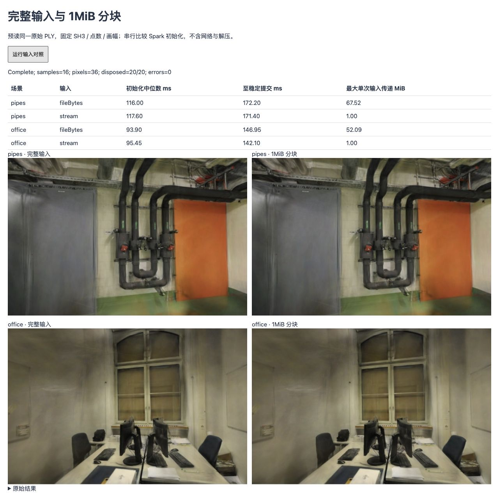
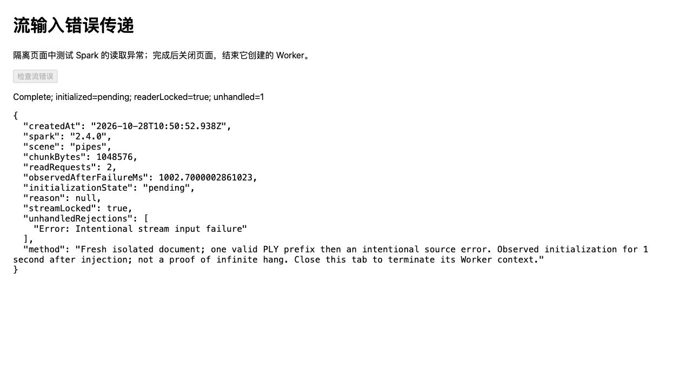

# PLY 分块输入实验

2026-10-28；基线 `29414b4`，Spark 2.4.0，Chrome 156 / Apple M5（WebGL2，ANGLE Metal）。结论：**暂不采用分块输入**。本次没有证明初始化提速或峰值内存下降，并复现了读取失败未正常传回初始化的边界；默认 PLY 加载保持不变。

## 对照条件

同一已解压、长度与 SHA-256 校验通过的原始 PLY，分别交给 `fileBytes` 和 `stream`。后者每次按需复制一个至多 1MiB 的独立缓冲，供 Spark 转移给 Worker；不使用共享原始缓冲的 `subarray`，避免转移时连带分离后续输入。原始输入在整个对照中保留，结束后再次校验摘要。

- pipes：300,000 点，70,801,551B；office：231,428 点，54,618,559B。原始照片、相机、12/2 与 22/4 训练/留出划分、SH3、关闭 LoD、评分长边 768 均不变。
- 每场景先按两种输入各预热一次；只在预热时记录 Worker 输入消息和解码属性，避免插桩进入正式计时。
- 每场景串行 ABBAABBA，A 为完整输入、B 为分块输入；每种各 4 次，共 16 个正式样本。每次新建模型并在检查后释放。运行期间页面未进入后台。
- `初始化`从构造模型计至 `initialized` 完成；`至稳定提交`从同一起点计至查看器四个稳定帧及 Mesh 提交完成。后者包含动画帧调度和异步排序等待，不是 GPU 绘制或屏幕呈现时间。
- 两组都使用热渲染器和 WASM，排除网络、gzip、输入校验、画质读回及哈希耗时。不是冷启动或端到端下载测试。

## 测量结果

单位 ms，括号为 4 次样本最小–最大值。

| 场景 | 输入 | 初始化中位数 | 至稳定提交中位数 | 最大单次输入传递 | 输入消息数 |
| --- | --- | --- | --- | --- | --- |
| pipes | fileBytes | 116.00（114.80–120.70） | 172.20（171.30–179.60） | 67.52MiB | 1 |
| pipes | 1MiB stream | 117.60（117.40–120.40） | 171.40（170.10–171.40） | 1.00MiB | 68 |
| office | fileBytes | 93.90（90.20–96.30） | 146.95（138.70–147.00） | 52.09MiB | 1 |
| office | 1MiB stream | 95.45（90.30–96.50） | 142.10（137.20–147.20） | 1.00MiB | 53 |

分块初始化中位数略高，至稳定提交的差异混有帧调度；样本量不足以认定稳定提速。消息数仅计非空模型输入，不含 EOF、RPC 状态与输出。所有记录的输入块在 `postMessage` 后均被分离，每组输入字节总和仍等于原始文件长度。

**减少单次传递上限不等于减少总复制量、进程峰值内存或显存。** Spark Worker/WASM 解码仍会分配输出；本实验还保留原始输入和控制模型，未测 GC、WASM 堆或峰值内存。不能把 67.52→1MiB 写成内存节省比例。

## 画质与资源检查

两种输入解码后的两组 `extArrays` 摘要完全一致。6 个留出视角和每场景首视角 ±0.08rad 共 10 个画面，每种输入检查一次；再加 16 个计时样本的首视角，**36 次像素哈希均与原始 PLY 控制一致**。

| 场景 | 两种输入的留出平均 PSNR | 两种输入的留出平均 SSIM |
| --- | --- | --- |
| pipes | 16.268912 | 0.730921 |
| office | 18.953445 | 0.839018 |

20 个独立实验模型均调用释放；正常路径无浏览器异常。该计数不等同于测得内存全部归还。偏转画面用于外观回归，没有测连续漫游的排序延迟或帧率。



[原始数据](benchmarks/stream-input-2026-10-28.json)包含全部样本、输入消息、属性摘要、源摘要、逐视角画质和像素哈希。

## 读取失败：暂缓采用的原因

在新开的隔离页面中，先提供 pipes PLY 的有效 1MiB 前缀，再在第二次读取时主动报错。错误发生后观察 **1002.7ms**：

- `SplatMesh.initialized` 仍是 pending，没有拒绝原因。
- 流仍被 reader 锁定。
- 收到 1 次未处理的 Promise 拒绝，内容是注入的读取错误。

这是一秒窗口内的复现，不证明无限等待。保存结果后关闭隔离页面，终止该页面创建的 Worker；未把单纯 `Promise.race` 超时当作 Worker 取消或资源释放方案。详见[失败记录](benchmarks/stream-input-failure-2026-10-28.json)。



源码与观测一致：Spark [SplatLoader.ts](https://github.com/sparkjsdev/spark/blob/ffe210dc0a45d0515a06c9235878108112827d61/src/SplatLoader.ts)在异步状态回调内读取流，未在读取失败时释放锁并结束解码；[SplatWorker.ts](https://github.com/sparkjsdev/spark/blob/ffe210dc0a45d0515a06c9235878108112827d61/src/SplatWorker.ts)调用状态回调但没有等待其 Promise。[worker.ts](https://github.com/sparkjsdev/spark/blob/ffe210dc0a45d0515a06c9235878108112827d61/src/worker.ts)等待下一块输入；当前复现没有覆盖所有失败或取消路径。

默认应用先完成有取消支持的读取、解压与长度检查，再用 `fileBytes` 初始化，因此没有把上述流错误路径接入生产。后续采用前需实现或等待可核实的错误传递/取消机制，验证 reader 解锁、Worker 作业结束及连续失败后恢复，再测冷启动和独立进程内存峰值；不直接改写依赖的内部 Worker 池。

## 复现

```bash
npm ci
npm test
npm run build
npm run dev -- --port 5183 --strictPort
```

先打开 `http://127.0.0.1:5183/tests/browser/stream-input.html`，点击“运行输入对照”，保持该页前台并等待 Complete。保存页面 JSON 后关闭。再单独打开 `http://127.0.0.1:5183/tests/browser/stream-input-failure.html`，点击“检查流错误”，保存结果后关闭该页，结束隔离 Worker。测试入口不进入生产构建。

分块辅助函数另有 3 项回归：真实转移分离后原始子数组仍完整、取消/空输入、非法块大小。完整测试和类型/构建结果见更新日志。

## 研究参考

2026-10-28 复核 Spark 的最新发行仍为 [v2.4.0](https://github.com/sparkjsdev/spark/releases/tag/v2.4.0)（2026-10-20，MIT），对应 `ffe210d`。流和 Worker 接口适用于当前浏览器 WebGL2 路径；不需要 CUDA。未测试替代 WebGPU 后端或独立原生 Metal 实现。

[RLSplat v2 §4.1](https://arxiv.org/html/2610.27712v2)（2026-10-23）把高斯生成的耗时和峰值显存与加载、渲染分开测量；[作者公开实现](https://github.com/mlvlab/RLSplat/tree/0eee023e1892996a35dd2af58a32738d331a57a3)按预算实际生成 token。其评测使用 RTX A6000、256×256，不能套用于本项目 768 长边的浏览器模型加载。代码为 MIT，依赖 CUDA 兼容 PyTorch / gsplat；本次只阅读，未运行或复制其训练/生成实现。日期、许可和适用条件见[研究索引](RESEARCH.md)。
