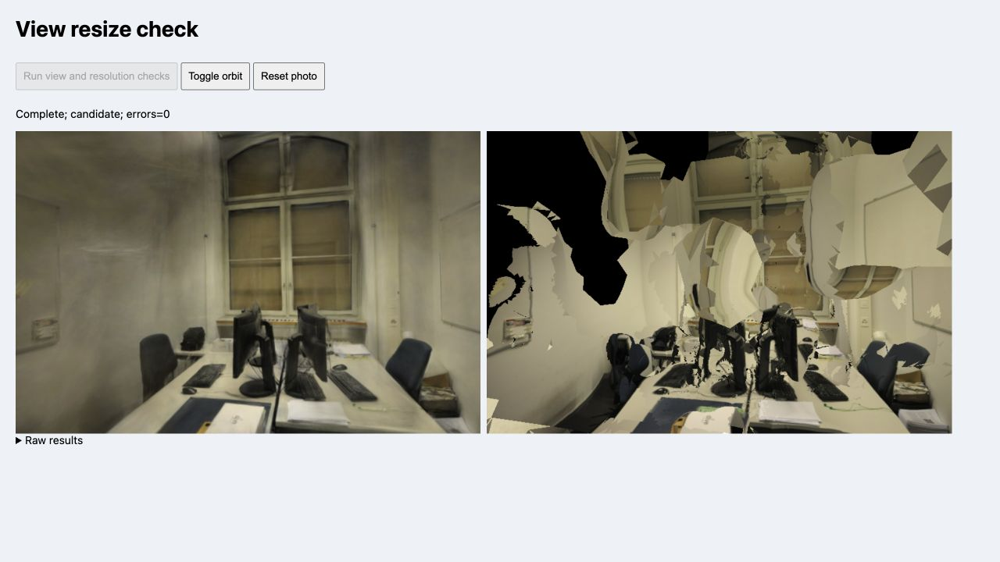

# 避免同尺寸画布重复设置

照片选择流程先设置标定相机，再退出漫游，两步都会进入 `setView()`。此前每步都调用两个渲染器的 `setSize()`，即使像素尺寸没有改变。现在先比较实际画布尺寸，仅在宽或高变化时调整；相机应用、容器比例和按需重绘请求仍照常执行。

两个渲染器固定 DPR=1。检查实际 canvas 宽高，因此初次加载和 pipes → office 的画幅高度变化仍会正确设置尺寸，而不是仅比较查看器里预设的字段。

## 浏览器对照

基线 `b7b71bd`，Spark 2.4.0、Three.js 0.180.0，Apple M5 / ANGLE Metal / Chromium 153；两个版本串行运行，开始前未发现重建训练进程。完整模型、SH3、LoD 关闭、DPR=1、黑色背景及相机保持一致。

| 操作 | 每侧基线 setSize 次数 | 每侧修改后次数 |
| --- | ---: | ---: |
| 重设相同尺寸 | 1 | 0 |
| 切换一张照片并退出漫游 | 2 | 0 |
| 真正改变渲染宽度 | 1 | 1 |
| 首次加载 / 切换到不同画幅场景 | 1 | 1 |

6 个留出照片切换合计避免 24 次重复调用。原始计数与画质结果见[JSON 记录](benchmarks/view-resize-2026-10-26.json)。这是渲染器 API 调用计数，未测量 CPU/GPU 时间、显存重分配、功耗或 FPS；当前 Chromium 的基线在同尺寸赋值后也保留了像素，因此不宣称修复了实测闪烁或空白帧。

## 画质与尺寸

两场景 6 个留出视角、两个后端共 12 对图像的 RGBA 哈希及 PSNR/SSIM/MAE 完全一致。留出评分维持 pipes 768×505、office 768×500；高斯数量与 SH 阶数没有变化。

另外逐场景检查 512 → 1024 → 768 宽度变化，12 对图像的尺寸及像素哈希与相同分辨率基线完全一致。该项检查验证尺寸切换，没有改变默认分辨率，也不以低分辨率成绩作为优化收益。

办公室同照片截图、相同方向拖动后的外观一致；修改后复位正常，控制台无错误或警告。下图为相同初始标定视角，照片及衍生画面遵循 ETH3D CC BY-NC-SA 4.0。

| 基线 | 修改后 |
| --- | --- |
|  |  |

42 项测试、类型检查及生产构建通过。

## 复现

在仓库根目录准备旧查看器副本：

```sh
python3 - <<'PY'
from pathlib import Path
import subprocess
source = subprocess.check_output(['git', 'show', 'b7b71bd:src/viewer.ts'], text=True)
Path('.qa').mkdir(exist_ok=True)
Path('.qa/resize-baseline.ts').write_text(source.replace('from "./', 'from "../src/'))
PY
npm run dev
```

打开 `/tests/browser/view-resize.html?variant=baseline`，点击 **Run view and resolution checks**。完成后关闭该页面，去掉参数运行修改后版本；结果在 Raw results 中。结束后可以手动漫游和复位，检查页不进入生产构建。

参考：[Three.js r180 尺寸设置实现](https://github.com/mrdoob/three.js/blob/r180/src/renderers/WebGLRenderer.js)、[canvas.width 语义](https://developer.mozilla.org/en-US/docs/Web/API/HTMLCanvasElement/width)、[Spark 按需绘制](https://sparkjs.dev/docs/on-demand-rendering/)。不改变尺寸不等于跳过相机重绘或异步排序结果提交。
