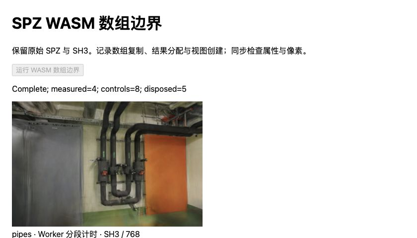
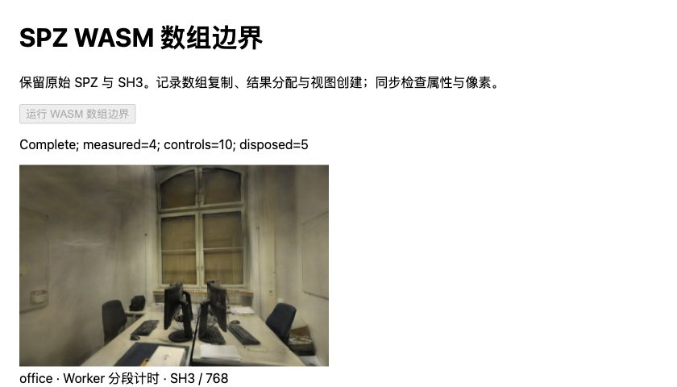

# SPZ 数组边界：复制流量与接口耗时

2026-10-31，基线 `0196f41`。接续 [Worker 分段](WORKER-PROFILE.md)，直接观察现有 WASM 二进制调用的 JS 数组接口。**两场景所计量接口的累计耗时中位数为 4.40 / 3.50ms，push 为 146.10 / 112.30ms。** 复制流量确实大于最终结果缓冲，但当前证据不支持优先移植“逐元素改批量复制”的优化；Spark 已使用批量接口。

本次是诊断工具和新的测量结论，没有生产提速或画质提升。完整结果、原始导入函数名和预检失败记录见 [JSON](benchmarks/wasm-imports-2026-10-31.json)。

## 方法与范围

使用与上次相同的 Spark 2.4.0 npm bundle 和内嵌 WASM，固定源码摘要，生成两份独立 Worker：

- A：提取后的原样 Worker。
- B：保留上次的阶段计时，包装 WASM 导入表，按阶段累计调用次数。对已核对的数组复制、分配、subarray 和标量写入接口另计字节数与函数体耗时；其他导入只计数，`timed=false`，不能把其 `bodyMs=0` 解释为零耗时。
- 包装函数透传原参数、接收者、返回值和异常，不更换算法或 WASM。只有 loadExtSplats handler 活跃时才记录导入；模块实例化、排序 Worker 和 GPU 上传不在这些导入统计内。

每场景完整文档顺序为 A、B、B、A；每份新文档一份预热、四份正式样本。两场景串行，共 32 个正式样本和 8 份预热。Apple M5、Chromium 156、ANGLE Metal / WebGL2、Spark 2.4.0、Three.js 0.180.0；文档全程可见，无并行训练。完整 fileBytes 输入、关闭 LoD，正式样本均复用已创建的 Worker。

保持原始 SH8 + AP16 文件、300,000 / 231,428 点、SH3、相机、照片和留出划分。pipes 768×505、office 768×500、DPR=1、黑背景。下载、模块导入、文件/展开摘要预检和外部输入副本在计时外；Spark 内部输入副本、初始化、AP16 恢复及排序稳定后的绘制提交在总计内。这不是 HTTP 冷加载、屏幕呈现或 GPU 计时。

第一份 pipes B 预检在预热后因“仅预期六次数组分配”而停止：源码还在 create 阶段创建两个零长度数组。修正为八次调用，并核验总分配字节恰好等于六个结果缓冲之和。**只改了计时区间外的校验，Worker 二进制和插桩代码未变**；失败记录保留且未计入正式统计。这次额外预检发生在 pipes A0 与完成的 B1 之间，不隐去其顺序影响。

当前环境未发现 Rust / wasm-bindgen 工具链，先利用现有二进制的可观察边界取得证据。尚未重建或计量 WASM 内部的 inflate、属性数学运算和 Rust 分配；不把剩余时间全部归到某一项。

## 复制与分配

以下是每份插桩模型的确定性计数，两份文档的正式样本完全相同；字节为接口请求复制/分配的累计大小，不是驻留内存或实际内存总线流量。

| 操作 | pipes 次数 / 字节 | office 次数 / 字节 |
| --- | ---: | ---: |
| 压缩输入 JS→WASM，U8 | 12 / 12,545,116B | 9 / 8,927,279B |
| 已有属性 JS→WASM，U32 | 55 / 52,800,000B | 44 / 40,731,328B |
| 属性写回 WASM→JS，U32 | 75 / 72,000,000B | 60 / 55,542,720B |
| 以上复制合计 | **142 / 137,345,116B** | **113 / 105,201,327B** |
| 结果 U32 数组创建 | 8 / 28,901,376B | 8 / 22,413,312B |
| subarray 视图创建 | 142 / 不计复制字节 | 113 / 不计复制字节 |
| 所有导入调用 | 485 | 392 |
| 其中计时导入调用 | 292 | 234 |

八次 U32 创建包括两个 0B 初始化数组，以及六个最终结果数组；总字节包含纹理填充，与逐份哈希检查的实际缓冲长度一致。U8 输入流量精确等于压缩文件长度，次数符合最多 1MiB 的 Rust 暂存片段。没有观测到所列标量写入导入被调用；这不表示 WASM 内部没有逐元素运算。

读取当前 [ExtSplatsData](https://github.com/sparkjsdev/spark/blob/ffe210dc0a45d0515a06c9235878108112827d61/rust/spark-rs/src/ext_splats.rs)可解释重复传递：prepare_buffers 从已有结果数组回读两个暂存块，flush_buffers 再写回；不同属性阶段会重复经过这些操作，SH2 也需要回读 SH1 的部分结果。由源码与计数推断，当前流量不是一次输入加一次结果输出。**是否值得减少这些往返，仍需同条件性能验证；流量较大本身不等于主要延迟来源。**

## 耗时与插桩影响

单位 ms，各格 8 个正式样本的中位数，阶段中位数不能相加。预热和慢样本保留，不推导 P95 或统计显著性。

| 场景 / Worker | 初始化 | AP16 恢复/发布 | 稳定等待 | 总计 |
| --- | ---: | ---: | ---: | ---: |
| pipes / A | 147.85 | 0.85 | 55.05 | 205.60 |
| pipes / B | 148.55 | 1.15 | 60.20 | 210.95 |
| office / A | 113.20 | 1.05 | 50.25 | 163.40 |
| office / B | 113.75 | 1.05 | 48.65 | 162.90 |

初始化 B−A 为 **+0.70 / +0.55ms**，总等待为 **+5.35 / −0.50ms**。不将后者解释为任何提速。按 A0/B1/B2/A3 文档分别计算，总等待中位数为 pipes 210.35/211.95/207.05/203.15ms，office 163.40/163.20/162.55/165.55ms，存在文档和排序等待波动。

A/B 总等待范围分别为 pipes 202.30–219.90 / 203.20–228.10ms，office 154.80–171.40 / 160.60–179.30ms。初始化范围为 pipes 147.20–153.80 / 147.30–153.20ms，office 112.10–117.10 / 112.10–116.50ms。

| B 中计量的操作 | pipes 中位数（范围） | office 中位数（范围） |
| --- | ---: | ---: |
| 压缩输入复制 | 0.40（0.20–1.00） | 0.40（0.20–0.70） |
| 属性 U32 回读 | 1.55（1.10–1.70） | 1.15（0.80–1.30） |
| 属性 U32 写回 | 2.25（2.00–2.60） | 1.90（1.30–2.30） |
| U32 数组创建 | 0.25（0.00–0.30） | 0.20（0.10–0.50） |
| subarray 创建 | 0.00（0.00–0.10） | 0.00（0.00–0.10） |
| 所计量导入函数体累计 | **4.40（3.90–5.10）** | **3.50（3.10–4.20）** |
| 整个 push | 146.10（145.70–149.10） | 112.30（110.90–114.10） |

这里的函数体时间不是完整的跨语言成本：分类、计数、时间累计、rest 参数、调用转换和部分探针开销在测量区间之外，WASM 内部工作也没有计时。亚毫秒调用受浏览器计时分辨率影响，0.00ms 不是零成本；累加数百次短调用的误差不能忽略。数组创建计时也不包含所有后续内存首次触碰成本。

因此，4.40 / 3.50ms **不是复制成本上界，也不能据差额宣称纯解压占比**。它支持的有限结论是：现有批量数组接口的已观测函数体时间只有几毫秒，没有理由直接照搬其他实现从逐元素循环改批量复制的速度倍数。

## 正确性与资源

40 组全部六个属性缓冲在 A/B、跨文档以及[上次报告](WORKER-PROFILE.md)之间完全一致；72 次 RGBA 摘要匹配已有 SH8 + AP16 控制。覆盖六个留出相机、每场景首相机 ±0.08rad，以及每份模型的首个留出视角。计数额外核验输入完整字节、1MiB 分块数、两空数组加六结果数组，以及实际分配字节。



管道房：四份正式样本完成，管道、墙面和门与控制摘要一致。



办公室：四份正式样本完成，桌椅、显示器和窗框与控制摘要一致。图片及衍生画面沿用 ETH3D CC BY-NC-SA 4.0。

40 个纳入统计的模型各释放一次，无浏览器错误或可见性变化；排序 Worker 随查看器释放，解析池所在实验文档随后关闭。没有测量实际堆回收、GPU 内存峰值或带宽。既有模型像素不变，未重复读取照片计算 PSNR/SSIM；[候选相对原始 PLY 的画质代价](SPZ-ALPHA16.md#留出画质与漫游)仍适用。离散偏转检查不等于连续漫游全路径。

## 原始参考与结论

2026-10-31 核对 Spark main [ffe210d / 2.4.0](https://github.com/sparkjsdev/spark/tree/ffe210dc0a45d0515a06c9235878108112827d61)及[发行说明](https://github.com/sparkjsdev/spark/releases/tag/v2.4.0)，仍为 2026-10-20 提交/发布，MIT。读取 [ChunkDecoder](https://github.com/sparkjsdev/spark/blob/ffe210dc0a45d0515a06c9235878108112827d61/rust/spark-rs/src/decoder.rs)、ExtSplatsData 与已安装生成绑定，确认 copy_to/copy_from 最终调用 TypedArray 批量 set，而非逐元素跨语言传递。

新读 Niantic [SPZ #74](https://github.com/nianticlabs/spz/pull/74)的实际补丁：2026-04-09 合并，提交 [b2a63b9](https://github.com/nianticlabs/spz/commit/b2a63b9204c2989de713e4e426a28eeaa415643e)，把 Emscripten 的逐元素导出改为 typed_memory_view + set，数值输入也改为批量转换。当前 [affd0ec](https://github.com/nianticlabs/spz/blob/affd0ecea7fbb4c265ee119475af7ee5b2997482/src/emscripten/spz-bindings.cc)（2026-08-05）仍保留这些实现；最新库 Release v3.0.0 为 2026-05-05，MIT。它是 C++/Emscripten CPU 解码边界优化，不是 WebGL2/WebGPU/Metal/CUDA 渲染优化；该 PR 的速度数字不能用于当前已经批量复制的 Rust/WASM 路径。

另读 Amir Said、Randall Rauwendaal 的 [GPU-friendly Graphics Texture Coding](https://arxiv.org/abs/2607.14513)（v1 2026-07-16，CC BY 4.0），重点为 IV 与 V-A。它把 SH 重排并用 BC1/BC7 压缩，研究随机访问和压缩状态下的 GPU 取样；实验使用 [Compressonator](https://gpuopen.com/compressonator/) 压缩、解压并恢复 SH 后比较渲染质量。不能把这项质量实验当作本项目已有的 GPU 直接解码性能验证。

未找到作者提供且可核实版本/许可的完整 3DGS 编解码实现入口；论文许可不等于代码许可。WebGL 的 BC7 路径需检查 [BPTC 扩展](https://registry.khronos.org/webgl/extensions/EXT_texture_compression_bptc/)及采样布局，不能仅凭支持 WebGL2 推断可用。WebGPU/Metal/CUDA 的论文实现和本机适配未验证，未修改 SH 格式或运行纹理编码实验。

下一步准备固定提交的独立 Rust/WASM 构建，记录编译工具链并先校验未修改构建的完整属性与像素，再拆分 gzip 消费、属性运算和内部缓冲管理。数组复制降为次级候选，不重复同一导入矩阵；实际收益仍以同条件端到端等待为准。流式/并发、取消、失败回退、冷加载和峰值内存另行验证。

## 复现

复用 [SPZ 容器实验](SPZ-CONTAINER.md)已有原始输入。仅首次生成本地探针时，在仓库根目录运行：

```bash
node --import tsx scripts/prepare_wasm_imports.ts
npm run dev -- --port 5190
```

脚本核对 Spark bundle SHA-256，保留上游 MIT 许可，拒绝覆盖 `.qa/wasm-imports/` 内的 Worker 和 manifest。已有产物先核验摘要，不重建输入或改原模型。

依次使用 `/tests/browser/wasm-imports.html?scene=pipes&variant=baseline&doc=0`、profile/1、profile/2、baseline/3；每份新文档点击“运行 WASM 数组边界”，Complete 后保存 JSON、关闭，再打开下一份。office 使用同顺序。汇总时比较跨文档与前次报告的六个属性摘要，并核对请求往返时间和每个导入的次数/字节一致性。

139 项回归、严格类型检查、准备脚本独立类型检查与生产构建通过。生产 JS/CSS 仍为 `main-maiyedTw.js` / `main-CRdM07cY.css`，仅有既知大包提示；没有改动生产页面、默认资源或部署 Pages。
