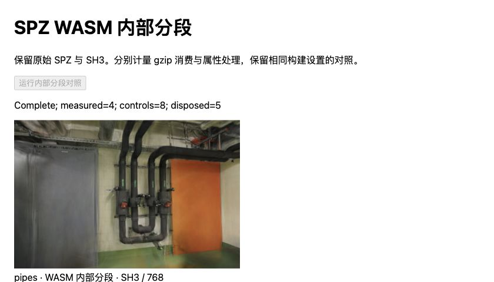
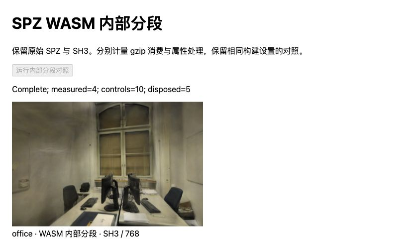

# SPZ 内部分段：优先检查 SH 打包

2026-10-31，基线 `55fefc2`。建立固定工具链的独立 Rust/WASM 构建后，将输入消费拆成 gzip 写入/刷新与属性状态机。**pipes / office 的 SH 阶段中位耗时为 73.75 / 57.10ms，gzip 消费为 53.85 / 39.90ms。** SH 占属性处理约 79%，下一步优先验证共享指数编码。

本次完成诊断与可复现构建，没有改动生产加载器或模型，也没有生产提速结论。原始样本、完整工具链、源码摘要和预检问题见 [JSON](benchmarks/wasm-internal-2026-10-31.json)。

## 固定构建与正确性

固定 Spark [ffe210d / 2.4.0](https://github.com/sparkjsdev/spark/tree/ffe210dc0a45d0515a06c9235878108112827d61)（2026-10-20，MIT），构建前逐一核对原始归档内 35 个 Rust 源码、配置及锁文件。工具均置于忽略的 `.qa/wasm-build/`，没有修改系统 PATH、默认依赖或父目录工程。

| 项目 | 固定设置 |
| --- | --- |
| Rust / Cargo | 1.99.1，Rust commit `58cf8f9c3`，LLVM 23.1.1，aarch64-apple-darwin |
| wasm-bindgen | CLI 0.2.117，与 Cargo.lock 对齐 |
| Cargo | `--locked --release -p spark-rs --target wasm32-unknown-unknown --jobs 4`，默认 features |
| 编译选项 | `-C target-feature=+simd128,+bulk-memory`；上游 opt-level=3、fat LTO、codegen-units=1 |
| 依赖 | flate2 1.1.10 / zlib-rs 0.6.3；Cargo.lock SHA-256 `005cc80bd5691d1b1c1713f8cc24293229fc96682db7aa936586f6f1e6e8b98d` |
| JS 打包 | esbuild 0.28.2，ES2022 IIFE、不压缩；保留上游 MIT 声明 |
| 后处理 | **未运行 wasm-opt**；不宣称二进制与 npm 发布版一致 |

上游[构建脚本](https://github.com/sparkjsdev/spark/blob/ffe210dc0a45d0515a06c9235878108112827d61/rust/build_rust_wasm.sh)使用 wasm-pack，但没有固定工具版本；其 release 流程还可能运行 wasm-opt。故先比较 npm 发布版 A 与未修改源码的本地构建 B，再比较 B 与计时构建 C。两个实验均为每场景四份新文档 A/B/B/A 或 B/C/C/B；每文档一份预热、四份正式样本。重编译和回归测试均在浏览器性能采样之外完成。

每组实验 32 份正式样本、8 份预热；合计 **64 份正式样本、80 组完整属性和 144 次像素校验**，全部与上次 SH8 + AP16 控制一致。每模型六个属性缓冲完整 SHA-256 一致，包括填充区域。发布版、本地构建、计时构建和跨文档都已核对。

环境为 Apple M5、Chromium 156、ANGLE Metal / WebGL2、Three.js 0.180.0。保持原始 SPZ/AP16、300,000 / 231,428 点、SH3、关闭 LoD、DPR=1、黑背景、同一照片/相机/留出划分。pipes 768×505，office 768×500。串行测试，无并行训练，所有实验文档无可见性变化。

下载、摘要预检、外部输入副本、模块导入和本地 WASM 编译均在计时外；初始化仍包含 Worker 实例化与模型解析，第一份样本单列预热。Spark 内部输入副本、AP16 恢复、排序稳定等待与绘制提交在总计内。不是 HTTP 冷加载、进程冷启动、屏幕呈现或 GPU 时间。

## 未修改源码的构建对照

单位 ms，中位数，每格 8 个正式样本；范围与预热均保留在 JSON。

| 场景 | 发布版初始化 | 本地构建初始化 | 发布版总等待 | 本地构建总等待 |
| --- | ---: | ---: | ---: | ---: |
| pipes | 148.55 | 148.60 | 211.45 | 210.35 |
| office | 113.25 | 112.60 | 163.05 | 163.15 |

pipes 发布版有一份初始化 215.90ms / 总等待 277.50ms 的慢样本，未删除。工具链、JS 包装及 wasm-opt 差异尚未逐项归因；中位数接近只支持继续使用本地构建进行独立诊断，不等于证明所有格式、异常或设备都与 npm 等价。

## WASM 内部测量

仅在独立源码副本中加入作用域计时：

- `gzipWriteFlush`：每个至多 32KiB 压缩片段的 `GzDecoder.write_all + flush`，包括输出分配等成本，不能称为纯 inflate 时间。
- `pollWithSwaps`：交换展开缓冲、解析文件头/属性状态机、再交换回来。
- `centers` 至 `sh`：属性状态机的每次迭代，**嵌套在 poll 内**。含等待更多字节的早退、数值转换、布局变换、ExtSplats 打包、JS 数组往返和缓冲 drain；不能与 poll 相加，也不能全部归给单个编码函数。

计时通过 WASM 导入调用同 Worker 的 `performance.now()`；作用域结束累计次数与时间，回复时随结果发送。未改计算结果或解码算法。计时调用会影响代码生成、内联与执行，短调用受计时精度限制，0.00ms 不表示无成本。

| 阶段 | pipes 中位数（范围）ms | office 中位数（范围）ms |
| --- | ---: | ---: |
| gzip 写入/刷新 | **53.85（53.50–54.80）** | **39.90（39.00–41.90）** |
| 属性处理，含缓冲交换 | **92.95（92.00–94.30）** | **72.25（72.00–72.90）** |
| ↳ 中心 | 1.55（1.30–1.90） | 1.40（1.30–1.60） |
| ↳ 不透明度 | 0.85（0.70–1.00） | 0.60（0.50–0.70） |
| ↳ 基础颜色 | 1.45（1.20–1.70） | 1.30（1.10–1.40） |
| ↳ 尺度 | 5.30（5.20–5.60） | 4.10（4.00–4.20） |
| ↳ 四元数 | 9.80（9.60–10.40） | 7.55（7.30–7.70） |
| ↳ SH | **73.75（73.10–74.70）** | **57.10（56.70–57.50）** |

gzip / poll 每份分别调用 383 / 273 次；SH 状态迭代为 238 / 163 次，其中包含数据不足时的等待迭代，不能当作实际 SH 输出批次数。逐样本 SH/poll 比值中位数为 79.27% / 78.90%；与同一请求往返时间相比为 49.63% / 50.35%，后者仍含消息调度。阶段中位数不能直接相加。

| 场景 / 构建 | 初始化 | AP16 恢复/发布 | 稳定等待 | 总等待 |
| --- | ---: | ---: | ---: | ---: |
| pipes / 未计时 B | 150.10 | 0.60 | 59.80 | 211.45 |
| pipes / 计时 C | 149.75 | 1.10 | 56.45 | 207.60 |
| office / 未计时 B | 114.20 | 1.05 | 48.30 | 162.90 |
| office / 计时 C | 114.15 | 0.60 | 48.30 | 163.05 |

C−B 初始化为 −0.35 / −0.05ms，总等待为 −3.85 / +0.15ms；**均不作为提速或“无探针开销”的结论**。pipes B/C 总等待范围分别为 202.50–219.70 / 202.80–220.30ms，office 为 161.30–188.20 / 161.90–179.80ms，排序等待和文档间波动仍在。完整预热与每文档中位数见原始记录。

## 下一步：保持编码语义，验证 SH 计算

[SPZ 解码](https://github.com/sparkjsdev/spark/blob/ffe210dc0a45d0515a06c9235878108112827d61/rust/spark-lib/src/spz.rs)先将 SH 字节展开为浮点并调整布局，[ExtSplatsData](https://github.com/sparkjsdev/spark/blob/ffe210dc0a45d0515a06c9235878108112827d61/rust/spark-rs/src/ext_splats.rs)再逐三通道调用 [`encode_ext_rgb`](https://github.com/sparkjsdev/spark/blob/ffe210dc0a45d0515a06c9235878108112827d61/rust/spark-lib/src/splat_encode.rs)，涉及 log2、向上取整、exp2、量化与符号打包。**这是由源码形成的优化假设，尚未独立测量该函数的占比。**

本次新核对 [#465](https://github.com/sparkjsdev/spark/pull/465)及 [8779cbd](https://github.com/sparkjsdev/spark/commit/8779cbd8ba07cfed50ff30d50063c358a8743881)（2026-10-02）：共享指数必须向上取整，旧的向下取整会截断颜色通道。后续尝试整数/查表路径时，先限定 SPZ 的离散 SH 值，覆盖零值、正负、幂次边界和舍入；保留现有编码语义，要求完整属性位级一致，再测无计时构建的端到端收益。通用浮点输入、其他格式和异常值另验，不直接替换全局编码器。

复读 [Visionary v1](https://arxiv.org/html/2512.08478v1)（2025-12-09，arXiv 非独占永久发布许可）§3.4、§4.1–4.4：论文区分一次预打包与每帧预处理/排序，RTX 4090 / PIX 帧计时不能代替本项目加载等待；其对照为 Spark 0.1.10。作者当前 [76a2b93](https://github.com/Visionary-Laboratory/visionary/tree/76a2b93cec0e0dfaeb598fd320b6ceabf4b39d48)（2026-10-15，无 latest Release，Apache-2.0）的 [SPZLoader](https://github.com/Visionary-Laboratory/visionary/blob/76a2b93cec0e0dfaeb598fd320b6ceabf4b39d48/src/io/spz_loader.ts)逐项转换 SH 并打包为 FP16，和 Spark 的共享指数格式不同，不能直接移植或引用其速度倍数。当前测量是 CPU/WASM，WebGL2 经 ANGLE Metal 绘制；WebGPU/CUDA 路径与其他 Metal 设备未验证。

## 画面与限制



管道房：计时构建完成四份正式样本，管道、门与墙面和既有控制像素一致。



办公室：桌椅、显示器和窗框保持控制画面。图片及衍生画面沿用 ETH3D CC BY-NC-SA 4.0。

覆盖全部六个留出相机、各场景首相机 ±0.08rad 及每份模型的首视角。相同像素不重新计算 PSNR/SSIM；[候选相对原始 PLY 的画质代价](SPZ-ALPHA16.md#留出画质与漫游)仍适用。离散偏转不等于连续漫游全路径，也没有验证其他模型格式。

80 个正式矩阵内模型各释放一次，无浏览器错误；排序 Worker 释放，解析池所在文档全部关闭，脚本 Blob URL 已撤销。没有测量真实堆回收、内存峰值或 GPU 时间。

## 复现与预检记录

准备脚本分别为 [`prepare_wasm_rebuild.ts`](../scripts/prepare_wasm_rebuild.ts) 和 [`prepare_wasm_internal.ts`](../scripts/prepare_wasm_internal.ts)。复用原有 SPZ/AP16 输入，不重新转换照片或模型。macOS arm64 所用下载来源与 SHA-256：

- [Spark 固定归档](https://codeload.github.com/sparkjsdev/spark/tar.gz/ffe210dc0a45d0515a06c9235878108112827d61)：`47c6b34ee5477ebd161001284aa6372815c56d22a5adbdb322afd5483fbf0478`。保存为 `.qa/wasm-build/spark.tar.gz`，在该目录按归档原路径提取 `rust/` 与 `LICENSE`。
- [rustup-init 1.29.2](https://static.rust-lang.org/rustup/archive/1.29.2/aarch64-apple-darwin/rustup-init)：`f7c7e11eb2e07f006e532a8aaac77b32f4527d305ac386c0c633ca6133d35ca9`。保存为 `.qa/wasm-build/rustup-init` 并设为可执行。
- [wasm-bindgen 0.2.117](https://github.com/wasm-bindgen/wasm-bindgen/releases/tag/0.2.117) 的 aarch64-apple-darwin.tar.gz：`d7691b221163d68884ef0a893cb57d3372f1100789dbf0cc2c9260a7f253a497`。提取可执行文件至 `.qa/wasm-build/wasm-bindgen`。

首次安装独立工具链后运行：

```bash
CARGO_HOME="$PWD/.qa/wasm-build/cargo-home" \
RUSTUP_HOME="$PWD/.qa/wasm-build/rustup-home" \
.qa/wasm-build/rustup-init -y --no-modify-path --profile minimal \
  --default-toolchain 1.99.1 --target wasm32-unknown-unknown
node --import tsx scripts/prepare_wasm_rebuild.ts
node --import tsx scripts/prepare_wasm_internal.ts
npm run dev -- --port 5191
```

脚本显式固定 `RUSTUP_TOOLCHAIN=1.99.1`、锁文件与源码摘要，并拒绝覆盖已有产物。先运行 `/tests/browser/wasm-rebuild.html?scene=pipes&variant=baseline&doc=0`，依次 rebuilt/1、rebuilt/2、baseline/3；office 同序。再运行 `wasm-internal.html`，以 rebuilt/0、profile/1、profile/2、rebuilt/3 对照。每份新文档完成后保存页面 JSON 并关闭，全部串行；核对跨文档属性摘要与阶段边界。

预检问题保留如下：首次 cargo 调用受到外层 stable 工具链选择影响，已在编译前中止并显式锁定版本。生成的 JS 经 Vite 追加 source map 后，摘要校验拒绝，尚未创建模型；改为校验 `.worker` 原始字节后创建 Blob Worker，两种构建使用同一路径并重启完整矩阵。此前五份发布版样本单独保留、不计入上述数字；失败 JSON 因页面自动重载未保存，记录保留已观察到的错误。内部探针初次打包未解析自定义导入模块，已用显式模块绑定修复；生成绑定仍有两个指向同一模块的重复键警告，实际导入和计时均成功。

139 项回归、严格类型检查、两个准备脚本独立类型检查和生产构建通过。生产 JS/CSS 仍为 `main-maiyedTw.js` / `main-CRdM07cY.css`，仅有既知大包提示。生产页面与默认资产不变，无需重新部署 Pages。
