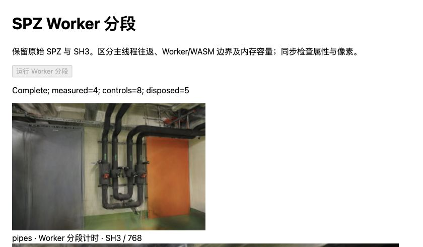
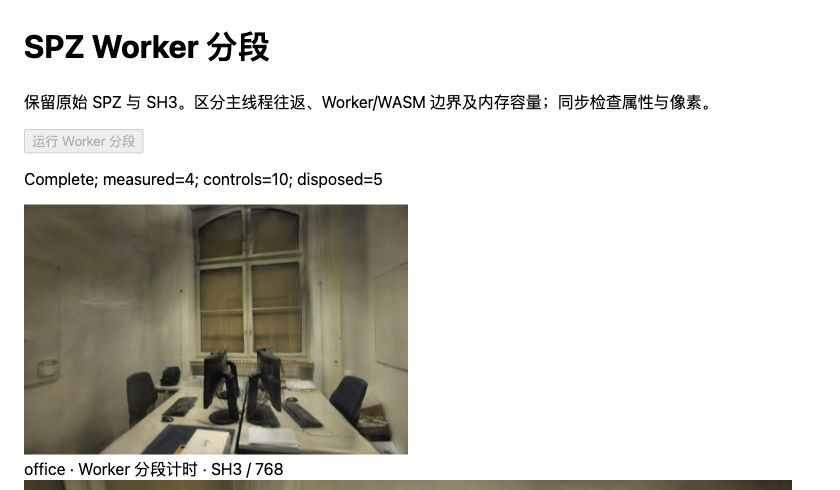

# SPZ Worker / WASM 分段记录

2026-10-31，基线 `9a8520c`。新增独立计时夹具，保持压缩文件、WASM 和解码算法相同。**热 Worker 的输入消费 `push` 中位数为 146.50 / 111.20ms（pipes / office），逐样本占 handler 的中位比例为 99.3% / 99.8%。** 结果收尾和消息往返余量较小，下一步应深入输入复制、解压和属性写入，暂不优先改结果导出。

这是瓶颈定位，未实现生产加载提速。插桩后总等待反而增加，完整保留；默认页面仍使用原始 PLY。

## 设计与控制

从已安装的 Spark 2.4.0 npm 包提取内嵌 Worker，用同源文件分别运行原样版本 A 和仅加计时的版本 B。两者携带相同 WASM；不替换 Rust 算法、模型或属性位宽。提取脚本核对 npm 版本、bundle SHA-256 和唯一替换边界，保留上游 MIT 许可，拒绝覆盖现有产物。两份 Worker 的摘要见[原始记录](benchmarks/worker-profile-2026-10-31.json)。

- 每场景四个新文档按 A、B、B、A 串行运行。每个文档使用同一查看器和 Worker 池，先预热一份模型，再测四份；共 **32 个正式样本、8 个预热**。正式样本均未创建新 Worker。
- 固定既有 SH8 + AP16 控制文件、300,000 / 231,428 点、完整 SH3、关闭 LoD。SPZ 分别为 12,545,116 / 8,927,279B，AP16 与已有清单一致。
- Apple M5、Chromium 156、ANGLE Metal / WebGL2、Three.js 0.180.0；两场景串行，文档全程可见，没有并行训练。pipes 768×505、office 768×500、DPR=1、黑色背景。
- 文件预载、模块导入、文件/展开摘要预检、每次传入副本在计时外；Spark 原有的内部副本、初始化、AP16 恢复和首次排序等待在计时内。两组使用相同规则。
- 两组都改用提取后的同源 Worker 文件，因此是**夹具内的插桩扰动对照**，不是生产 blob Worker 的冷启动对照。首次样本单列，不能当作清缓存、重启进程或整页冷加载。

夹具只用于串行、完整 `fileBytes`、无 LoD 的 `loadExtSplats`。没有验证流式输入、并发 RPC、分页、取消或失败回退；不得把实验 Worker 接入生产。

## 计时边界

主线程与 Worker 分别使用各自的 `performance.now()`，只比较同一时钟内的持续时间，不相减跨线程绝对时间。

| 字段 | 覆盖范围 |
| --- | --- |
| `beforeRequestMs` | 创建模型至调用 Worker postMessage 前，含 Spark 内部输入副本与调用准备 |
| `requestPostMs` | 同步 postMessage 调用及计时记录，不能代表完整 IPC |
| `roundTripMs` | 主线程发送至收到最终回复，包含调度、handler、结果传递和回调等待 |
| `create` | WASM `decode_to_extsplats` 调用 |
| `push` | WASM `chunkdecoder_push`，含输入复制、解压、属性消费/打包及结果数组写入 |
| `finish` | WASM `chunkdecoder_finish`，含最终刷新和 JS 对象导出 |
| `resultLayout` | JS `toExtResult` 整理已有数组引用 |
| `handlerMs` | Worker 的 loadExtSplats handler，总计至返回结果；不含随后 transfer list 整理与 postMessage |
| 往返余量 | 同一样本 roundTrip − handler，混合线程调度、传递、回调等成本，不能称作纯 IPC |
| `initializeMs` | 模型创建至 initialized 完成 |
| `totalMs` | 初始化、AP16 恢复/发布、排序稳定等待与绘制提交；不是屏幕呈现、GPU 查询或稳态 FPS |

插桩增加时钟读取、内存容量读取、数组记录和回复字段；非加载 RPC 不记录阶段，但也经过增加的 handler 计时逻辑。因此不能假设其总成本为零。0.00ms 是当前计时分辨率下的记录，不表示没有执行工作。

## 热运行时结果

每格为 8 个正式样本的中位数，单位 ms。各列中位数不能相加；不从八个样本推导 P95。全部预热、正式样本、缓冲摘要与慢样本都保存在 JSON。

| 场景 / Worker | 请求前 | 往返 | 回复后 | 初始化 | AP16 恢复/发布 | 稳定等待 | 总计 |
| --- | ---: | ---: | ---: | ---: | ---: | ---: | ---: |
| pipes / A 原样 | 1.10 | 147.60 | 0.05 | 148.80 | 1.15 | 61.50 | 211.10 |
| pipes / B 插桩 | 1.15 | 147.90 | 0.10 | 149.25 | 0.90 | 63.10 | 215.00 |
| office / A 原样 | 0.95 | 111.45 | 0.05 | 112.55 | 0.65 | 50.60 | 163.30 |
| office / B 插桩 | 0.80 | 111.65 | 0.05 | 112.45 | 0.70 | 54.25 | 171.70 |

B−A 初始化中位数为 **+0.45 / −0.10ms**，总等待为 **+3.90 / +8.40ms**。初始化差异较小，但总等待未保持一致，不能将夹具称为零开销。稳定等待和文档间波动仍存在，不把差值全部归因于计时指令。

按文档顺序 A0、B1、B2、A3，pipes 初始化中位数为 148.60、150.25、148.70、149.40ms，总等待为 214.90、215.00、215.30、207.10ms；office 初始化为 112.45、112.70、112.40、112.65ms，总等待为 163.15、175.80、167.10、167.15ms。只做了每场景两份 A / 两份 B 文档，没有统计显著性或跨设备结论。

| 插桩阶段 | pipes 中位数（范围） | office 中位数（范围） |
| --- | ---: | ---: |
| create | 0.00（0.00–0.10） | 0.00（0.00–0.00） |
| push | **146.50（144.80–149.70）** | **111.20（110.30–115.00）** |
| finish | 0.00（0.00–0.10） | 0.00（0.00–0.10） |
| resultLayout | 0.00（0.00–0.10） | 0.00（0.00–0.00） |
| handler 总计 | 147.55（145.70–151.20） | 111.35（110.50–115.20） |
| handler 内未分段余量 | 0.90（0.10–1.40） | 0.15（0.00–0.30） |
| 主线程往返余量 | 0.30（0.20–0.70） | 0.25（0.10–0.40） |

同步 postMessage 各组中位数为 0.00–0.05ms，全部不超过 0.10ms。**这不能证明零复制，也不能排除复制已经发生在 push 内部。** 当前证据只支持缩小优先调查范围，尚未把 inflate、属性数学运算或某一次数组复制单独归因。

A / B 总等待范围：pipes 203.10–227.90 / 203.70–226.10ms，office 155.00–180.20 / 155.60–179.90ms。首次预热的初始化 A0/B1/B2/A3 分别为 pipes 177.40/166.70/171.60/168.50ms、office 130.50/143.40/131.50/131.40ms；保留原始值，但不用于热样本统计或冷启动收益结论。

## 缓冲与资源

四份插桩文档首次进入 create 前的 WASM 线性内存容量均为 1.25MiB，create 后为 1.4375MiB，push 后为 **25.5625MiB**；随后四个正式模型在所有边界均保持该容量。

这只是 `wasm.memory.buffer.byteLength` 的容量快照。WASM 可复用已扩展内存，稳定容量不能证明没有分配，也不能证明泄漏；该数字不是活跃堆、整个 Worker、页面 RSS 或 GPU 峰值。Spark 的六个最终 JS 属性缓冲合计另为 **27.5625 / 21.375MiB**（包含纹理填充），没有计入该 WASM 容量。两者也不能简单相加作为总内存峰值。

40 个模型各释放一次，8 份查看器释放均终止排序 Worker；解析 Worker 仍在文档内池中，完成后关闭实验文档。没有浏览器错误或可见性变化，未测实际内存回收。

## 画面控制

40 组全部六个属性/SH 缓冲摘要在各场景的 A/B、不同文档间完全一致；72 次 RGBA 摘要匹配既有 SH8 + AP16 控制。覆盖全部六个留出相机、每场景首相机 ±0.08rad，以及每份模型的首个留出视角。



管道房：插桩文档完成四个正式样本，管道、门和墙面与控制摘要一致。



办公室：插桩文档完成四个正式样本，桌椅与窗框与控制摘要一致。图片及衍生画面沿用 ETH3D CC BY-NC-SA 4.0。

没有改变解码结果，不重复读取照片计算 PSNR/SSIM；[SH8 + AP16 的既有评分及相对生产 PLY 的代价](SPZ-ALPHA16.md#留出画质与漫游)继续适用。离散偏转控制不代表连续漫游全路径或其他设备已验证。

## 原文、实现与下一步

2026-10-31 核对 Spark main 及最新发行仍为 [2.4.0 / ffe210d](https://github.com/sparkjsdev/spark/tree/ffe210dc0a45d0515a06c9235878108112827d61)（提交与发行 2026-10-20，MIT）；[发行说明](https://github.com/sparkjsdev/spark/releases/tag/v2.4.0)包含 WASM 故障恢复等更新。Worker 文件最近的 [2d1f297](https://github.com/sparkjsdev/spark/commit/2d1f297f20c44b5a064a945dfd31c604a144c1b8)为 2026-10-16 的类型整理。本实验不替换上游已采用的 [flate2 / zlib-rs 路径](https://github.com/sparkjsdev/spark/pull/485)。

直接阅读固定版本的 [Worker handler](https://github.com/sparkjsdev/spark/blob/ffe210dc0a45d0515a06c9235878108112827d61/src/worker.ts)、[WASM ChunkDecoder](https://github.com/sparkjsdev/spark/blob/ffe210dc0a45d0515a06c9235878108112827d61/rust/spark-rs/src/decoder.rs)、[extSplats 入口](https://github.com/sparkjsdev/spark/blob/ffe210dc0a45d0515a06c9235878108112827d61/rust/spark-rs/src/lib.rs)及[属性结果实现](https://github.com/sparkjsdev/spark/blob/ffe210dc0a45d0515a06c9235878108112827d61/rust/spark-rs/src/ext_splats.rs)后可确认：

- fileBytes 路径对整个输入调用一次 JS decoder.push；Rust 边界内部以最多 1MiB 暂存片段复制 JS 输入，再调用 receiver.push。更内层的解压与属性消费仍在这个区间内。
- ExtSplatsData 在消费过程中创建 JS Uint32Array，并逐批写回属性。finish 最后刷新暂存内容，into_splat_object 组装已有数组句柄；不能把所有结果缓冲创建/写入都算到 finish。
- 本次 decode 发生在 CPU/WASM Worker，绘制是 WebGL2，经 ANGLE Metal 运行；没有执行 WebGPU compute 或 CUDA，也没有验证浏览器以外的 Metal 原生路径。

新阅读 [SpeedyGS v1](https://arxiv.org/html/2607.12656v1)（2026-07-14，作者页面列为 [ACM MM 2026](https://vision.nju.edu.cn/29473/list.htm)）的 §3.4.1、§4.1.1 与附录 E.4。论文分别讨论结构优化、统计编码、固定长度编码和解码成本，适合借鉴“分阶段测量”方法；它涉及训练、剪枝和量化，不能直接替换本实验的同属性 SPZ。原文为 arXiv perpetual non-exclusive license，不等于实现代码许可；截至查阅时未找到作者提供且可核实版本/许可的公开实现入口。论文使用 PyTorch/GPU，WebGL2/WebGPU/Metal 及具体 CUDA 适配尚未核实，不引用其速度倍数作为本项目收益。

下一步只在独立、固定版本的 Rust/WASM 构建中进一步分开输入复制、gzip 消费和属性打包/JS 写回，先确认哪一部分占主导，再考虑改接口或批量写入。新构建需再次做未插桩对照与完整属性/画面检查；不能将此次 push 总时间称为纯 inflate。结果导出优化暂降优先级，不继续扫描容器级别或训练参数。峰值内存、真实 CDN、HTTP 冷/热缓存、取消与回退分别待验证。

## 复现与校验

复用 [SH8 + AP16](SPZ-ALPHA16.md#复现与下一步)及[容器实验](SPZ-CONTAINER.md)的原始输入；已有且摘要正确的 `.qa/spz-container/manifest.json` 无需重建。在仓库根目录运行：

```bash
node --import tsx scripts/prepare_worker_profile.ts
npm run dev -- --port 5190
```

提取脚本拒绝覆盖 `.qa/worker-profile/` 内已生成的 Worker/清单；产物已存在时先核对摘要，再直接运行夹具。它们是本地实验产物，不写入生产包。

依次打开 `/tests/browser/worker-profile.html?scene=pipes&variant=baseline&doc=0`，将 variant/doc 依次改为 profile/1、profile/2、baseline/3；每份新文档点击“运行 Worker 分段”，等待 Complete，保存页面 JSON，关闭后再打开下一份。然后以相同顺序运行 office。不能同时运行两个文档。

每份文档必须有五份样本、四个正式样本、五次模型释放；pipes / office 分别有八/十次像素检查。所有阶段顺序、输入绑定、摘要和像素检查通过才可纳入。汇总时再比较同场景跨文档的六个属性摘要，并确认 request.receivedAt − sentAt 等于对应 roundTripMs。

139 项回归、严格类型检查和生产构建通过；准备脚本另外做严格 TypeScript 检查。生产 JS/CSS 仍为 `main-maiyedTw.js` / `main-CRdM07cY.css`；保留已知的大包提示。本次只有实验工具、记录和文档，不重复部署 Pages。
